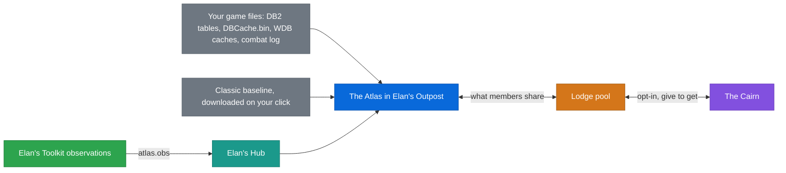
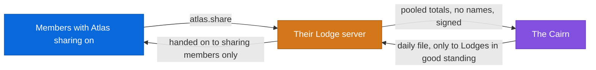

# How Elan's addons and the Outpost fit together

This is the contract between the in-game addons, Elan's Hub and Elan's Outpost.

> [!IMPORTANT]
> Read it before adding any data that crosses from the game to the Outpost (or back). If something new doesn't fit a
> role below, change this file first.

## Contents

**[The big picture](#the-big-picture)** - Who does what between the addons, Elan's Hub, the Outpost and the Lodge; the data formats; rules and open issues.<br>
[Roles](#roles) · [Which data belongs where](#which-data-belongs-where) · [Three shared layers](#three-shared-layers) · [ElansLib](#elanslib) · [Paths and how fast they are](#paths-and-how-fast-they-are) · [Handing data to the Hub](#handing-data-to-the-hub) · [Stored layout (ElansHubData)](#stored-layout-elanshubdata) · [Versions](#versions) · [Rules](#rules) · [Schemas](#schemas) · [core v1](#core-v1) · [bags v1](#bags-v1) · [bank v1](#bank-v1) · [guildbank v1](#guildbank-v1) · [gear v1](#gear-v1) · [reps v1](#reps-v1) · [talents v1](#talents-v1) · [professions v1](#professions-v1) · [flight v1](#flight-v1) · [hunter.fieldnotes v1](#hunterfieldnotes-v1) · [hunter.pets v1](#hunterpets-v1) · [health v1](#health-v1) · [The HUD](#the-hud) · [The Outpost's changelog and log](#the-outposts-changelog-and-log) · [Release and update trust](#release-and-update-trust) · [Game data start, progress and updates](#game-data-start-progress-and-updates) · [Background activity and the close guard](#background-activity-and-the-close-guard) · [Migration (dual read)](#migration-dual-read)

**[The Atlas: data layers](#the-atlas-data-layers)** - Where the Atlas's facts come from: the game's files, what the client has seen, maps, drops and sources.<br>
[Atlas: the game's own data](#atlas-the-games-own-data) · [Item data layer v1](#item-data-layer-v1) · [Spells, skills, recipes, factions and item details](#spells-skills-recipes-factions-and-item-details) · [Browse by category](#browse-by-category) · [What the client has seen (SeenData)](#what-the-client-has-seen-seendata) · [Combat log](#combat-log) · [Map layer](#map-layer) · [Atlas: items, maps, instances and where things come from](#atlas-items-maps-instances-and-where-things-come-from) · [atlas.obs v1](#atlasobs-v1)

**[The Atlas: pages and planners](#the-atlas-pages-and-planners)** - Talents, classes and races, professions, the Atlas page and shell, gear upgrades.<br>
[Talent layer](#talent-layer) · [Classes and races](#classes-and-races) · [Professions and camping](#professions-and-camping) · [Atlas page](#atlas-page) · [Atlas shell](#atlas-shell) · [Atlas entity template and global search](#atlas-entity-template-and-global-search) · [3D models in the Atlas](#3d-models-in-the-atlas) · [Foundation the layers share](#foundation-the-layers-share) · [Gear upgrades](#gear-upgrades) · [Enchants and food in the Upgrades panel](#enchants-and-food-in-the-upgrades-panel) · [Consumables](#consumables)

**[The world map](#the-world-map)** - Entrances, the 2D and 3D world map, drawn dungeon plans.<br>
[Dungeon and raid entrances](#dungeon-and-raid-entrances) · [World map](#world-map) · [Drawn dungeon plans](#drawn-dungeon-plans)

**[The world map: live position, flights, buildings](#the-world-map-live-position-flights-buildings)** - Opt-in live position, learned flight paths, 3D buildings and bridges.<br>
[Live position on the world map](#live-position-on-the-world-map) · [Learned flight paths](#learned-flight-paths) · [3D buildings and bridges](#3d-buildings-and-bridges) · [Trees, objects and real ground](#trees-objects-and-real-ground)

**[The Lodge and the Cairn](#the-lodge-and-the-cairn)** - Lodge server features and the Cairn, the commons shared across Lodges.<br>
[Lodge feature atlas](#lodge-feature-atlas) · [Gathering nodes, routes and the guide in game](#gathering-nodes-routes-and-the-guide-in-game) · [The Armory](#the-armory) · [Hosted datasets: the Classic baseline from the Lodge](#hosted-datasets-the-classic-baseline-from-the-lodge) · [Badges and the ladder](#badges-and-the-ladder) · [Realm status](#realm-status) · [Cairn: a shared commons across Lodges](#cairn-a-shared-commons-across-lodges)

---

## The big picture

*Who does what between the addons, Elan's Hub, the Outpost and the Lodge; the data formats; rules and open issues.*

### Roles

| Part | Its job | It never |
|---|---|---|
| **Feature addons** (Hunter Helper, Paladin Helper, Priest Helper, Bags, Toolkit, future ones) | Make the game better while you play. Hand data that is only theirs to know to Elan's Hub with one call. | Talk to the Outpost, write files for it, or collect general character data the Hub already has. |
| **Elan's Hub** (addon, required) | The data layer and the only bridge. Collects general character data for every class, stores what feature addons hand over, versioned, in its own saved data. Owns the pixel strip and reads `SharedData.lua`. Gives feature addons read access to shared data. | Has game features of its own beyond small utilities (emote wheel, `/rl`). |
| **Elan's Outpost** (app) | Reads Elan's Hub's saved data, shows it, shares what the user allows with the Lodge. Writes back only `SharedData.lua` in the Hub folder. | Reads feature addons' saved files (except the legacy readers below, until migrated), writes any SavedVariables or anything else in the WoW folder besides installing addons. |
| **Lodge server** | Members, voice, chat, calendar, shared flight times, files, the Atlas pool, the Armory (characters members chose to share). | Talks to the game or the addons directly. Only the Outpost talks to it. |

One sentence version: **addons → Hub → Outpost → Lodge, and back the same way.**


### Which data belongs where

- **General character data** (every class has it) is collected by **Elan's Hub**: identity, level/xp,
  money, equipped gear, talents, professions, bags, bank, guild bank, location.
- **Feature data** (only one addon knows it) is collected by that addon and **handed to the Hub**:
  e.g. Hunter pets and their abilities.
- **Class-agnostic features living in a class addon** move out of it: the flight timer moved from Hunter Helper to
  Elan's Toolkit.
- **Settings** stay in each addon's own SavedVariables and are never read by the Outpost.

### Three shared layers

| Layer | Holds | Where |
|---|---|---|
| **Live data** | What changes while you play: character data, bags, talents, handed-over feature data | Elan's Hub (`Publish` / `Get` / `Subscribe`) |
| **Shared code and reference data** | Code and fixed data used by **two or more** addons: map/minimap pins, Bug Trap, Diag, theme, widgets, tooltips, the secret-value check, `copyDefaults` | **ElansLib** (see below) |
| **Own** | Everything only one addon uses (e.g. hunter trainers, pet abilities) | That addon |

Generated reference data (trainers, vendors, spells, pet data, and the Outpost's zone names in `ZoneNames.cs`) is
built by `Tools/build_all.py` in the Hunter Helper repo from **one QuestieDB snapshot** (`Tools/sources`), for every
addon and the Outpost, so the game and the Outpost agree.

`build_all.py --check` (run by `release.py` and `Tools/tests/data_check.py`) fails when a committed generated file is
stale. Runtime sharing of data through ElansLib stays limited to data two addons actually use at runtime (none today).

### ElansLib

*Built and in use: `lib/ElansLib/` in the addon repo, embedded as `Libs/ElansLib` in every addon. Modules today:
BugTrap, Defaults, Diag, Grid (party / raid frames), MinimapButton, Pins, Secret, Theme, Tip, Widgets, Window. Each addon
keeps only a small file that registers with a module (its own `BugTrap.lua`, `Tip.lua`, ...).*

- One source folder in the addon repo (ElansHunterHelper, `lib/ElansLib/`). The release script copies it into every
  addon that lists it, so it is never edited inside an addon.
- Embedded, LibStub style: each copy carries a version number, and when several addons load, the newest
  copy wins. No extra addon to install, and an addon one version behind still works.
- Modules are added only when a second addon needs the same thing; until then the code stays in its addon.
- Reference data is not an ElansLib module: it is generated at build time by `Tools/build_all.py` (see above), and
  only data two addons use at runtime would move into the lib.

### Paths and how fast they are

| Path | Direction | Speed | Use for |
|---|---|---|---|
| SavedVariables (`ElansHub.lua`) | game → Outpost | on `/reload` or logout | everything that can wait |
| Pixel strip (Hub, top-left corner) | game → Outpost | ~1 s | live presence (who, where, combat/AFK), plus opt-in map data (see below). Use sparingly: every byte added costs screen space |
| `SharedData.lua` (Hub folder) | Outpost → game | read on `/reload` | data from the Lodge (shared flight times, `fieldNotes` for Hunter Helper's Beast Finder), the leveling guides the user follows in game (`profGuides`) |
| Lodge messages | Outpost ↔ server | live | only what the user's sharing settings allow |

What the pixel strip carries beyond live presence, **only when the player opts in** (Hub 1.15.3+ "Share my map
position with Elan's Outpost", off by default):

| Since | Adds |
|---|---|
| Hub 1.15.3+ | the zone-map position for the world map |
| Hub 1.16.0+ | one trail event at a time (kill, loot, gathering, level, death, quest, discovery: numbers only) |
| Hub 1.16.1+ | three bits: on a flight, indoors, swimming (for the 3D height) |
| Hub 1.17.0+ | two more bits: mounted, pet out (for the paw-print trail) |

### Handing data to the Hub

Elan's Hub exposes one global, `ElansHub` (API level `ElansHub.API`). A feature addon never depends on it
being installed:

```lua
local H = rawget(_G, "ElansHub")
if H and H.Publish then
  H.Publish("hunter.pets", 1, petsTable)                 -- this character
  H.Publish("hunter.flight", 1, legs, { scope = "account" })
end
```

- **`ElansHub.Publish(module, version, data [, opts])`**
  - `module`: lower-case id, `owner.topic` for feature addons (`hunter.pets`), plain for the Hub's own
    (`core`, `gear`). Pattern `^[a-z][a-z0-9_]*(%.[a-z0-9_]+)?$`.
  - `version`: integer schema version of `data` (see Versions).
  - `data`: a plain table: strings, numbers, booleans and tables only. It is copied, so the caller can
    keep changing its own table.
  - `opts.scope`: `"char"` (default, stored under the current character) or `"account"`.
  - Returns `true`, or `false, reason` (bad module name, bad version, too big, not a plain table).
  - In combat the call is queued (latest wins per module) and stored after combat.
- **`ElansHub.Get(module [, charKey])`** returns `data, version, at` for reading shared data in-game.
  - Example: Bags showing alt counts.
  - `charKey` defaults to the current character, `"account"` for account-scoped modules.
- **`ElansHub.Subscribe(module, fn)`** calls `fn(module, scope, charKey)` after `module` was stored.
  - Also called after a queued publish flushed; `charKey` is `"account"` for account scope.
  - The call is pcall-wrapped, so a failing callback can never break the Hub or other subscribers.
  - Returns an unsubscribe function, or `nil, reason`.
  - Use it to refresh a display when `ElansHub.Get` data changed; guard it like Publish:
    `if H and H.Subscribe then ... end`.
- **`ElansHub.CharKey()`** returns `"Realm-Name"`, the one key format for characters everywhere.
- **`ElansHub.Characters()`** (Hub 1.13.0) lists every character the Hub has data for:
  `{ { key, at, modules = { ... } } }`, newest first. Feature addons use it instead of reading `ElansHubData` directly.

### Stored layout (`ElansHubData`)

*In `ElansHub.lua`.*

```lua
ElansHubData = {
  schema = 1,                                  -- layout of this table itself
  chars = {
    ["Realm-Name"] = {
      at = 1760000000,
      mods = { core = { v = 1, at = ..., by = "ElansHub", ver = "1.11.0", data = { ... } },
               ["hunter.pets"] = { v = 1, at = ..., by = "ElansHunterHelper", ver = "1.26.0", data = { ... } } },
    },
  },
  account = { mods = { ["hunter.flight"] = { ... } } },
}
```

`ElansHubData` is separate from `ElansHubDB` (Hub settings and legacy keys), so data and settings don't
mix even though WoW saves both into the same file.

### Versions

- Each module carries an integer `v`. **Adding** a field keeps `v`; **renaming, removing or changing the
  meaning or unit** of a field bumps it.
- The Outpost keeps a table of the highest `v` it understands per module. A newer `v` is not parsed: the
  Outpost says "Update Elan's Outpost to show <module>" instead of guessing.
- Readers ignore unknown fields, so an older Outpost keeps working with an addon that only added fields.
- Every schema lives in **Schemas** below with its version history. Change the doc in the same commit.

### Rules

- **Never collect:** chat text, mail contents, other players' data beyond what the user's own group
  sees, account or Battle.net names, real names, `/played` (asking for it prints to chat), anything
  read from Blizzard UI code (taint).
- **Combat:** no scanning in combat. Collect on events, out of combat, throttled. `Publish` in combat
  only queues.
- **Secret values:** every value read from the game passes the secret check before it is stored.
- **Size:** at most 20,000 values per `Publish` call. Keep per-character data small; prefer item id +
  count over full links.
- **One writer per file.** The game writes `ElansHub.lua`; the Outpost writes only `SharedData.lua`,
  atomically, data only, validated.
- **Read-only consumers.** Feature addons may read Hub data with `ElansHub.Get`, never write another
  addon's tables.

### Schemas

Short field names are used where a table repeats many times (items, slots, nodes).

### `core` v1

*Hub, per character.*

<details><summary>Fields and shared shapes</summary>

`name, realm, class, classFile, race, raceFile, sex, faction, level, xp, xpMax, rested, money, guild,
zone, subzone, updated`

#### Shared shapes

**Item** (inside containers and gear): `{ i = itemId, c = count, q = quality, ic = iconFileId }`. Full links
are not repeated per slot; each module has one `links = { [itemId] = itemLink }` table instead.

**Container**: `{ n = slots, k = kind, id = bag itemId or nil, ic = icon, s = { [slot] = Item } }`.
`k` is `"backpack" | "bag" | "reagent" | "bank" | "bankbag" | "tab"`.

</details>

### `bags` v1

*Hub, per character.*

`{ at, cont = { [containerIndex] = Container }, links }` — backpack, bags and reagent bag. Scanned out of
combat after `BAG_UPDATE_DELAYED`, throttled to once per 2 s.

### `bank` v1

*Hub, per character.*

`{ at, cont = { [containerIndex] = Container }, links }` — only rescanned while the bank is open
(`BANKFRAME_OPENED` until closed); `at` tells how old it is.

### `guildbank` v1

*Hub, account.*

<details><summary>Shape and scanning</summary>

```
{ guilds = { ["Realm-Guild"] = { name, realm, money, at,
                                 tabs = { [tab] = { name, ic, at, s = { [slot] = Item } } } } },
  links }
```

Tabs are scanned only when the player views them; tabs not viewed keep their older data. The Hub merges
into its own stored table, so one guild's update never drops another guild.

</details>

### `gear` v1

*Hub, per character. `stats` added in Hub 1.13.0 (additive, stays v1).*

<details><summary>Shape and the <code>stats</code> fields</summary>

```
{ at, ilvl = average item level or nil,
  slots = { [inventorySlotId] = { i, q, ic, il = itemLevel } },
  links, stats = {...} or nil }
```

`stats` feeds the Outpost's paper-doll stats panel. It holds only what the client returned readably out of combat,
every field optional, secret values dropped:

| Field | Meaning |
|---|---|
| `health, power` | max |
| `powerType` | "MANA", "RAGE", ... |
| `str, agi, sta, int, spi` | effective |
| `armor` | effective |
| `ap, rap` | base + buffs |
| `melee = { min, max, speed }` | |
| `ranged = { min, max, speed }` | |
| `crit, rcrit, dodge, parry, block` | percent, 2 decimals |
| `speed` | movement, percent of base run speed |

- Refreshed with the gear scan, also on `UNIT_STATS`, `UNIT_MAXHEALTH` (player) and `PLAYER_LEVEL_UP`, through the
  same throttled scheduler.
- Only maximum health and power are read, never live values.

</details>

### `reps` v1

*Hub 1.16.0, per character.*

<details><summary>Shape, reading and limits</summary>

```
{ at, partial = true | nil,
  list = { { id = factionId, s = standing 1 Hated .. 8 Exalted, v = value, min, max, n = name } } }
```

- **Reading**: from the reputation list as the client offers it (`C_Reputation.GetFactionDataByIndex`, else
  `GetFactionInfo`).
  - A header is never expanded or collapsed, so factions under a collapsed header are not readable.
  - Such a read is `partial` and keeps the stored entries it could not see (`EHUB.MergeReps`).
  - A full read replaces the list.
- **Limits**: at most 300, sorted by id, out of combat, on `PLAYER_ENTERING_WORLD` / `UPDATE_FACTION` (5 s throttle).
- **Outpost**: read by `HubModules.RepsOf` (every number checked again). Shown on the Atlas faction page
  ("Your characters", `AtlasQuery.Reputation.cs`).
- **Lodge**: sent only through the Armory's opt-in `reputations` feature, without names.

</details>

### `talents` v1

*Hub, per character.*

<details><summary>Shape</summary>

```
{ at, api = "traits" | "classic", spent, unspent,
  nodes = { { id, r = rank, m = maxRank, x, y, s = spellId, n = name,
              ic = spell icon file id (optional) } } }
```

Raw positions; the Outpost groups them into trees for display. `api` says which client API it came from.

</details>

### `professions` v1

*Hub, per character. `line` and `known` added in Hub 1.14.0 (additive, schema stays v1).*

<details><summary>Shape, when recipes are read, APIs, merging</summary>

```
{ at,
  list = { { name, skill, max, ic, kind = "primary" | "secondary", line = skillLineId (Hub 1.14.0) } },
  known = { [skillLineId] = { at, partial = bool, n = profession name, ids = { recipeSpellId, ... } } } }
```

`known` is absent until a profession window was opened.

#### When recipes are read

The game only lets an addon read a recipe list while the profession window is open, so `Collect.lua` reads it on:

- `TRADE_SKILL_SHOW / _LIST_UPDATE / _UPDATE / _DATA_SOURCE_CHANGED`
- `CRAFT_SHOW / _UPDATE`
- `NEW_RECIPE_LEARNED`
- and a last time on `TRADE_SKILL_CLOSE / CRAFT_CLOSE`

It is throttled with the other jobs, never in combat.

#### APIs

Each is guarded and `pcall`ed, tried in this order:

1. Modern: `C_TradeSkillUI.GetAllRecipeIDs` + `GetRecipeInfo(id).learned`.
   - The open profession comes from `GetBaseProfessionInfo`, `IsTradeSkillReady`.
   - A linked, guild or NPC window is never recorded.
2. Classic: `GetNumTradeSkills / GetTradeSkillInfo / GetTradeSkillRecipeLink`.
3. The craft window (enchanting): `GetNumCrafts / GetCraftInfo / GetCraftRecipeLink | GetCraftItemLink`.

The spell id is parsed from the `enchant:` / `spell:` link.

#### Partial scans and merging

- **Partial when**:
  - secret ids or flags are skipped;
  - a collapsed header (classic API) or an active sub-class / slot filter is in the way;
  - a "full" scan holds under half of what was known before (a filtered list).
- **Merge rule**:
  - a partial scan only adds;
  - a full scan replaces (a recipe leaves only through a full scan that lacks it);
  - an earlier full scan stays full when a partial one adds.
- **Caps**: 1000 ids per profession, 8 professions (oldest scans dropped).
- **Matching**: the skill line is matched to the player's professions by id, then by name
  (Smelting = Mining, Herb Gathering = Herbalism).

#### Outpost side

The Outpost reads it with `HubModules.ProfessionsOf` (`HubProfessionsModule.Known`, `HubKnownScan`) and
`ProfChar.Known / ScanOf / Knows`. A profession without a scan is *unknown*, never "not learned".

</details>

### `flight` v1

*Elan's Toolkit, account.*

<details><summary>Shape and owner</summary>

`{ legs = { ["<Horde|Alliance>|<nodeIdA>><nodeIdB>"] = { t = seconds, n = samples (max 5), at } }, names = { [nodeId] = name } }`

Same format as Hunter Helper's old `flightLegs` / `flightNodeNames`. Published by Elan's Toolkit, which owns
the flight timer from Toolkit 0.2.0, with `by = "ElansToolkit"`. The Outpost shares it with the Lodge.

</details>

### `hunter.fieldnotes` v1

*Hunter Helper 1.26.11, account scope.*

<details><summary>Shape, reading, sharing and writing back</summary>

```
{ at, notes = { ["<npcId>"] = { name, min, max, n, first, last, hist, map, x, y,
                                pts = { { map, p = { x, y, ... } } }, class, fam, dead,
                                taught = { "bite4", ... }, dmin, dmax, dclass, dfam } } }
```

Only `n` is always there, positions are percent.

- **Reading**: the Outpost reads it with the `atlas.obs` rules (`AtlasObs.Notes.cs`).
- **Sharing**: it shares `n, name, min, max, last, class, fam, taught, pts` (map fractions) as the `fieldnotes`
  section of `atlas.share` (Lodge 2.23, feature `atlas5`).
- **Writing back**: it writes the Lodge's merge back to `SharedData.lua` (500 beasts at most) for Hunter Helper's
  Beast Finder, as:

```
fieldNotes = { v = 1, at, npcs = { [id] = { name, min, max, n, m, last, class, fam,
                                            taught = { token = hunters },
                                            pts = { [uiMapId] = { { x, y } } } } } }
```

</details>

### `hunter.pets` v1

*Hunter Helper, per character. Published since Hunter Helper 1.26.5; shown since Outpost 2.46.0.*

<details><summary>Shape, keys and publishing</summary>

```
{ at,
  active = petKey or nil,                      -- the pet that is with the hunter ("Name:Family")
  pets = { [petKey] = {
      name, family (text), familyId (Hunter Helper's family id, e.g. "bear"), level,
      loyalty = 1..6, loyaltyText = text as the game gave it (stabled pets only have this),
      ic = icon file id (only when known as a number),
      stable = stable slot, or nil = with you,
      tpTotal, tpSpent = training points (when readable),
      happiness = 1 unhappy | 2 content | 3 happy (the active pet, only when readable out of combat),
      abilities = { { id = abilityId, name, rank } } } },
  known = { [abilityId] = rank } }             -- abilities the hunter can teach at Beast Training
```

- **Keys**: `petKey` is `name:family` as in Hunter Helper's own saved data. `abilityId` is Hunter Helper's
  lower-case ability id (`bite`, `fasterattack`...).
  - The Outpost has a small id-to-name table for `known`, and falls back to the id's text.
- **Which pets**: only pets that are with the hunter or seen in the stable are published, never older leftovers.
- **Publishing**: by Hunter Helper 1.26.5 (`by = "ElansHunterHelper"`) a few seconds after a stable visit, a pet
  change or learning an ability, never in combat (it follows after combat).
- **Own copy**: Hunter Helper keeps its own copy (`cdb.pets`) for its own use; this module is only the hand-over.
- **Outpost**: caps what it reads (40 pets, 40 abilities per pet, 100 known), skips odd values, and shows the Pet
  tab on the Characters page for hunters only (Outpost 2.46.0).

</details>

### `health` v1

*Elan's Toolkit's Bug Trap host, account.*

<details><summary>Shape, source, publishing and reading</summary>

```
{ addons = { [addonFolder] = {                  -- every addon registered with the Bug Trap (Toolkit, Hunter Helper, Paladin Helper, Priest Helper, Bags)
      version,                                  -- the addon's version as it reported it
      bugs = { { msg, stack, count, time, at, version, addon } },     -- max 40, newest first (the saved Bug Trap shape)
      diag = { runs = { <db.diag.runs entry> },                      -- max 6, newest first, same shape as db.diag.runs
               autoVersion, lastVersion } } },                       -- db.diag.autoVersion, db.lastVersion
  other = { bugs = { ... } } }                  -- errors of non-Elan addons the host kept (mode "all"), max 40
```

- **Source**: built from the per-addon tables the Bug Trap and Diag keep anyway (`db.bugs`, `db.diag`,
  `db.lastVersion`), which are still written as before: this is a second copy for the Outpost.
- **Publishing**: by the Toolkit's Bug Trap host (ElansLib BugTrap 4, `by = "ElansToolkit"`).
  - About 5 s after the last new error or finished Diag run (a burst is one publish).
  - Not while in combat (it follows after combat).
  - Once after login and, if something is still waiting, at `PLAYER_LEAVING_WORLD`.
  - Nothing is published without Elan's Hub.
- **Outpost reading**: it reads an addon's bugs / diag / version from here when the module has an entry for it and
  is not too new.
  - An addon without an entry (older addon version, or the Hub companion's own `ElansHubDB`) falls back to its own
    saved variables.
  - `other.bugs` are counted as "other addons" on the host and never listed or reported.
- Character and guild names for the anonymous report also come from `core` (and `guildbank`).

</details>

### The HUD

*One bar, every class adds to it.*

Elan's Toolkit owns the movable HUD block and its general segments: the cast bar (your casts and
channels, the flight timer) and the threat bar (who holds aggro, group tank). Class addons don't build
their own HUD; they register into it:

- `ElansToolkit.HUD.Register{ ... }` adds a segment (its own row in the block).
- `ElansToolkit.CastBar.AddProvider{ ... }` adds something the cast bar shows when you are not casting,
  e.g. Hunter Helper's Auto Shot reload/aim timing. Your own casts always win.

So Hunter Helper adds shot timers, Quick Shots, aspect and distance; a future class addon adds its own
(swing timer, seals). Class addons list `ElansToolkit` as a dependency.

### The Outpost's changelog and log

*Since Outpost 2.77.*

#### What's new

*Settings > About, `Services/Changelog.cs`.*

- **Embedded**: `src/CHANGELOG.md` and `addon/ElansHub/CHANGELOG.txt` are `EmbeddedResource`s
  (`Changelog.outpost.md`, `Changelog.companion.txt`), so every build shows its own notes.
- **Parser**: the same rule as release.py's `hub_changelog()` (`## x.y.z` sections of `- ` lines), plus an optional
  date in the header (`## 2.77.0 - 2026-10-16`) and indented continuation lines.
- **Other addons**: their notes come from the update manifest (`AddonInfo.Changelog`).
- **Privacy**: both files are public (they become the GitHub release notes).
  - `Changelog.PrivacyProblems` must find nothing: user folders, local paths, WoW account folders, e-mails, IPs
    other than loopback, tokens, secrets, links with credentials or to home-network hosts.
  - The `about` self-test enforces it, and `src/CHANGELOG.md` maps to that section.

#### One-time note

- `Settings.WhatsNewSeen` = the version the note was shown for.
- Shown when the Outpost is newer than it (or it is unset on an existing install).
- A first start (`SettingsStore.Fresh`) only records the version. Never in a self-test.

#### Log viewer

*`LogViewerWindow.cs`, model in `Services/LogView.cs`.*

- **Reading**: reads `hub.log` (`Util.Log`, `yyyy-MM-dd HH:mm:ss  text`, rewritten from empty past 512 KB) with
  `FileShare.ReadWrite | Delete`.
- **Polling**: then polls its length every 0.8 s.
  - Grown = read the new bytes; a half-written last line waits.
  - Shorter = read again.
- **Levels**: there is no level column. `LogParser.LevelOf` reads it from the words (error / warning / info; counts
  of 0 are not trouble).
  - Lines without a time continue the entry above (stacks, in any Windows language).
  - An exception under a plain line raises the whole entry to Error.
- **Redaction**: `LogRedactor` hides, before anything is shown, searched or copied:
  - the user folder (`%USERPROFILE%`), the Windows user and PC names, `WTF\Account\<account>`;
  - e-mails, IPs and token-like values.
  - The file itself is never changed.

### Release and update trust

- **Signed releases** (since Outpost 2.99): every release's `manifest.json` comes with `manifest.json.sig`, an ECDSA
  P-256 / SHA-256 signature made by `Tools/release.py` (addon repo). The Outpost checks it against the public keys built
  into it (`Services\ReleaseSignature.cs`) before it trusts any checksum in the manifest. Since 3.1.1 an unsigned or
  wrongly signed manifest is refused.
- **Checksums**: the self-update must match the SHA-256 in the signed manifest, and addon downloads are checked against
  theirs.
- **Downloads** only over https, from GitHub or (3.8.1) from an update home, right inside its folder.
- **Install paths** are confined to the AddOns folder.
- **Update homes** (3.8.1, `Services\UpdateHomes.cs`): GitHub stays the first and normal source. Only when the GitHub check
  fails (network error, 5xx, rate limit, a missing release file, a refused manifest) does the Outpost try its update homes,
  one after the other, never in parallel and never while GitHub works. A home is a plain static https folder holding
  `manifest.json`, `manifest.json.sig` and the release files by name; the manifest is the same signed file as on GitHub,
  and each download address in it is mapped onto the home by its file name (`.../releases/download/<tag>/ElansBags-1.2.0.zip`
  -> `<home>ElansBags-1.2.0.zip`). The built-in home is `https://updates.nasferatu.dk/outpost/`. A manifest read from a
  home goes through exactly the same checks: signature required, SHA-256 per download (never optional from a home), https,
  the same install paths. When every home fails they rest for 6 hours (kept in the settings), logged once per run; the
  user sees only the usual "Couldn't reach the update server". Only for the normal update address: a custom manifest
  address (development, the self-test) has no homes.
- **Signed list of homes**: a release's manifest may carry `"homes": ["https://...", ...]` (at most 4, https only). The
  Outpost takes it only from a manifest whose signature is valid, keeps it, and uses it instead of the built-in home from
  then on (still after GitHub). A signed manifest without `homes` sets it back to the built-in one. This lets a future
  release move every Outpost to another site. `release.py --homes` writes it before signing; `release.py --mirror` sends a
  stable release's manifest, signature and named files to the home and checks every file's SHA-256 there against the
  local files and the manifest (both off by default).
- **Never older** (3.8.1): the Outpost keeps the newest Outpost version it has accepted from any source and refuses a
  manifest that is older (logged), so a replayed old release - on GitHub or a home - cannot roll addons back. Stable
  manifests are compared with the newest stable one seen, a pre-release with everything seen, so switching from the test
  channel back to stable still works. A refused manifest from GitHub counts as a GitHub failure (the homes are asked).

### Game data start, progress and updates

*Since Outpost 2.70.*

- **Start**: `GameDataStart.StartAll()` starts every reader together, 2.5 s after the window shows (maps first).
- **Shared storage**: readers lease one opened storage (`CascShared`).
  - One per WoW folder + client + build, closed 15 s after the last reader.
  - `CascStorage.UseRootIndex` keeps the root file as a sorted id -> content key table, built once (~0.3 s and
    25 MB for 1.25 M ids), instead of a full root walk per lookup.
  - Rebuilds from the game files take turns (`CascShared.OneAtATime`), so their large short-lived arrays are never
    alive together; loads of the saved copies never wait.
- **Progress**: every reader reports to `GameDataProgress` (Begin / Rebuilding with the reason / Step / Report n of
  m / End). The title bar strip, the waiting pages and the talent planner read it.

  | Reason | Shown as |
  |---|---|
  | no saved file | first start |
  | a saved file of another build | WoW updated |
  | a file this version cannot read | the Outpost was updated |

- **Stale while revalidate**: a saved copy of another game build in the current format is published at once
  (`<Reader>.Stale` = true, `LastLoadFrom` "cache file (previous game build)").
  - Then the game files are read and the fresh set replaces it.
  - The terrain areas (`cache\areas-<build>-<map>.bin`) are kept per build, so the old map index keeps its zone
    levels meanwhile.
- **Zone levels** (`ZoneLevels`): the Zones list no longer waits for the area probe.
  - When many terrain tiles are missing, the list is built without (or with the previous) levels.
  - `ZoneLevels` reads the tiles ahead on 3 threads (`AreaProbe.Prefetch`, area ids only, one buffer per thread),
    works out every zone and bumps its revision (the zones index is part keyed on it).
- **Pages**: `AtlasPage.Updates.cs` builds the new page off the UI thread when data changes and compares a text
  signature.
  - Equal = nothing happens; different = the "Updated with the new game data" notice.
  - A page that had no data (NotFound / no client layer / zone levels pending) is redrawn directly.
  - The refresh fires at most 600 ms after the first change.

#### Measured

*Dev PC, measured on the pre-launch Forever beta (1.60.1.70425), Classic baseline loaded, empty cache. Self-test section `coldstart` keeps it there.*

| Measure | Before | After |
|---|---|---|
| Zones list | 66 s | 1.1 s (levels 1.7 s) |
| All readers | 3.1 s | 1.4 s |
| Peak working set | 2.5 GB | 0.77 GB |
| Warm start Zones list | 0.8 s | 0.3 s |

### Background activity and the close guard

*Since Outpost 2.96.*

#### `Services/Activity.cs`

The one place that knows what the Outpost is busy with.

- **API**:
  - `Activity.Begin(name, kind)` returns a token (dispose = end, twice is harmless).
  - `Hold(key, name, kind)` / `Release(key)` for a job whose start and end are in different callbacks (one entry
    per key).
  - `Track(name, kind, task)` wraps a task.
- **Threading**: thread-safe (a lock around a small list), `Changed` on the reporting thread.
- **Two kinds**:

  | Kind | Covers | On close |
  |---|---|---|
  | **Work** | reading files, rendering, building caches that resume | may simply stop when the Outpost closes |
  | **Save** | writing data, an upload in flight | closing waits for it |

#### Wired

- **Work**:
  - game-file reading (`GameDataProgress` folds into one Work entry `gamedata`, named by its current step);
  - world map and terrain builds (`WorldMapService`: the pyramid resumes and writes tile by tile through .tmp);
  - the Cairn fetch (written atomically);
  - reading characters (Inventory / Professions pages);
  - the self-update download.
- **Save**:
  - the Atlas upload while its answer is pending (`atlas.share`, released on the answer or a disconnect: the answer
    is what marks the finds as sent);
  - saving the upload record and the Lodge's Atlas cache;
  - Lodge file uploads (chat and Files slots);
  - SharedData.lua for the add-ons;
  - add-on installs, updates and roll-backs.

The rail ring (`MainWindow.Activity.cs`) reads `Activity.Now()`; see DESIGN.md "Background activity".

#### Close guard

- **Every way out** goes through `Quit()` -> `FinishUp(CloseCap = 15 s)`: window close with run-in-background off,
  tray Quit, the self-update restart, the end of a self-test.
- **`FinishUp`**:
  - no Save running = at once;
  - a save ending within 0.4 s = no dialog;
  - otherwise the "Finishing up" dialog until the saves end, the cap runs out or "Close anyway".
- **`QuitNow()`** then flushes what waits on a timer (Atlas pins / recents, the settings, the Lodge session's marks
  and Atlas cache on disconnect) and shuts down.
- Work jobs are background threads and die with the process.
- The updated Outpost waits up to 30 s for the old one to let go of the single-instance lock, so a
  guarded close cannot make it give up.
- Self-test section `activity`.

### Migration (dual read)

Existing flows keep working while data moves to the Hub:

| Today | Moves to | Status |
|---|---|---|
| Hub `ElansHubDB.chars` / `current` / `online` | `ElansHubData` `core` | ✅ done (Hub 1.11.0, Outpost 2.43.0 reads it) |
| Bags `ElansBagsDB.chars` / `guilds` (read by the Outpost) | Hub modules `bags`, `bank`, `guildbank` (+ `gear`, `talents`, `professions` new) | ✅ done (Hub 1.12.0 collects; Outpost 2.44.0 Characters page reads it, Elan's Bags data as fallback) |
| Hunter Helper `flightLegs` / `flightNodeNames` (read by the Outpost) | Hub `flight` (account), published by Elan's Toolkit, which takes over the flight timer and the HUD | ✅ done (Toolkit 0.2.0 publishes, Hunter Helper 1.26.0 plugs in, Outpost 2.45.0 reads Hub + old file) |
| Hunter Helper `cdb.pets` / `cdb.known` (pets, stable, abilities; the Outpost never read it) | Hub `hunter.pets` (per character), published by Hunter Helper | ✅ done (Hunter Helper 1.26.5 publishes, Outpost 2.46.0 shows it as the Pet tab; `cdb` stays Hunter Helper's own) |
| Health (`bugs`, `diag` in each addon's file) | Hub `health` (account), published by the Toolkit's Bug Trap host | ✅ done, dual: Hub first, per-addon fallback (see below) |

Health details: Toolkit 0.3.1 / Hunter Helper 1.26.6 / Paladin 0.6.9 / Bags 0.4.15 with ElansLib BugTrap 4 publish;
Outpost 2.46.0 reads Hub first, then each addon's own file; the per-addon tables are still written.

The Outpost reads the new layout first and falls back to the legacy keys. A legacy reader is deleted
only after the addon versions that wrote the old keys are no longer offered by the Outpost.

---

## The Atlas: data layers

*Where the Atlas's facts come from: the game's files, what the client has seen, maps, drops and sources.*



### Atlas: the game's own data

*Since Outpost 2.48.0.*

Atlas is the Outpost's reference layer about the game itself: items, and where things drop, who sells them and which
quest gives them. One principle decides everything about it:

> [!IMPORTANT]
> **Local, read-only, at runtime**: the Outpost reads the user's own game files, locally, read-only, at runtime.
>
> - The installer ships no game or third-party data.
> - Data the user's install does not hold is downloaded only on the user's click: the Classic baseline (`ClassicSetup`)
>   or the user's own Lodge (feature `classic`).
> - Every fact keeps its source label ("Your game data", "Classic baseline", "Seen by the Lodge", "Seen on Forever").

- **Read-only, shared**: every file is opened `FileShare.ReadWrite | Delete` (the game rewrites some of them while it
  runs) and nothing is written to the WoW folder.
  - The only thing Atlas writes is its own compact index in the Outpost's data folder (`cache\itemdata.bin`).
- **Layout-checked, never guessed**: each table's layout hash is written in the file by the game.
  - The Outpost has a small table of the layouts it knows (`Services/Db2/ItemTables.cs`, from WoWDBDefs for build
    1.60.1.70338).
  - A hash it does not know means the game was patched: item data says "unavailable: game updated", logs it, and every
    screen behaves as it did before Atlas.
- **Background, never on the UI thread**: the index is built on a worker, once per game build; the next start loads the
  saved index.
  - A changed `DBCache.bin` (the game learned new items) re-reads only that file, after a quiet moment.
- **Off switch**: Settings > General > "Read item data from my WoW installation" (default on).

### Item data layer v1

*Client tables + hotfix cache.*

| Source | Holds |
|---|---|
| `ItemSparse.db2` (CASC, FileDataID 1572924, WDC5, layout `6FCC3191`) | name, description, quality, item level, required level, slot, binding, sell/buy price, stat shares, speed, bag size |
| `Item.db2` (841626, layout `9A2A4834`) | class, subclass, icon file id |
| `RandPropPoints.db2` (1310245, layout `4FD22743`) | item-level budgets |
| `Cache\ADB\<locale>\DBCache.bin` (XFTH v9) | the item rows the server pushed to this client, among them items that were hidden until somebody found them ("revealed") |
| the same `DBCache.bin`, other tables | the server's hotfix rows for `SpellName`, `Spell`, `SpellMisc`, `SpellEffect`, `QuestV2`, `Lock`, `FactionTemplate` |

<details><summary>How each source is read</summary>

How each source is read:

- **`ItemSparse.db2`**: `Casc.cs` (read-only CASC reader; key-locked blocks read as zeros) + `Services/Db2/Wdc5.cs`.
  - Records are "sparse" (strings inline).
  - The 80 rows in key-locked sections are skipped.
- **`Item.db2`**: same reader; optional (without it item classes are unknown).
- **`RandPropPoints.db2`**: the game stores stats as a share of a per-item-level budget:
  amount = budget(item level, quality, slot group) x share / 10000, rounded.
  - Without this table the stat amounts are left out, not guessed. Optional.
- **`DBCache.bin` (items)**: `Services/Db2/DbCache.cs`. Same row layout as `ItemSparse`; its `Item` rows give class /
  icon.
  - A row in the cache wins over the shipped one.
- **`DBCache.bin` (hotfixes)**: `Services/Db2/Hotfixes.cs` (`ServerHotfixes`).
  - Each row is the table's record of this build at natural widths (WoWDBDefs layout of 1.60.1.70374, used only when
    the shipped table has that layout and the cache is of the game's build).
  - Laid over the shipped tables in `SpellData`: row replaces, status 2 removes, 3 / 4 only cancel an earlier hotfix
    row.
  - Atlas facts from them are labelled "Server hotfix".
  - Not shared through the Lodge: these are pushed hotfixes every client gets at login.

</details>

#### `ItemData` and its use

- **Index**: `ItemData` (`Services/Db2/ItemData.cs`) turns that into `id -> ClientItem` plus a lower-case name index
  (prefix / word / substring search).
  - Memory is about 7 MB for 24,000 items; first read about 0.3 s, a start from the saved index about 50 ms.
  - The saved index is keyed by the game build (`.build.info`) and, for the revealed part, `DBCache.bin`'s size and
    time.
- **Used by the Characters page**:
  - item tooltips (bags, bank, guild bank, gear);
  - "not revealed yet on WoW Forever" for items the client does not know;
  - matches for items you do not own in the search ("Not on your characters");
  - the item level on the Gear tab when the Hub did not save one.
  - Elan's addons never see or need this data; it is Outpost-only.
- **Money** (2.77): every amount is copper.
  - `Services/MoneyFormat.cs` is the only place that splits it into gold / silver / copper (and reads amounts back out
    of a line of text).
  - `Controls/MoneyText.cs` draws it with the game's coin pictures (FileDataIDs 237618 / 237620 / 237617 =
    `Interface\MoneyFrame\UI-GoldIcon` / `UI-SilverIcon` / `UI-CopperIcon`, through `IconStore`'s cache; drawn coins
    without a game).
  - The older helpers (`AtlasFormat.Money`, `InventoryReader.Money`, `ProfMoney.Format`, `UpgradeSource.Money`,
    `ItemText.Coins`) all call it.
- **Not in the client, so not in this layer**: loot tables, vendors, spawns, quest givers.
  - Armor, weapon damage, item effects and item sets are not stored in the item either: the next section reads them
    from further tables.

### Spells, skills, recipes, factions and item details

*Layers A2 + A4.*

Same rules as the item layer (read-only, layout-checked, background, saved index keyed by the game build, same off
switch).

- **Files**: `Services/Db2/SpellData.cs` (service), `SpellModel.cs` (model + parsing), `SpellTables.cs` (the table
  registry), `SpellText.cs` (description tokens), `ItemDetailTables.cs`, `FactionData.cs`, `RevealedItems.cs`.
- **Lifetime**: it starts and stops with `ItemData` and keeps its own index `cache\spelldata.bin`.
- **Layout checks**: each table has its own layout check; an unknown layout hash makes only THAT table unavailable (its
  group keeps what the other tables give).
  - The reason goes to the log and the Settings "Game data" line ("..., spell data unavailable (...)").

<details><summary>Layouts known (WoWDBDefs, build 1.60.1.70338)</summary>

Layouts known (WoWDBDefs, build 1.60.1.70338):

| Table | Layout |
|---|---|
| Spell (sparse: NameSubtext, Description, AuraDescription) | E3D134FB |
| SpellName | 782EE721 |
| SpellMisc | 434B3607 |
| SpellEffect | 5362E3D4 |
| SpellReagents | FF40D202 |
| SpellDuration | A931BD2B |
| SpellCastTimes | 75B6BD3A |
| SpellRange | ADA13705 |
| SpellRadius | F9A913EE |
| SkillLine | 6763217C |
| SkillLineAbility | 224F7EA0 |
| Faction | 6D443C38 |
| FactionTemplate | 22B6DC22 |
| ItemArmorTotal | EB155D51 |
| ItemArmorQuality | 2935AA9D |
| ItemArmorShield | 7E6C94F9 |
| ArmorLocation | FB67352F |
| ItemDamage{OneHand,OneHandCaster,TwoHand,TwoHandCaster,Ammo} | 56F30531 |
| ItemDamage{Ranged,Thrown,Wand} | 3CD722C1 |
| ItemEffect | 4CA77678 |
| ItemXItemEffect | 96F083AD |
| ItemSet | F79068A4 |
| ItemSetSpell | 2666A73F |

</details>

- **Reader additions (`Wdc5`)**:
  - relationship data (the foreign key of a column that is not stored in the record: SpellMisc / SpellEffect -> spell,
    ItemXItemEffect -> item, ItemSetSpell -> set);
  - arrays stored without compression (one field entry for the whole array);
  - the string space of tables with several sections (the client counts the records of ALL sections, locked ones
    included, before the string blocks).
- **Spells**: `SpellData.Spell(id)` = name, rank text, icon, cast time, duration, range and the descriptions with the
  tokens filled in.
  - Tokens: `$s1 $m1 $o1 $t1 $a1 $x1 $q1 $d`, `$12345s1`, `$@spellname123`, `${...}` arithmetic, `$/1000;s1`,
    `$l a:b;`, `$g`, `$?s1[a][b]` = else branch.
  - Anything it cannot work out (character-scaled amounts, `$w1`, unknown letters) stays EXACTLY as the game wrote it.
  - Amounts are the table's base amount (for a "14 to 22" spell the client's table holds the middle: 18).
- **Skills and recipes**: `SpellsOfSkill(skill)`, `RecipesOfSkill(skill)`, `RecipesProducing(item)` (spell, skill,
  rank, reagents), `ReagentFor(item)`.
  - A recipe = a skill-line ability of a profession (SkillLine category 9 / 11) whose spell makes an item (effect 24)
    or uses reagents.
- **Factions (A4)**: `FactionData.Name(id)`, `NameOfTemplate(templateId)`, `GroupOfTemplate`, `ToAlliance(template)` /
  `ToHorde(template)`, `Describe(template)`.
  - `ToAlliance` / `ToHorde` give friendly / hostile / neutral by the client's own rule: enemy group and enemy factions
    first, then friends.
- **Item details**:
  - armor = ItemArmorQuality x ItemArmorTotal x ArmorLocation (shields from ItemArmorShield);
  - weapon damage per second from the ItemDamage table of the weapon kind (caster weapons = `Flags[1] & 0x200`),
    x speed, spread from `DmgVariance`;
  - item effects ("Use: / Equip: / Chance on hit:" with the spell's own description);
  - item sets ("Set name (n/N)", the pieces, the bonuses).
  - `ClientItem.Armor` / `TryDamage` compute from these tables on demand.
- **Ids**: `AtlasIds.Item/Spell/Skill/Faction/Class/Race` build and parse the `item:` / `spell:` / `skill:` /
  `faction:` / `class:` / `race:` links (the last two: see "Classes and races").
- **Used by**:
  - item tooltips (armor, damage, speed, dps, effects, set);
  - Characters > Professions ("Recipes you can learn for this profession", each with the item's tooltip and the
    reagents);
  - Characters > Talents (the spell's rank and description in the tile's tooltip);
  - the Settings line;
  - the Lodge hook: `RevealedItemsSource` hands the DBCache-revealed items to `AtlasObs.RevealedSource`; armor and
    damage stay local, the wire format has no field for them.

### Browse by category

*`AtlasBrowse`, `AtlasCategories`.*

#### Registry

- **Data, not code** (`Services\Atlas\AtlasCategories.cs`): the start page tiles and the roots of browse ids are data.
  - `AtlasCategories.Register(new AtlasCategory { Id, Title, Glyph, Blurb, Order, Host, Available })` adds or replaces
    one; `Unregister(id)` removes it.
- **List category**: opens a browse page. The ten built in: items, creatures, objects, quests, zones, instances,
  spells, skills, recipes, factions.
- **Hosted category** (`Host` set: `sub-path -> FrameworkElement`, called on the UI thread each time it is shown):
  opens that control inside the Atlas page instead.
  - Its ids are `<id>:` + a sub-path (`talents:`, `talents:tree/hunter`).
  - They go through `Open(id)`, the history, Back / Forward and `NormalizeId` like any other id
    (`AtlasCategories.IsRouted`).
  - Talents and Professions are hosted categories (below).

#### Hosted Talents and Professions

- **Where**: `MainWindow.Atlas.cs` registers them; `Services\Atlas\AtlasHosts.cs` has the ids, names, search and links.
- **Where they show**: the left rail has no Talents or Professions button; they are rows of the Atlas nav.
- **Same controls**: `TalentsPage` and `ProfessionsPage` are the same UserControls as before, built once by the main
  window and handed back for every visit.
  - So a build in progress or a recipe search survives navigating away and back.
  - `Embed()` drops their own title and panel (the Atlas draws the breadcrumb `Atlas > Talents > Hunter`).
  - A hosted control sits in the page's `HostSlot` with its own scrolling instead of the page's scroller.

Ids (they go through `Open(id)`, the history and `NormalizeId` like every other id):

| Id | Opens |
|---|---|
| `talents:` | Talents as it was left |
| `talents:tree/<classfile>` | a class tree (`hunter`, `mage` ...) |
| `talents:build/<ETB code>` | imports the code, the class follows |
| `professions:` | since 2.85 `AtlasNav.Upgrade` turns it into `browse:professions`, see below |
| `professions:<profession>/<tab>` | `cooking/recipes`, `first-aid/guide`; tab = recipes \| craft \| guide \| camp; the name is a slug |
| `professions:camp` | camping |

#### Professions list

*Since Outpost 2.85.*

- **Hosted AND listed**: the Professions category has `AtlasCategory.Listed`, `HasList`. `browse:professions` is a
  normal browse page (`AtlasBrowse.BuildProfessions` in `AtlasBrowse.Classes.cs`).
- **Entries**: one `BEntry` per profession of `ProfessionBook.Build`, kind `skill`.

| Field | Content |
|---|---|
| `SubLabel` | Primary / Secondary from the skill category = the chips |
| `Detail` | kind + "skill 1-<max rank cap>" + ranks |
| `Extra` | recipes + trainers |
| `Rank` | the trainers the Classic baseline (npc flag 0x10, title "<profession> Trainer") and the game's cache know; -1 = no source |
| `Link` | `professions:<slug>/recipes`; a gatherer without recipes `/guide` |

- **Sorts**: Name / Most recipes. Banner `banner-professions.jpg`.
- **Opening**: `OpenId` of a listed category is its browse id, so the nav row, the palette, `OpenAtlasCategory` and the
  hosted page's "Professions" crumb open the list.
  - The nav count is the list's count.
  - `professions:<profession>/<tab>` still opens the hosted page.

#### Changes inside a hosted page

- When the user picks another class, profession or tab inside the page (`TalentsPage.ClassChanged`,
  `ProfessionsPage.ViewChanged`), the page calls `AtlasPage.HostedChanged`.
  - That replaces the current id (`AtlasHistory.Replace`, no new history step) and the last crumb, like a browse
    filter.
- `AtlasCategory.Canonical` makes a bare `talents:` read `talents:tree/hunter` once shown.
- `ShowTab("talents" | "professions")` and Ctrl+6 are `OpenAtlasCategory`: the Atlas on that category, left alone when
  it is on it already.

#### Cross links

Only where the data is there:

- A crafted item has a "Crafted by Tailoring 125" fact, a recipe's spell page a "Profession" fact, both to
  `professions:<profession>/recipes`.
- A talent's spell page has a "Talent of" fact to `talents:tree/<class>`.
- A profession's skill page has a "Professions page" fact, and the Skills list opens professions on the Professions
  page.
- Ctrl+click on a talent opens its `spell:<id>` page.
- Every link inside Professions (recipes, reagents, sources) opens its Atlas page inside the same Atlas page through
  `ProfessionLinks`, so Back returns to the recipe list.
- The search overlay's first group, "Atlas pages", offers the hosted categories by name (`AtlasCategory.Search`:
  "talents", "hunter talents", "cooking", "camping").
- Self-test: `atlashosts`.

#### Browse ids

```
browse:items/weapons/one-handed-swords?name=..&minlvl=20&maxlvl=30&q=3&slot=Head&src=game|classic|lodge&how=drop|vendor|quest|crafted|fishing|container|gathered&for=<character key>&zone=<uiMapId>&rank=elite|rare|boss&sort=name|level|quality|ilvl|chance|zone|continent
```

- `BrowseQuery.TryParse/ToId` give one canonical text per query.
- That text is the history entry; typing in a filter box `History.Replace`s it instead of adding a step.

#### Indexes

- **Per category** (`AtlasBrowse.Index.cs`): one `BIndex` per category (entries with everything the filters and sorts
  need, plus a tree of `BNode`s with absolute predicates).
  - Built lazily on the worker thread that runs `AtlasBrowse.Run(id)`, cached.
  - Rebuilt when any layer underneath is another object or the Lodge pool moved on (`Token()`).
- **Item sub-categories**: made from the client's class and subclass names (`ItemNames`); only classes that have items
  appear.
- **"How to get it"** per item is worked out at index time from:
  - the Lodge (`Drops/Vendors/QuestsRewarding`);
  - the Classic baseline (`SourcesOf`; herb / ore / chest / fishing objects are told apart by `ObjectKinds`, see
    below);
  - `SpellData.RecipesProducing`.
- **Usable-by-character**: `ItemProficiency` (classic class tables, mail / plate at 40) plus the required level.

#### Object kinds

*`Services/Atlas/ObjectKinds.cs`, pure, since Outpost 2.77.*

- **Kinds**: herbs | ore | chests | fishing | other, for the Objects lists, the world map's node layers, the gathering
  guide and an item's "Gathered / Container" source.
- **Evidence, in this order**:
  1. Type 25 = fishing.
  2. The object's Lock (client cache / Lodge `SeenView.LockOf`, else the Classic baseline's `data0` for chests, quest
     givers and goobers), read through the game's `Lock.db2` (`WorldLookups.Locks`):
     - Herbalism or Mining with a level above 0 = herb / ore.
     - Any other known lock (Pick Lock, Open, Herbalism 0 = a quest object anyone can gather) is never herb or ore: a
       chest-type object with real container loot or a container's name is a chest, the rest other.
  3. Only when the lock is unknown does the loot decide (herbs at least half of the distinct items and nothing a chest
     gives).
  4. Then the name (vein / deposit; chest / crate / box ... on a chest-type or unknown-type object).
- **Audit**: `AtlasBrowse.ObjectVerdictOf(id)` says why; the real-data section `atlasdatareal` writes
  `objects-audit.txt` with every object that moved.

#### Quest chains

*`Services/Atlas/QuestChains.cs`, pure, since Outpost 2.77.*

- **Links**: from the Classic baseline's `quest_template` (`PrevQuestId`, `NextQuestId`, `ExclusiveGroup`,
  `NextQuestInChain`, `BreadcrumbForQuestId`, kept since index format 2).
  - Forever's own `NextQuest` answers (questcache.wdb) are laid over `NextQuestInChain`.
- **Walking back** over the single predecessor: the quest whose next-in-chain this is, else `PrevQuestId`, else the
  single quest whose `NextQuestId` opens it.
- **Walking forward** over the single successor: next-in-chain, else `NextQuestId`, else the only quest whose
  `PrevQuestId` is this one.
- **Stop**: a quest seen twice or 40 steps stop a walk (`Cut`).
- **Quest lines**: a quest on one of Forever's quest lines (`QuestLine.db2`) takes the line as its chain and its name.
- **Also**: pre-quests (done / in the log), the quests that open it (all of / one of), exclusive groups, follow-ups,
  breadcrumbs both ways.
- **Quest page**: carries it as `Custom` (`AtlasPage.QuestChain.cs`: a timeline with this quest highlighted, folded
  around it over 12 steps).
  - Plus the facts Chain, Requires skill, Standing, You are given and the "Turn in to" table
    (`creature / gameobject_involvedrelation`).
- No completion data exists yet, so no step is marked done.

#### Page

- **Layout** (`AtlasPage.Browse.cs`): breadcrumb, sub-category chips with counts, the filter bar (only the controls the
  category has), a virtualised `AtlasList`.
  - A filter change runs `Run` again on a worker and swaps the list.
- **Without data**: without the Classic baseline or a Lodge the lists still work and a quiet note says what to
  download.
- **Presets**: `AtlasBrowse.Presets()` are the start page shortcuts; a preset whose list would be empty is not shown.

### What the client has seen (`SeenData`)

*Layer A3.*

- **Files**: reads `Cache\WDB\<locale>\creaturecache.wdb`, `gameobjectcache.wdb`, `questcache.wdb` (read-only, shared)
  in the background.
  - Saved index `cache\seendata.bin` keyed by the three files' sizes and times.
  - Looked at again (debounced) when the game rewrites one.
  - Off with the same "Read item data from my WoW installation" switch.
- **API**: `SeenData.Npc(id)`, `Object(id)`, `Quest(id)`, `Search(text, max, kind)` (ids `npc:` / `obj:` / `quest:`).
- **WDB container**: 24-byte header (magic reversed, build, locale reversed, size, record version, cache version), then
  `id, length, bytes` records up to `0, 0`.
  - The records are the server's query answers.
  - The file carries no layout hash, so every decoder checks the exact length it computes, and a file where most
    records do not fit is left out ("layout not recognised").

| Record | Fields |
|---|---|
| Creature | bit-packed name lengths, names, flags, type / family / rank, displays, title, quest items |
| Game object | type, display, 7 strings, 35 data fields, quest items |
| Quest | id, type, level, minimum level, sort (zone), then title / objectives / description |

- **Sharing**: `AtlasObs.SeenSource` (`ISeenSource`) feeds the Lodge pool.
  - With a server that advertises the sub-feature `atlas2`, the batch builder adds `seenNpcs` / `seenObjects` /
    `seenQuests` (ids not sent before, persisted in the upload record with keys `N` / `G` / `W`).
  - `LodgeAtlas.Npc(id)` / `Object(id)` / `QuestInfo(id)` return what the Lodge pooled (first description stays, later
    ones fill empty fields).

### Combat log

*Layer A5, since Outpost 2.95: `Services/Atlas/CombatLogData.cs`.*

- **Files**: the game's own combat log, `<client>\Logs\WoWCombatLog-*.txt`. Elan's Toolkit (0.5.12, Settings > Atlas)
  can switch the game's logging on; the addons never read or scan anything in combat themselves.
  - Read from disk only: opened shared, never written, renamed or deleted; reparse points skipped.
  - Read on from where the last pass stopped (at most 64 MB a pass, whole lines only); a file that got shorter is read
    from the start.
  - A pass runs in the background when the Atlas asks for it, at most once a minute (`RefreshSoon`); a self-test never
    reads the real logs.
- **What is kept**, per creature (npc id): the spells it was seen using (cast, aura, damage, heal, summon) with counts,
  and with advanced combat logging where it stood (world position, map, zone map), its level and its health at that
  level.
  - Only lines whose unit is a Creature GUID count; a player's pet, totem or guardian is left out.
  - No names, no player or pet GUIDs, no chat: ids, counts, rounded positions.
  - Caps: 5,000 creatures, 60 spells, 30 positions and 20 levels each.
  - Stored in `<data>\combatlog.txt` (format `combatlog 1`, written through .tmp).
- **Shown**: on a creature page the "Seen using" section and Health facts; its positions as "fought here" spots
  (`AtlasQuery.NpcSpots`, on the NPC page and the world map) where no own spot is near. The log's x / y order is checked
  against the zone map, not assumed.
- **Not shared**: the combat log data stays on this PC.

### Map layer

*Atlas layer B: world, zone and instance maps + one coordinate system.*

Same rules as the item layer (own game files, read-only, layout-checked, background, off with the same "Game data"
switch).

- **Index**: lives in `cache\mapdata.bin` (keyed by the game build).
- **Map pictures**: PNGs in `atlas\maps\<version>-<buildkey8>_v<render version>_<uiMapId>.png`, made on first use.
  - The render version, `MapRender.RenderVersion`, is bumped when the picture itself changes, so older pictures are
    made again and removed.

<details><summary>Tables read, map art and overlays</summary>

| Table (CASC FileDataID) | Layout (1.60.1.70338) | Gives |
|---|---|---|
| `UiMap` (1957206) | `DB51D55F` | the map tree: id, name, parent, type (cosmic / world / continent / zone / dungeon / micro / orphan), flags, system. **Required**: without it the layer is unavailable. |
| `UiMapXMapArt` (1957217), `UiMapArt` (1957202), `UiMapArtStyleLayer` (1957208), `UiMapArtTile` (1957210) | `EAE7DA2A`, `3AE7D144`, `3F597F5A`, `2DA5B77B` | which BLP tiles make a map's picture (see note 1) |
| `UiMapAssignment` (1957219) | `C9CC8DFB` | the world rectangle (map id, x / y) each UiMap shows, and which part of the picture it fills (`UiMin` / `UiMax`): the whole coordinate system. |
| `Map` (1349477) | `D43AFAC3` | map ids, names, instance type (1 dungeon, 2 raid, 3 battleground, 4 arena), max players. Some rows are key-locked and skipped. |
| `WorldMapOverlay` (1134579), `WorldMapOverlayTile` (1957212) | `9A196494`, `2C843422` (table hashes `1D740E72`, `AC599725`) | the explored-area pictures (see note 2) |
| `UiMapGroupMember` (1957204) | `0FF75B01` | floors of multi-floor maps (this client's table is empty). |
| `AreaTable` (1353545) | `9995B797` | area names and parents (`UiMapForArea`). |

1. **Map art tables**: layer size, tile size, (row, col, FileDataID).
   - The links (`UiMapID`, `UiMapArtID`, `UiMapArtStyleID`) are "noninline relation" columns: they come from the WDC5
     relationship section (`Wdc5.ParentOf`).
   - All four or no art.
2. **Overlay tables**: per UiMapArt a list of overlays (TextureWidth / TextureHeight, OffsetX / OffsetY in the art
   layer's pixels) and their tiles (RowIndex, ColIndex, LayerIndex, FileDataID; `WorldMapOverlayID` is the relationship
   column).
   - Layouts checked against the build's real files (1,081 overlays, 1,739 tiles, 84 of 144 arts have overlays).
   - Optional: a missing or unknown overlay table leaves the base art alone and keeps the reason
     (`MapSet.OverlayProblem`).

</details>

#### Ids and coordinates

- **Ids**: `zone:<uiMapID>` = `MapData.Index.Get(id)`, `instance:<mapId>` = `Index.Instance(id)`.
- **Markers** hold fractions (0..1 from the left / top of a UiMap's picture), the numbers the game's own coordinates
  use.
  - So an observation (uiMap + fractions) and a Classic baseline position (map id + x / y) meet on one map through
    `WorldToMap` / `MapToWorld` / `Convert`.
- **World <-> map**: world x is north, y is west.
  - `fx = (MaxY - y) / (MaxY - MinY)`, `fy = (MaxX - x) / (MaxX - MinX)`, then mapped into the assignment's
    `UiMin..UiMax` window.
- **Most specific map wins**: city / dungeon / battleground (no "show overlays" flag; a tight rectangle) > zone (a loose
  rectangle that overlaps its neighbours, so the one the point is most central in wins) > continent > world map.
  - The zone rectangles are boxes, not outlines: near a border the answer is the best the data allows.

#### This client's data

- **UiMaps**: 60 (the world, 4 continent maps of which 2 are alternative copies, about 50 zones and cities, 4
  battlegrounds / islands), all with art (1002 x 668, 12 tiles each).
  - The 3,840 x 2,560 style in the table is used by none of them.
- **Map rows**: 71, of which 54 are named instances.
- **Dungeons and raids have no UiMap and no picture in the game files** (their entrances on the continents are in
  "Dungeon and raid entrances" below).
  - So only the battlegrounds (Alterac Valley, Warsong Gulch, Arathi Basin, Darkspear Islands) have map art.
  - The others get a plan drawn from their own geometry (see "Drawn dungeon plans", 2.63, with the game's minimap
    pictures laid over since 2.84).

#### Pictures

- **Base and overlays**: the base art tiles are the *unexplored* (fogged) look of a zone; the game draws the explored
  parts on top from the overlay tables.
  - So `MapRender.Compose` draws every overlay of the art over the base: tile (row, col) at
    `(OffsetX + col x 256, OffsetY + row x 256)` in the same pixel space as the base layer (no scaling).
  - Cut at the overlay's texture size, alpha-blended, so the whole zone looks explored.
  - Continents and cities have no overlays and stay as they were.
- **Rendering**: `MapRender` decodes the tiles one at a time (existing `Blp` decoder) straight into the picture, writes
  the PNG next to the index and forgets the bitmap.
  - A failed map is not retried for 90 s.
  - The `AtlasMap` control loads only the map it shows and lets go of it when it leaves the screen.

#### Control

- **`Controls/AtlasMap.cs`**: `ShowMap(uiMapId)`, `ShowInstance(mapId)`, `AddMarkers(...)`, `ClearMarkers()`,
  `LinkClicked(id)`, `MapChanged(uiMapId)`.
- **Interaction**: wheel / drag / keyboard, breadcrumb up the tree, floor selector.
- **Markers** that overlap on the screen merge into one numbered marker.

### Atlas: items, maps, instances and where things come from

Goal: a complete item and world reference for WoW Forever in the Outpost, where a Lodge can trace every item it
finds (who found it, from what, where, how often).

**Principle: we never ship game or third-party data.** Each Outpost reads the user's own WoW install (read-only) and
downloads public data itself on request; the Lodge only pools what its members observe. Every value carries its
source label: **Forever** (the user's client, or observed by the Lodge) or **Classic baseline** (unverified).

| Layer | Where | Status |
|---|---|---|
| A. Items | Outpost `Services\Db2`, `ItemData` | ✅ built (Outpost 2.48.0) |
| A2. Spells, skills, professions | Outpost `Services\Db2`, `SpellData` | ✅ built |
| A3. What the client has seen | Outpost `Services\Db2` (WDB reader) | ✅ built |
| A4. Factions & reputation | Outpost `Services\Db2` | ✅ built |
| A5. Combat log | Outpost `Services\Atlas\CombatLogData` (the game's `WoWCombatLog-*.txt`, read-only) | ✅ built (Outpost 2.95) |
| B. Maps & instances | Outpost `Services\Maps` | ✅ built |
| C. Classic baseline | Outpost `Services\Atlas\Classic` | ✅ built |
| D. Observations | Toolkit → Hub module `atlas.obs` (account) | ✅ built (Toolkit) |
| E. Lodge pool | server `AtlasModule` + `LodgeSession.Atlas` | ✅ built (server 2.15.0) |
| G. Talent calculator & builds | Outpost Talents page (`TalentsPage`, Ctrl+6), build codes and links; hand-off to Hunter Helper's planner planned, not wired | ✅ built |
| H. Professions & camping | Outpost Professions page (per profession: recipes, colours, reagents with sources, what you can craft from all characters' items, a skill-up plan, camping items and buffs); Lodge "who can craft this" (the Armory, `Crafters`) | ✅ built |
| F. Atlas page | Outpost UI (`AtlasPage`, `Services\Atlas\AtlasQuery*`) | ✅ built |

Sources per layer:

- **A. Items**: client `ItemSparse`/`Item` DB2 from CASC + revealed items in `Cache\ADB\enUS\DBCache.bin`.
- **A2. Spells, skills, professions**: client `SpellName`, `Spell`, `SpellEffect`, `SpellMisc`, `SkillLine`,
  `SkillLineAbility`, `ItemEffect`, `ItemSet` DB2 (recipes, what a skill/profession teaches, item use/equip effects).
- **A3. What the client has seen**: the client's own caches of things the player met: `creaturecache.wdb` (Forever NPC
  names, levels, types), `gameobjectcache.wdb`, `questcache.wdb`.
  - Like revealed items, they fill the Forever-only gaps and are pooled in the Lodge.
- **A4. Factions & reputation**: client `Faction` / `FactionTemplate` DB2 (which faction an NPC/vendor belongs to,
  reputation rewards).
- **B. Maps & instances**: client `UiMap`, `UiMapArt*`, `UiMapAssignment`, `Map`, `AreaTable` DB2 + map tile textures
  (BLP).
- **C. Classic baseline**: public cMaNGOS classic-db dump (GPL-3.0), credited.
  - Downloaded by the user's Outpost on request from GitHub, or fetched from the Lodge that hosts the same original
    files (Outpost 2.49).
  - Holds creatures, spawns, creature/object loot with chances, vendors, quests.
- **D. Observations**: Elan's Toolkit records loot (incl. kills with no drop), object loot, vendor stock and prices,
  quest rewards, and items the client reveals; with zone + position.
- **E. Lodge pool**: Lodge server feature `atlas`: members upload observations, the server aggregates (counts,
  per-member dedupe, outlier and rate limits), everyone downloads the aggregate.
- **G. Talent calculator & builds**:
  - client talent trees (`Trait*` DB2: trees, nodes, entries, edges, conditions, currencies + spell text from A2);
  - characters' real talents from the Hub `talents` module;
  - recommended builds: Hunter Helper's own build list (read from the installed addon) plus openly licensed community
    builds fetched on the user's click, plus builds shared in the Lodge.
- **H. Professions & camping**:
  - client `SkillLine`/`SkillLineAbility` (recipes with skill-up colours), `SpellReagents`, created items;
  - camp kits and camp items (Forever camping: blueprint recipes, the buff spells they give);
  - recipe sources from the Classic baseline and the Lodge pool;
  - the user's characters' professions and items (Hub).
- **F. Atlas page**: search items / mobs / zones / instances; item page (tooltip, sources with Lodge-observed % and
  Classic %, vendors, quests, who in the Lodge has it); zone and instance maps with spawn and find markers.

### `atlas.obs` v1

*Elan's Toolkit, account; cumulative since first record.*

<details><summary>Full shape</summary>

```lua
{ since = time,
  kills   = { [npcId]  = { n = lootedKills, items = { [itemId] = { n = timesDropped, c = totalCount } }, z = { [uiMapId] = kills } } },
  objects = { [objectId] = { n = opened, items = { [itemId] = { n, c } }, z = { [uiMapId] = n } } },   -- chests, herbs, ore
  fishing = { [uiMapId] = { n = casts looted, items = { [itemId] = { n, c } } } },
  vendors = { [npcId]  = { at, z = uiMapId, x, y, items = { [itemId] = { p = priceCopper, s = stackSize, l = limit (-1 none) } } } },
  quests  = { [questId] = { at, rewards = { itemId, ... }, choices = { itemId, ... } } },
  finds   = { { i = itemId, c = count, src = "npc:123" | "obj:45" | "fish" | "vendor:67" | "quest:89", z = uiMapId, x, y, at } },  -- newest 500
  spawns  = { [npcId] = { { z = uiMapId, x, y } ... max 20 per npc } },   -- where looted mobs were (player position at loot)
  nodes   = { [objectId] = { [uiMapId] = { { x = 0.4123, y = 0.5531, n = 3, at = time }, ... } } },   -- additive, schema stays v1 (profguide part A)
  entrances = { [instanceMapId] = { { z = uiMapId, x, y, n = timesEntered, at }, ... max 8 } },        -- additive (Toolkit 0.5.7): the last spot outdoors before a dungeon / raid
  npcspots = { [npcId] = { { z = uiMapId, x, y, k = 1 | 2 | 3, n = timesSeen, at }, ... max 10 } },      -- additive (Toolkit 0.5.10): where npcs were met (1), killed (2), seen as a vignette (3)
  pickpocket / skinning / mining / herbalism / salvage = { [npcId] = counter }, contained = { [openedItemId] = counter },   -- additive (Toolkit 0.5.10)
  build = gameBuild,                                                                                     -- additive (Toolkit 0.5.10)
  -- every counter may carry x = { b = { [build] = n }, q = { [questId] = kills while it wanted an item }, lv = { lo, hi }, cl = { [0..6] = n }, fp = { fingerprints } }
  -- and its items q = questId, sx = { [randomSuffixId] = drops }, b = { [build] = drops }; finds may carry b and sx, src may be "item:<id>"
  -- (Outpost 2.77) a find's b (the game build) is kept as AtlasObs.Find.Build, shared as "gb" (Lodge 2.26+ stores and returns it; an older Lodge ignores it), shown as
  -- "game 1.60.1" (the build you run), "build N (older game version)" or "unknown version" (FindVersions)
}
```

</details>

#### Loot accuracy

*Toolkit 0.5.10, `Looter.lua`.*

How a loot window is classified:

| Case | Counted as |
|---|---|
| a window from a creature that is alive (the target / mouseover with that GUID, `UnitIsDead` false) | `pickpocket` |
| within 4 s of a Pick Pocket cast (`UNIT_SPELLCAST_SUCCEEDED`, id 921 or its name) | `pickpocket` |
| within 4 s of a Skinning / Mining / Herb Gathering / salvage cast | `skinning` / `mining` / `herbalism` / `salvage` |
| a second window of a corpse already counted whose items are Trade Goods 6 / 7 / 9 / 1 | `skinning` / `mining` / `herbalism` / `salvage` |
| an `Item-` GUID source | `contained` |

- **Once per corpse and kind** for `skinning` / `mining` / `herbalism` / `salvage`.
- **`contained`**: the item id is found by `C_Item.GetItemGUID(ItemLocation:CreateFromBagAndSlot(bag, slot))` over bags
  0-4.
- **Quest items**: `GetLootSlotInfo`'s isQuestItem + questID.
- **Quest kills**: the quests whose `C_QuestLog.GetQuestObjectives` still have an unfinished `item` objective (cached
  until `QUEST_LOG_UPDATE`).
- **Random suffix**: field 7 of the item link.
- **Level / class**: `UnitLevel` / `UnitClassification` of the target / mouseover with the corpse's GUID.
- **Fingerprint**: a 31-bit polynomial hash of the GUID's server id and spawn part.
- **Sharing**: the Outpost sends extras and the new sections only to a Lodge with `atlas9` (2.26, `Services/Atlas/AtlasObs.Extras.cs`).
  - The Lodge merges them per member (max per key, lv range, fp union) and adds `dup` (fingerprints several members
    sent).
  - Pages count `UniqueKills = n - dup`, scale the drops alike, use the quest kills for a quest item, and claim no rate
    under 30 (`AtlasObs.RateText`).
- **Suffix names** (ItemRandomProperties / ItemRandomSuffix) are not read: suffixes show as numbers.

#### `npcspots`

*Toolkit 0.5.10, `NpcSpots.lua`.*

Forever keeps its spawn points on the server, so the Toolkit notes them from play through public APIs only.

| k | Kind | How it is noted |
|---|---|---|
| 1 | interact | a gossip / quest / merchant / trainer / taxi / bank / stable / auction / binder window opened (`GOSSIP_SHOW` ... and `PLAYER_INTERACTION_MANAGER_FRAME_SHOW`) for a `Creature` / `Vehicle` GUID of `"npc"`: the player's spot is the npc's (one visit per creature GUID per 30 s) |
| 2 | kill | every creature source of a loot window the Looter had not counted (the same hook as `kills`) |
| 3 | vignette | `C_VignetteInfo.GetVignettes` / `GetVignetteInfo` (`objectGUID` a creature) / `GetVignettePosition(guid, uiMap)` on `VIGNETTES_UPDATED` / `VIGNETTE_MINIMAP_UPDATED` (one scan a second at most, each vignette once per session) |

- **Vignette API**: in client 1.60.1.70374 (`Blizzard_APIDocumentationGenerated/VignetteInfoDocumentation.lua`,
  Environment All; the world map loads `VignetteDataProvider`).
  - Whether the server sends vignettes shows in `/etk atlas`.
- **What is never stored**: nothing inside instances; secret values (`issecretvalue`) are never stored.
  - k is a number, so the published copy holds no strings but `finds.src`.
- **Merging**: same kind on the same zone map within 0.01 = one spot (`n` + 1, position averaged).
- **Caps**:
  - 10 spots per npc (the kind with the most spots gives one up, so kills never push out the one place a vendor
    stands);
  - 1500 npcs (the oldest goes; an npc with an interact / vignette spot counts 30 days newer).
  - The publish trim drops kill spots right after the old `spawns`, interact / vignette spots last.
- **Sharing**: the Outpost (`AtlasObs.ParseNpcSpots`) shares it as the `npcspots` section of `atlas.share` (Lodge 2.26,
  feature `atlas8`): `{ "<npcId>": [ { z, x, y, k, n } ] }`.
  - The merge comes back as `npcspots { "<npcId>": [ { z, x, y, k, n, m } ] }`.
  - Merge rules: same kind, same zone map within 0.01; position weighted by n; `n` summed, `m` = members; 12 per npc,
    the best spot of each kind first.
- **Shown** (`AtlasQuery.NpcSpots`): the Lodge's spots first, then the player's own that no Lodge spot of the same kind
  covers.
  - On an NPC page ("Seen at" section and its map).
  - On the world map, layer `seen`: kinds met / killed / rares.
  - The vendor / trainer / quest / rare layers show the members' place and leave out the Classic baseline's points in
    zones where members met the npc or saw it as a rare.
  - Kill spots only sample a creature's spawns, so the baseline stays beside them.

#### `entrances`

*Toolkit 0.5.7, `Entrances.lua`.*

- **Recording**: while outdoors the Toolkit keeps the player's zone-map spot (every 5 s and at
  `LOADING_SCREEN_ENABLED`).
  - Arriving in a `party` / `raid` instance (`GetInstanceInfo`, 8th value = the Map id) from a spot at most 30 s old,
    and not within 2 minutes of a `CONFIRM_SUMMON`, notes it.
- **Merging**: within 0.01 on the same zone map = the same spot (`n` + 1, position averaged).
- **Caps**: 8 spots per instance, 300 instances.
- **Sharing**: the Outpost (`AtlasObs.ParseEntrances`) reads it with the usual tolerance and shares it as the
  `entrances` section of `atlas.share` (Lodge 2.24, feature `atlas6`): `{ "<instanceMapId>": [ { z, x, y, n } ] }`.
  - The merge comes back in `atlas.data` as `entrances { "<instanceMapId>": [ { z, x, y, n, m } ] }`.
  - Merge rules: same zone map within 0.01 = one spot, `n` summed over members, `m` = members, at most 8, most members
    first.
- **Which way in a page shows** (`AtlasInstances.Entrance`), first match wins:
  1. the game's ghost spot (Map.db2);
  2. the Lodge's spot most members entered from ("Lodge members");
  3. your own note ("You");
  4. the game data's approximate spot (`NamedEntrances`: an AreaPOI named like the instance, else the middle of the
     continent area of that name, "near ...").
- JournalInstanceEntrance / JournalInstance (the modern dungeon-pin tables) are in the 1.60.1 install with their
  WoWDBDefs layouts (874E7CC2 / 6C5ED7F2) but empty.

#### `nodes`

*Herbs, ore veins, chests, fishing pools, other lootable objects.*

- **Recording**: the player's map position when they looted an object the Looter attributes to an object (nothing in
  instances or without a position).
- **Positions**: x / y are fractions 0..1 rounded to 4 decimals.
- **Merging**: a loot within 0.008 (Euclidean, map fraction) of an existing node of the same object on the same map
  merges into it (`n` + 1, `at` = now).
  - The Toolkit documents whether the position stays or is averaged.
- **Caps**: 150 nodes per object per map (least seen, oldest first dropped), 400 objects.
- `n` is cumulative and never goes down.
- **Outpost side** (`AtlasObs.ParseNodeObject`): reads it like the other fields.
  - Absence or garbage is tolerated; a bad point is dropped and counted; the same caps apply.
  - Two points of one object within 0.008 become one (the first position, the larger count).

#### General rules

- ids are numbers; x/y are map fractions 0..1 (3 decimals).
- Counters only grow; the Outpost uploads the difference since its last upload (like flight times).
- Revealed-item details are not in the addon: the Outpost reads them from `DBCache.bin` and shares parsed fields (name,
  quality, item level, slot, stats) with the Lodge.

---

## The Atlas: pages and planners

*Talents, classes and races, professions, the Atlas page and shell, gear upgrades.*

### Talent layer

*Atlas layer G: calculator, builds, codes.*

Same rules as the other client layers: own game files, read-only, layout-checked, background, saved index
`cache\talentdata.bin` keyed by the game build, same "Game data" switch. `TalentData` follows `ItemData`'s state, so no
Settings code changed.

Code:

- `Services/Db2/TalentTables.cs` (registry), `TalentData.cs` (service), `TalentParse.cs` (tables -> trees, saved index).
- `Services/Talents/` (model, rules, build code, builds).
- `TalentsPage`.

<details><summary>Tables: CASC FileDataID and layout</summary>

| Tables: CASC FileDataID and layout (1.60.1.70338) | Gives |
|---|---|
| `ChrClasses` (1361031) `AFC9B0C2`, `SkillLineXTraitTree` (4505477) `853B88D6`, `SkillLine` / `SkillLineAbility` (spell layer) | tree -> class: the class bit of the tree's skill line abilities; the three tree names of a class = the class skill line most of a column band's talents belong to |
| `TraitNode` (4420297) `A01A518A`, `TraitNodeXTraitNodeEntry` (4420304) `802ED455`, `TraitNodeEntry` (4420298) `733B015D`, `TraitDefinition` (4420327) `060A9F4C` | nodes with positions, max ranks, spell per entry, optional own name / icon / text |
| `TraitEdge` (4420308) `907C9B77` | arrows: 2 sufficient / 3 required for availability, 4 exclusive, 0 visual |
| `TraitNodeGroup` (4420300) `ECA626BE`, `...XTraitNode` (4420302) `B9288EB8`, `TraitCond` (4543085) `BFDD1994`, `...GroupXTraitCond` (4543090) `3F06B639`, `TraitNodeXTraitCond` (4543092) `E2160AA8` | the gates: a condition "N points spent in group G" on the group of the gated row; G = the rows above it |
| `TraitTreeXTraitCurrency` (4524218) `E093CD62`, `TraitTreeXTraitCost` (4420306) `19EEFE95`, `TraitCost` (4420295) `70C65F17`, `TraitCurrency` (4524216) `A8B0874B`, `TraitCurrencySource` (4539393) `4C49B6AA` | point currency of a tree (3820), cost per rank (1), the cap (51), the level sources |
| `TraitDefinitionEffectPoints` (4536895) `7E18C372`, `CurvePoint` (892586) `7D4954A1` | rank curves: rank n of a talent = the curve's value for spell effect i (so descriptions can be rank-aware, `SpellData.Spell(id, effectPoints)`) |

</details>

Required tables unknown / missing = layer unavailable ("game updated", logged, Settings line). The optional ones
(currency, curves, node conditions) only take their feature.

- **This client**: 17 trait trees, 9 of them the class trees.
  - One class tree per class: three trees side by side in one trait tree, 50-54 talents, 7 rows, 4 columns, 51 points.
  - The other eight are not shown: ids 1058, 1066, 1081, 1083 = leftovers of earlier tree layouts; 1187/1188/1189 =
    the Legacy trees with their own currency 4225.
- **Repairs** (`TalentNormalise`): each repair is a note in the log.
  - A position above 20000 is divided by 10 (102800, 39300, 21300), then snapped to the 600-unit grid when within 150.
  - Two nodes of one spell in a tree (Hunter Lightning Reflexes, Priest Holy Specialization): the one whose position
    needed no repair is kept, the other is an alias (a character's rank or a code naming it lands on the node that
    stays).
- **Rules** (`TalentRules`, data driven, no per-class code):
  - A node is available when all its conditions hold and its edges allow it.
  - Group condition = points spent in the group, the node's own points not counted.
  - Edges: every required source full; if it has sufficient edges, one of them full; an exclusive edge blocks it while
    the other holds a point.
  - Hook `EdgeNeedsFull` (default true: the classic rule that a prerequisite must be maxed).
  - A refund is allowed when every node that still holds a point is still available.
  - All seven Hunter Helper builds of the real client pass these rules point by point.
- **Points by level**:
  - The sources of currency 3820 are one point at each level 10..60 (capped at `SourcedMax` 51) plus five sources
    "Talented Rank n (Level 10-n)".
  - Those five exist only once the Forever Legacy talent "Talented" has n ranks (so with 5 ranks the first point is at
    level 5).
  - The Legacy ranks are a choice in the calculator (and inferred from a character's level and points).
  - If the currency tables cannot be read, `TalentRules.StandardSources()` (one point per level from 10) stands in.
- **Build codes** (`BuildCode`): `ETB1-<base64url>`: version, class, talents as (node id delta, rank), CRC-16.
  - Refused with words: not a code, damaged, wrong check sum, newer version, class or node not in this game build,
    rank above the max, layout the rules do not allow.
  - `BuildCode.Find(text)` finds a code inside a chat message (hook for a Lodge chip; the Lodge UI is not touched).
- **Build links** (`BuildLinks`): the Talents page import box also reads a LINK pasted from an online calculator.
  - Tried after `ETB1-`; decoded from the text and our own trees, never fetched.
  - Each site writes the ranks as digits in the order of the tree's talents sorted by row, then column (verified
    against each site's public tree data: same talents, same positions as the game's trees).
  - The calculators other than Seemeta leave out the Hunter's leftover Improved Serpent Sting node (spell 19464,
    `LeftOut`), so their digits count without it.
  - NOT readable, named in the error: Zockify (its own talent ids), WoW Forever Builds (its talent lists differ from
    the game's for several classes), WoW Forever Talents, Icy Veins, RankedBoost, Wowhead (format unknown/unreachable).
  - The game's own loadout string (the client has `C_Traits.GenerateImportString`) is recognised and refused plainly:
    no real string was available to verify a decoder.
  - After an import the save boxes are prefilled with the site in the notes.
  - A link whose digits do not line up with our tree (too long, rank above the max, not a legal layout, class not in
    the game data) is refused as a whole, never partly applied.

  Readable links:

  | Site | Link form | Notes |
  |---|---|---|
  | **Seemeta** | `/wow-forever/talent-calculator/<class>?build=<t1>-<t2>-<t3>` | trailing zeros cut |
  | **WoW Forever Talent** | `<class>/#b=1~<tree version>~<class>~<level>~<t1>-<t2>-<t3>` | every talent, nothing cut; a wrong length is refused |
  | **Talents Forever** | `<class>/<level>/<t1>-<t2>-<t3>[-legacy x3][-order]-7` | version 7 (the trees of build 70425); a version 6 link is converted to the -7 positions, refused when a point sits on a removed talent; the order is a symbol per talent, a run length 1-4, replayed through the rules like a recommended build, dropped with a note when it does not fit |

- **Open in Seemeta** (2.77, `BuildLinks.SeemetaUrl`, `TalentsPage.OpenWebLink` = `MainWindow.OpenAtlasLink`): the
  other way, the build on screen as a Seemeta link.
  - Same digit order, trailing zeros cut, empty trees at the end left out, an empty middle tree kept as `--`; nothing
    spent = the class page alone.
  - Opened in the Outpost browser (system browser when WebView2 is missing). Only the class and the ranks go into the
    address.
  - Checked on the live site in Chromium (October 2026): `?build=1`, `?build=55-05-5` (20 of 51, 10/5/5) and
    `?build=55--5` (15, 10/0/5) load; an illegal build is silently dropped by the site.
  - Seemeta was chosen because its format is stable and has no tree version in it. WoW Forever Talent links carry a
    tree-version string that changes with its data.
- **Recommended builds**: Hunter reads Hunter Helper's own list from the installed addon.
  - File: `<WowRoot>\<flavor>\Interface\AddOns\ElansHunterHelper\Data\Builds.lua`, read-only, 512 KB cap, parsed with
    `LuaData`.
  - Names are mapped to nodes by the spell name (case and punctuation ignored), unmatched names reported, the order
    replayed through the rules with the level of each point.
  - Other classes: none yet (see below).
  - Saved builds (name, notes, code) live in `talentbuilds.json` in the Outpost's data folder.
- **Community builds, researched**: there is no machine-readable, openly licensed list of builds for the other eight
  classes.
  - talentsforever.com publishes its talent data as JSON (`/data.json`, `/export/<class>.json`) under CC BY 4.0 (credit
    with a link; icons and text stay Blizzard's).
  - But that file has talents and tooltips only: its "popular builds" are web pages built from a private tally, not
    data, and the terms ask not to scrape.
  - foreverwisp.com publishes no build data and no open licence (Wisp's talent helper lives in its addon).
  - So the list says "No recommended builds for this class yet" and offers saved builds and codes.
  - A future "Get community builds" fetch would be an opt-in download on the user's click with the source, licence and
    credit shown (like the Classic baseline) once a source exists.
- **Hand-off to the game**: not wired.
  - `SharedData.lua` is built by `SharedDataFile.Compose` from the flights, `profGuides` and `fieldNotes`, plus
    `extraSections`; a hand-off would be one more fragment.
  - `TalentHandoff.Fragment(class, name, order)` builds the validated, escaped text for it:

    ```lua
    talentBuild = { class = "HUNTER", name = "...", order = { { "Deadly Aspects", 5 }, ... } },
    ```

### Classes and races

*Atlas layer I: `ClassData`, ids `class:<id>` / `race:<id>`.*

Same rules as the other client layers: own game files, read-only, layout-checked, background, saved index
`cache\classdata.bin` keyed by the game build, same "Game data" switch (`ClassData` follows `ItemData`'s state).

Code:

- `Services/Db2/ClassTables.cs` (registry), `ClassModel.cs` (model, parsing, saved index), `ClassData.cs` (service).
- `Services/Atlas/AtlasClasses.cs` (spellbook, "Learned by", character links).
- `AtlasQuery.Classes.cs` (pages, search), `AtlasBrowse.Classes.cs` (lists), `AtlasPage.Classes.cs` (the
  Spells-by-level card).

<details><summary>Tables and what each gives</summary>

| Table (CASC FileDataID) | Table hash / layout (1.60.1.70338) | Need |
|---|---|---|
| `ChrClasses` (1361031), shared with the talent layer | `F5889D8C` / `AFC9B0C2` | **Required** |
| `ChrRaces` (1305311) | `53F1783C` / `4F44C796` | **Required** |
| `CharBaseInfo` (1343386) | `3067A8F8` / `FEC46FB7` | **Required** |
| `ChrClassesXPowerTypes` (1121420) | `C0315ACF` / `70DA1F8C` | Optional |
| `SkillRaceClassInfo` (1240406) | `06ADE420` / `24277B48` | Optional |
| `SpellLevels` (1140079) | `1DDEC5E6` / `7EB86FDC` | Optional |
| `SpellPower` (982806) | `A1ACE1DF` / `61AD223F` | Optional |
| `SpellCooldowns` (1139924) | `F9F37C57` / `DC945B8C` | Optional |

What each table gives (field numbers in brackets):

- **`ChrClasses`**: name (0), file name (1), description (5), icon FileDataID (12), starting level (15), display power
  (32), class colour R G B (37-39), roles mask (40: 2 tank, 4 healer, 8 damage), id (29, inline).
- **`ChrRaces`**: 58 rows (the whole retail list: Goblin, Dracthyr, Vulpera ...); only the playable ones are shown.
  - name (2), lore name (6: "Forsaken", "Kaldorei"), description (10), faction template (16), starting level (26),
    display order (27).
  - playable race bit (28: the bit of the race in every race mask), side (36: 0 Alliance, 1 Horde), id from the id list.
- **`CharBaseInfo`**: RaceID (0), ClassID (1): the race x class pairs the client lets a player create.
  - 56 on this client: the eight Classic races plus the two Skyborne races, Forever's own.
  - A race in no pair is not playable.
- **`ChrClassesXPowerTypes`**: PowerType (0) per class (the relationship column): mana, rage, focus, energy, combo
  points.
- **`SkillRaceClassInfo`**: SkillID (0), ClassMask (1), Flags (2), Availability (3), MinLevel (4), RaceMasks[2] (6: a
  64-bit mask in two halves). It tells:
  - which skill lines are a class' spellbook tabs (class skill / its own secondary skill, class mask = exactly the
    class);
  - its armor and weapon skills (category 8 / 6, with the level they open at);
  - a race's racial lines, languages (Availability 1) and riding skills (a row naming only that race).
- **`SpellLevels`**: BaseLevel (3: the level a spell is learned at), SpellLevel (4), per spell (relationship column,
  default difficulty). 12,911 rows, 160 key-locked ones skipped.
- **`SpellPower`**: the cost of a spell: ManaCost (2), PowerCostPct (7: float), PowerType (11: signed, -2 = health);
  the first cost (order 0). Rage is stored x10 (150 = 15 Rage). 37 rows key-locked.
- **`SpellCooldowns`**: CategoryRecoveryTime (1), RecoveryTime (2), StartRecoveryTime (3: the global cooldown, not
  shown). A spell's cooldown = its own, else its category's. 65 rows key-locked.

Checked and not used: `ChrClassRaceSex` (1306188; empty on this client), `SpellCategories`, `SpellCategory`,
`SpellClassOptions`, `SpellEquippedItems`, `SpellAuraOptions` (layouts match the .dbd, nothing a page needs).

There is no `PlayerCreateInfo` table in the client, so **a race's starting zone is not in the game files**. The Classic
baseline's `playercreateinfo` is not imported either; the race page says so.

Required tables unknown / missing = the layer is unavailable (`ClassData.Status`, a calm line on the pages). An optional
one only drops its feature (no costs, no levels, no tabs).

Pages:

- Class and race pages are `AtlasQuery.BuildClass / BuildRace`.
- The spell pages get Cost, Cooldown and "Learned by / Racial ability of" facts (`SpellOrigins`).
- `SpellView` carries `CostText` / `CooldownMs` for the game-style tooltips: the cost on the left of the range line,
  the cooldown on the right of the cast line.

</details>

#### Spells by level

`ClassSpellBook.Build(classId)` -> `Groups(filter)`: the spells of the class' tabs (SkillLineAbility of each tab line)
that have a SpellLevels row, grouped by level.

- **Level**: BaseLevel; where that is 0, the spell's own level when above 1 (labelled "spell level"). A spell with
  neither sits in a last group "No level in the game data".
- **Ranks** come from the spell's rank text ("Rank 3"); SkillLineAbility's SupercedesSpell is 0 for the class lines in
  this client.
- **Left out** (the count is kept in `HiddenHelpers`; the real Hunter book has 269 spells and leaves 75 out):
  - spells with no SpellLevels row (talent ranks, internal effects);
  - a costless half of a spell that has a costed copy of the same name and rank (traps and their "Effect" spell);
  - a level-less variant of a spell that has a leveled one;
  - a spell with no description, cost or cooldown at all.
- **Talent spells** (a spell that is an entry of the class' talent tree) are hidden unless asked for.
- **Filters** (they live in the card, not in the id):
  - tab (a skill line; the pet's Beast Training is its own, off in "All");
  - "Only new spells" (the first rank of each ranked spell);
  - level range;
  - search over name / rank / description.

#### Trainer costs and character links

- **Trainer costs**: the client has none. Nothing is invented.
  - `ClassicTrainers.Source` (a `Func<int, IReadOnlyList<TrainerOffer>>`) is the one place a Classic baseline that
    carries an `npc_trainer` table would plug in (cost, trainer names, merged into the row and labelled "Classic
    baseline").
  - The current baseline index (`ClassicIndex` format 2) imports no trainer table, so the page says so and shows no
    costs.
- **Characters page**: the race and class of a character's Overview line are Ctrl+click links to `race:` / `class:`
  (`CharacterLinks`).

#### About card and fixed top

*Since Outpost 2.81; checked against Forever in 2.83.*

`AtlasQuery.AddClassLore / AddRaceLore` (`AtlasQuery.ClassLore.cs`) put a `ClassLorePage` on the model:

- **The official text**: `ChrClasses.Description_lang` / `ChrRaces.LoreDescription_lang`, already in `ClassData`'s
  snapshot and cache. The real Forever client has it for all 9 classes and 10 races, the Skyborne included.
- **The Outpost's notes** (`ClassLore`): `Assets/Data/classlore.json`, embedded as `Data.classlore.json`, classes keyed
  by class file, races by name; `"basis": "game"` = written from the in-game data only.
- **The figures**: resolved to `npc:<id>` only when the zone notes' checked creatures or the Classic baseline have
  exactly one creature of that name.
- **"At a glance" lines**: copied from the page's own sections (races / classes, armor, weapons, racial abilities,
  "Starts in" with its source label).

Checked against Forever (2.83):

- `SkillAbility.RaceMask` (`SkillLineAbility` field 17, two 32-bit halves, 0 = every race; spell cache format 4) splits
  a racial line several races share (`SpellOrigins.RacialAbilities`).
  - Example: the Skyborne line gives Read Leyline to the High Order only and Skysight to the Windshapers only.
- Racial rows name the class of a per-class variant (Eureka!, Expansive Mind).
- A class page adds "Race-only spells" (`AtlasQuery.RaceOnlySpells`): the spells of the class's tab lines that exactly
  one of its races gets and that have a learn level.
  - The priest's two per race count; mage portals and paladin mounts are side-wide, runes have no level.
- `classlore.json` was audited against the Forever client (pairs, armor levels, stance / form levels, racial and
  race-only names) and Blizzard's Forever pages.
  - No entry has `basis: game` any more (the Skyborne cite Blizzard).
- The "Starts in" line of the Classic races still comes from the Classic baseline's first quests (labelled Classic);
  everything else in At a glance is the Forever client's.

Layout:

- The class and race pages drop the game-tooltip card (`AtlasPage.HeroIsTheCard`).
- `AtlasPage.FixedHead.cs`: for these pages `Draw` moves the hero and the tab strip into a head and the entity grid into
  a `ScrollViewer` of its own.
- The page Scroller is set to `VerticalScrollBarVisibility.Disabled` (padding 0). Its one child is a grid bound to its
  `ViewportHeight` (Auto head row, star content row), so the layout is right in the same pass and no bar flashes.
- Wheel over the head and the page keys are forwarded to the content scroller; nested lists hand the wheel to
  `OuterScroll` at their ends.
- Leaving such a page (`ResetEntity`) restores the Scroller.

#### Banners and tests

- **Banners** (2.77): a class or race page opens with a painted 4:1 banner like a zone page.
  - `AtlasPage.HeroArtOf` -> `ArtLibrary.Class(ChrClasses file name)` / `ArtLibrary.Race(ChrRaces client file, side)`.
  - Keyed by the game's names, not ids; the two Skyborne races share the client file "Skyborne" and are told apart by
    side.
  - A class or race with no entry, or a picture that cannot be read, keeps the plain name card.
- **Tests**: `atlasclasses` (`MainWindow.AtlasClassesTest*.cs`):
  - synthetic tables in the .dbd layouts, unknown / missing / cut-off tables, the saved index, ids, routing, search,
    lists;
  - the class / race / spell pages, spells by level, trainer merge, the window, no data;
  - a read-only check of the real files with optional screenshots.

### Professions and camping

*Layer H: `Services/Professions/`, `ProfessionsPage`.*

Same rules as the other client layers: built from `SpellData` / `ItemData` (the player's own game files, read-only),
nothing shipped. Every source line is labelled `Classic baseline` or `Forever (Lodge)`.

The Outpost only claims what the Hub read:

- Since Hub 1.14.0 / Outpost 2.52.0 the `professions` module carries `known`: the learned recipes per skill line, read
  when a profession window is open.
- Recipes, Craft now and the leveling guide use it (Known / Not learned, "Learn first: ...", learned recipes have no
  learn step).
- A character whose window was never read stays on the skill estimate and the page says so.
- Atlas recipe and item pages show "Learned by" (your characters) and the browse preset / filter "Recipes you can
  learn"; the Armory adds the Lodge's "Who can craft this?".

#### Recipes and ranks

- **Skill-up colours**: `SkillLineAbility` has two trivial ranks per recipe (`TrivialSkillLineRankLow` / `High`; the
  model's `SkillAbility.Green` / `Gray`).
  - Checked on the real table: Linen Bandage 30 / 60, which the game shows as orange 1, yellow 30, green 45, grey 60.
  - So: **low = where yellow starts, high = where grey starts, green = their middle**.
  - `MinSkillLineRank` is 1 for every recipe, so the first skill a recipe can be learned at is *estimated* as
    `low - (high - low)` (Coyote Steak 90 / 130 -> 50).
  - Recipes the profession teaches itself (acquire method 1) start at 1. A band of 0 / 0 gives no skill-up.
- **Ranks and trainer milestones** come from the rank spells' own text ("... up to a maximum potential skill of 75"):
  Apprentice 75, Journeyman 150, Expert 225, Artisan 300 on every crafting and gathering profession of this build
  (Fishing and Poisons have no rank spells here).
- **How a recipe is learned**:
  - taught with the profession (acquire 1);
  - a recipe item, found from the item effects: trigger 6 = "learn spell", or a `Learn Spell` effect that teaches the
    recipe spell (1,979 of 2,519 recipes in the current build);
  - or a trainer (neither; the trainer lists themselves are not in the client tables and not in the Classic baseline's
    index).
- **Sources and prices**:
  - Recipe items' sources and reagents' sources are the item's Classic baseline / Lodge sources.
  - Vendor prices are the Lodge's observed price, else the client's own `BuyPrice` when a vendor is known, else an
    estimate (`BuyPrice`, or 4 x `SellPrice`), marked "~".

#### Guides

- **Leveling guide** (`SkillGuide.cs`):
  - Per skill point pick the cheapest orange / yellow recipe: cost per point = crafts per point x reagent price
    (orange 1.0, yellow 1.25, green 2.5, grey never).
  - Keep the current recipe while it is orange / yellow and at most 25 % dearer than the best.
  - Recipes that only a drop teaches are used only when nothing else exists (marked "hard to get").
  - Steps split at the rank caps with a "train the next rank" milestone; craft counts rounded up per step.
  - Materials per step with running cost.
  - A shopping list minus the chosen character's (or all characters') bags + bank, each line with its cheapest known
    source.
  - Camp objects are left out unless asked for. Plain-text export (copy / .txt).
- **Gathering guide** (`GatherGuide.cs`, `LiveGatherWorld.cs`):
  - Zones by 50-point skill bracket from the Classic baseline's node / hole / skinnable-creature spawns put on the
    player's own map data.
  - Zone level = median level of the creatures spawned there; skill estimated as 5 x that level (skinning: the usual
    10 x level - 100 / 5 x level rule).
  - The Lodge's opens per zone add places, labelled.
  - The client has no skill requirement per node, so this is an estimate and says so.

#### Camping, read from the tables

`Camping.cs`; no ids or names are hard-coded.

- Camp recipes are recipes whose spell rank text is `[Tier n]`; the made item's "Use:" spell tells what it is.
- There is **no Camping skill line**: camp objects are ordinary recipes of their profession (so the profession's skill
  gates them).

<details><summary>Findings against the public guides, and the camp objects</summary>

Findings for build 1.60.1.70338 against the public guides:

| Topic | Tables say | Guides |
|---|---|---|
| Kits | three kits (Basic / Journeyman / Expert Campfire Kit, made by Cooking) take **3 / 5 / 10** camp objects | matches |
| Blueprints | the Journeyman and Expert kits need **Blueprint** items | matches |
| Kit recipe bands | 1-5, 95-105 and 205-220 | "learn ~90, use ~140 / learn ~200, use ~220": only partly match |
| Fire | burns **15 minutes** | ~10 |
| Benefit start | after **1 minute** sitting or crafting nearby | matches |
| Buff and cooldown | the buff lasts 1 hour and **all camping features share a 1 hour cooldown** | matches: one object per hour |
| Higher tiers | placed over the lower object, replace it and keep its benefit ("May be placed over a ... to replace it") | do not say this |

Camp objects: 36 camp objects, 12 professions x up to 3 tiers (Tier 1 from skill 20 for most). Tier 1 examples:

| Object | Benefit |
|---|---|
| Sharpening Wheel | +34 Strength |
| Faction Banner | +32 Spirit (one per faction) |
| Enchanted Lute | +308 Armor |
| Mana Well | +29 mana / 5 s |
| Lodestone | +90 melee AP |
| Incense Candle | +25 Intellect |
| First Aid Kit | +56 Stamina |
| Fish Bowl | +8 % stats |
| Camp Chair | +2 % crit |
| Camp Tent | rested XP |
| Reagent Bot / Cookie's Feast ... | |

</details>

- Several buffs are mutually exclusive with the class buff: Strength of Earth Totem, Power Word: Fortitude, Blessing of
  Kings / Might / Wisdom, Mark of the Wild, Arcane Intellect, Divine Spirit, Moonkin Aura.
- Not in the tables:
  - the quest "The Great Outdoors" and the ~level 5 unlock (guides only, marked "from guides" in the page);
  - where the Blueprints come from (no Classic baseline entry; the Lodge pool will show it once members find one).

#### Links

- Every item / spell / npc / object / zone on the page goes through `ProfessionLinks.Open("item:123")`.
- It raises `ProfessionLinks.OpenRequested(string id)` (ids as in `AtlasIds`); the main window subscribes to it and
  opens the id in the Atlas (`MainWindow.Atlas.cs`).
- `ProfessionLinks.Last` is the last id asked for.

### Atlas page

*Layer F: the page that ties the layers together.*

Rail item 4 (Ctrl+4). `AtlasPage` (`src/AtlasPage*.cs`, `AtlasPage.xaml`) only draws. `Services/Atlas/AtlasQuery*.cs`
combines every layer into **page models** (`AtlasModel.cs`) on a worker thread and never throws. A layer that is missing
(no Classic download, no Lodge, game data off) only leaves its rows out and puts a note on the page that says what
would turn it on.

#### Search

`AtlasQuery.Search`: one box, results grouped by kind (items, NPCs, objects, quests, zones, instances, spells, skills,
factions), at most 6 per group with the number that matched.

- **Order of hits**:
  1. Match rank: exact, prefix, a word starts with it, inside.
  2. **Forever before Classic baseline** (a creature the client has seen and the baseline has is ONE hit, labelled
     Forever).
  3. The shorter name.
- Groups are ordered by their best hit.
- One letter or blank finds nothing.
- `item:100`, `Item 100`, `npc=5` go straight to the thing (an id nobody knows still opens a page that says so).
- Arrow keys + Enter, Esc closes; the answer of an older keystroke is dropped.

#### Pages

`AtlasQuery.Build(id)` for `item: npc: obj: quest: zone: instance: spell: skill: faction:`: identity card (the game's
own tooltip for an item, facts with their source for the rest), tables (`AtlasSection` / `AtlasRow`), one map, notes.

Every row carries:

| Field | Values |
|---|---|
| `Label` | **Forever** = this client's data or observed by the Lodge; **Classic baseline** |
| `Tier` | 0 Lodge-observed, 1 client tables such as recipes, 2 Classic baseline |
| link | |

Rows sort by tier first, so Forever-observed rows rank above Classic ones.

- **Item**:
  - "Your characters": bags, bank, worn, guild banks (the Characters page's own index).
  - **Where it comes from** = Lodge drops (`12% · 340 kills · 3 members`), Lodge vendors (price, stack, limit), Lodge
    quests, recipes that make it, then the baseline's drops, vendors, quest rewards, skinning, pickpocketing and
    objects.
  - A source both layers know is **one row**: the Lodge's figure on top, the baseline's own figure on the row's second
    line ("Classic baseline: 10%").
  - Classic loot under 0.1 % is folded into one line ("+ 30 world-drop sources under 0.1%", it opens in place); an item
    with nothing but tiny sources still shows its best 6.
  - Then "Used in recipes", "Needed for quests" (baseline) and "Found by the Lodge" (newest first, the member's Lodge
    display name, source, zone, age).
  - An item the client does not know but a Lodge member's game revealed takes its name, quality, level, slot and stats
    from the pool; one only the baseline knows says the game has not shown it yet.
- **NPC**:
  - title / rank / type from the client's cache (Forever);
  - level / family / faction (through the client's `Faction` tables) from the baseline;
  - loot (Lodge chance from kills merged with the baseline's table), skinning, pickpocketing, what it sells, the quests
    it gives, a map of its spawns.
- **Zone**:
  - map, `In <continent>`;
  - creature level range (baseline: 5th to 95th percentile of the non-service creatures standing in it);
  - the creatures in it (bosses and rares first), objects;
  - quests sorted under it (the client's cache first, then the baseline);
  - notable drops (the Lodge's finds there, then the best of the baseline's loot).
  - A continent lists its zones instead.
- **Instance**:
  - type and players (client);
  - the baseline's bosses (creature rank 3 standing on that map) with the Lodge's kills, their better loot, other
    creatures;
  - the map: the client has no dungeon art, so a drawn plan (see "Drawn dungeon plans", 2.63; minimap pictures 2.84).
- **Quest**, **object**, **spell** (description, recipe with reagents), **skill** (recipes), **faction** (parts) are
  compact.

#### Map markers

`PlanBuilder`:

- Classic world coordinates go through `MapIndex.WorldToMap` (the most specific zone map wins); Lodge points are zone
  fractions already.
- Limits: per source at most 40 baseline places (fewer when many sources compete: 16 for up to four, 6 above), 600 in
  all.
- A baseline drop under 1 % is only drawn when nothing better says where the item is; folded sources put nothing on
  the map.
- Places inside an instance with no map are counted and offered as a link to the instance page.
- One `AtlasMap` per page, a zone picker when the places span several zones; the picture loads after the rest of the
  page is drawn.

#### Classic baseline card

Start page, `ClassicSetup` + `AtlasPage.Classic.cs`. The flow:

1. Not downloaded -> button "Get Classic data (about 19 MB, cMaNGOS, GPL-3.0)".
2. The question with the exact size, the dump, the update files and the licence notice.
3. Download progress -> reading progress.
4. "Ready · dump of <date> · counts".

- Cancel at any step; a failure shows GitHub's message and "Try again"; Remove asks first.
- The credit line and a link to the licence file in the data folder are always there.
- The card talks to `IClassicBackend` (the real downloader / importer, or a fake in the self-test).
- Nothing is fetched from the public source without the click and the question.
- With a Lodge that hosts the data, the same buttons fetch it from the Lodge (no question: it is the Lodge's copy of the
  same files) and a member's PC gets it by itself (see "Hosted datasets: the Classic baseline from the Lodge" below).

#### Start page, history and speed

- **Start page**: the data status of each layer, the Classic card, the Lodge pool (state of the session, sources /
  vendors / finds / members, last update) and the Lodge's recent finds. Coming back to the tab redraws the page only
  when something it was drawn from changed.
- **History**: back / forward (buttons, Alt+Left / Alt+Right, mouse side buttons), a new visit drops the forward part,
  80 entries.
- **Open in Atlas**: Ctrl+click on an item chip in Lodge chat and on an item in the Characters page (bags, search
  results); `MainWindow.OpenInAtlas(idOrName)`.
- **Never blocks**:
  - Pages and searches are built in `Task.Run`; a skeleton stands in after 150 ms; an answer that arrives after a newer
    click is dropped.
  - Tables over 40 rows are a virtualising list (`AtlasList`); a zone's creature list is capped at 400.
  - Search is local only, nothing is sent anywhere.
- Self-test section `atlaspage` (invented world + optional read-only run on the real game files), see `TestScope`.

### Atlas shell

*Navigation, Home, palette.*

The Atlas page is a small app of its own: a persistent sub-navigation, a breadcrumb header, a Home, a Data sources page
and the Ctrl+K palette (look and numbers: DESIGN.md, "Atlas shell"). The entity template and global search are the next
section.

- An entity id may carry `?tab=`.

#### Registry

`AtlasCategories`, `AtlasCategory`. New fields:

| Field | Meaning |
|---|---|
| `Group` | `AtlasNav.Database / World / Character / Lodge`; "" = Database |
| `NavKey` | categories with the same key are ONE nav row (see below) |
| `NavTitle` | |
| `NavPrimary` | which member the shared row opens; default the first by `Order` |
| `Keywords` | what the palette matches a page by |

- A hosted category (Talents, World map, Professions, a future page) registers these in `MainWindow.Atlas.cs`.
- The nav is built from `AtlasCategories.Visible`, so a category without its data hides itself and a new one just
  appears.
- **Rows**: every built-in category is a row of its own.
  - The Skills list leaves out the skill lines the Professions page covers (`AtlasNav.IsProfessionName`: the 12 of
    `AtlasHosts.ProfessionNames`, and every SkillLine of category 11), so nothing is listed twice.
  - `AtlasNav.Upgrade` sends the old `browse:skills/professions` to `professions:` (`AtlasPage.Open` and `KeyFor` use
    it).
  - A profession's `skill:` page belongs to the Professions row.

#### Made-up icons

- **Race icons**: `RaceIcons` gives each race + sex a made-up icon id (`Base` 2,100,000,000 + n).
  - `IconStore.Extract` cuts it out of its UI atlas texture (one decode per atlas per batch, `IconStore.CropPng`, kept
    at 128 px in `cache\icons\<id>.png`).
  - So every row, hit and page model takes it as its `IconId` like a FileDataID.
  - The rectangles are checked against the client's UiTextureAtlasMember in the `atlasclasses` real-data section.
- **Faction and dungeon icons** (2.77): the game has no icon field for a faction.
  - `FactionIcons` names the game's own pictures per well-known reputation faction: the capital's mage portal, the
    race portrait via `RaceIcons`, insignia / tabard icons; the side's PvP banner for any other faction of a side.
  - `InstanceIcons` names the dungeon-finder picture `Interface\LFGFrame\LFGIcon-<name>.blp` from the instance's name
    (a few aliases; the generic dungeon / raid picture as fallback).
  - Rows get a made-up icon id: `FactionIcons.Base` 2,110,000,000 + faction id, `InstanceIcons.Base` 2,112,000,000 +
    map id.
  - `IconStore.Extract` resolves the candidates by name in one root pass (`CascStorage.ResolveNameHashesToFileIds`:
    the root's name hashes -> FileDataID) and uses the first one the game has (`NamedIcons.Pick`).
  - Names checked against build 1.60.1 with `--iconprobe factions` / `--iconprobe names:...`.
  - A faction without candidates keeps the glyph.
- **Skill icons**: `SkillIcons.For` gives the racial skill lines the game ships without an icon (Racial - Troll / Gnome
  / Human) their race portrait.

#### `AtlasNav`

`Services/Atlas/AtlasNav.cs`, pure.

<details><summary>Members</summary>

| Member | What it does |
|---|---|
| `Entries()` | the rows, group by group; the Lodge's "Finds" = `browse:items?src=lodge&how=drop` when the Lodge pool has data |
| `KeyFor(id)` | which row a page belongs to, for every kind of id: browse with or without filters, `item:` ... `faction:`, hosted, `atlas:data`, "" |
| `Describe(id)` | title, glyph, icon, quality for Recent / Pinned / Continue / the palette: from the caches only, it never builds a page |
| `CategoryCrumb(kind[, id])`, `EntityCategory(kind, id)` | |
| `Upgrade(id)` | sends old ids to where the page is now (see the spells / skills rule below) |
| `AllPages()` / `PageHits(text)` | the pages of the Atlas itself for the palette |

</details>

- **Spells / skills rule** (2.77, one rule, `Services/Atlas/AtlasSkillModel.cs`):
  - Spells = what you cast: class lines, racial lines, the professions' spells and spells of no line.
  - Skills = the lines you get better at: Weapon skills, Armor skills, Languages, Riding, Other skills.
  - A spell of a skill line is not in the Spells list and its page belongs to the Skills row; a class / racial `skill:`
    page belongs to Spells.
  - Old group ids (`browse:spells/weapon-skills`, `browse:skills/class-abilities`, ...) open where the group is now,
    filters kept.
- `atlas:data` is the one new id: the Data sources page (`AtlasNav.DataId`, routed like a browse id:
  `AtlasCategories.IsRouted`, `AtlasQuery.NormalizeId`).

#### Recents and pins

`AtlasNavState`, in the settings: `atlasRecents`, `atlasPins`, ids only.

- `Visit(id)` moves a page to the front (8 kept, no duplicates, the start page is never listed).
- `Follow(old, new)` lets a list whose filters change keep ONE entry.
- `Pin / Unpin / TogglePin / MovePin / MovePinTo` (40 at most; `MovePin` and `MovePinTo` clamp).
- The state edits the two `Settings` lists in place and tells the owner after each change.
- `AtlasPage` saves 1.5 s later (a burst of clicks is one write; `FlushNav` writes at once, also when the page unloads).
- A damaged list is cleaned on load.
- Names and icons are looked up again each time they are shown (`AtlasNav.Describe`), so a pin of `item:2589` shows
  the item's name once the game data is read.

#### The nav on the page

`AtlasPage.Nav.cs`: `InitShell` / `UpdateShell` run after every navigation (`UpdateNav`).

- **Crumbs**: `CrumbsFor(id)`, from the browse result, the page model or, while one loads, from the id alone.
- **The Pin button**.
- **The nav** (`BuildNav`): rebuilt only when its signature changed: the highlighted key, collapsed or not, the
  registry, the first 5 recents, the pins. The numbers are not part of it.
- **Size**: a 240 px column (`SideMenu.Column(12)`: `Size.SideMenu` less the fill's overhang); 56 px (icons, tooltips)
  when the page is narrower than 1000 px.
- **Pinned rows** reorder by drag and drop (`DragDrop`, data format `atlas-pin`) and unpin with their hover button.
- **Section colours** (2.71.1):
  - `SectionBrushKey(group)` gives a group its `Brush.Section.<Group>` (else Neutral).
  - `NavRow` / `GroupLabel` take that key for the icon and the label.
  - `MarkSelected(row, section)` sets the selected row's `.Tint` fill and the hue as `Side.Row`'s `BorderBrush` (its
    4 px bar).
  - `navRowSection` keeps each row's key for the menucolors self-test.

**Numbers** (2.77, `Services/Atlas/AtlasNavCounts.cs`): one per nav key, held for the run and in
`atlas-nav-counts.txt` (data folder, `key=n` lines), so they show at once on return and on the next start.

- `Enable()` (the Atlas first shown) hooks
  `ItemData / SpellData / ClassData / SeenData / MapData / ZoneLevels / AtlasCategories.Changed`.
- Those and the page's `PoolChanged` / `DataChanged` call `Invalidate()` (800 ms debounce) -> one pass on a worker.
- The pass skips when the data token (`AtlasBrowse.DataToken()` + zone levels + visible rows) is unchanged.
- Else `Compute(entry)` per row:
  - `AtlasBrowse.Count` for a list;
  - `AtlasCategory.NavCount` for a hosted page (World map = `WorldMapService.Continents`, Professions =
    `AtlasHosts.ProfessionCount`);
  - the Finds list's total.
- A result <= 0 (data not loaded) never replaces a remembered number.
- `Changed` -> `ApplyNavCounts` sets the text of each row's count `TextBlock` in place.
- `CountIfBuilt` compares with the zones' own token, so a built Zones list counts too.

#### Home and Data sources

`AtlasPage.Start.cs`, `DrawStart`. Home has, top to bottom:

- The Classic banner and offer (only while the baseline is missing).
- The sharing invite (a member whose Atlas sharing is off is asked once, `AtlasPage.SharingInvite.cs`).
- The hero.
- The data-sources card (where the Atlas's data comes from, `AtlasPage.DataHonesty.cs`).
- Recommendations and shortcuts ("For <character>", worked out on a worker).
- The Lodge's day.
- Continue (recents; the search is the title bar box / Ctrl+K).
- The Lodge's finds.
- One status line (`SourceStates()`: game data, Classic, Lodge, world map cache).

The **Data sources** page (`DrawData`, `atlas:data`) has the sources explainer and coverage, the Classic offer and the
cards `GameDataBlock`, `ClassicCardView` (Get / Cancel / Remove / Lodge share), `LodgeBlock` and `WorldMapBlock`.

#### Palette

`AtlasPage.Search.cs`, `Services/Atlas/AtlasPaletteSearch.cs`.

- **Open and close**: `OpenPalette(seed, scope)` and `ClosePalette()`. Opened by:
  - Ctrl+K on any page, "/";
  - the title bar box (a read-only `TextBox` that only launches it);
  - the status of `Open("a name")`.
- **Search**: `AtlasPaletteSearch.Run(text, scope, ct)` runs on a worker (`Task.Run`) with a `CancellationToken`.
  - `AtlasQuery.Search` got an optional token; a newer keystroke cancels the older search and its late answer is
    dropped by a generation counter.
  - It runs the existing `AtlasQuery.Search` across the kinds narrowed to the scope: `items`, `creatures`, `quests`,
    `zones` (+ instances), `spells` (+ skills), `pages`, `all`.
  - Also: the pages of the Atlas (categories, hosted sub-pages, Data sources), "i: n: z: q: s: p:" prefixes, and links
    (an id or a `browse:` / hosted id is one result that opens).
  - A tolerant second pass when nothing matches: every word on its own against name + detail, then without the last
    one or two letters; the result says so.
- **Preview** of the selected result: the item's `GameTooltip` (items in the game data), or built on a worker after a
  140 ms rest (`AtlasQuery.Build`: facts, the spell tooltip).
- **Host**: the palette is a layer (`PaletteLayer`) that the main window hosts over its page area (`PaletteHost`,
  `AtlasPage.UseOverlayHost`), so it is over every page of the Outpost, not only the Atlas (see "Atlas entity template
  and global search" below).

#### Airspace: WebView2 over the palette

A WebView2 is a window of its own and is always drawn above WPF elements, so a WPF palette over the world map would be
hidden behind it. Tested first (self-test `worldmap`): the palette really is invisible behind the live map.

Solution (`WorldMapView.FreezeAsync` / `Thaw`):

- When the palette opens and the hosted page is the world map, `CapturePreviewAsync` takes a PNG of the web view
  (about 250 ms, with a 1.5 s timeout; WebGL included).
- It shows the PNG in an `Image` over the stage and hides the web view. `webWanted && !frozen` decides `Visibility`,
  so a build overlay cannot bring it back on top. The palette layer is shown after that.
- On close (Esc, the dim, a result, any page change - `Show` closes the palette first) the Image goes and the live view
  is shown again, untouched (page state, layers and view are kept: it was only hidden).
- If the capture fails the stage colour stands in and the palette still works.
- `Dispose` thaws. A separate topmost window was not needed.

Ctrl+K while the web page has the keyboard:

- The WebView2 window never gives WPF the key, so `WorldMapView` hooks `CoreWebView2Controller.AcceleratorKeyPressed`
  and raises `PaletteRequested`.
- The WPF wrapper keeps the controller private: it is found by reflection. If that fails the shortcut simply does not
  work over the map; the header box does.

#### Tests

<details><summary>Sections and the <code>atlasmenu</code> checks</summary>

| Section | File | Covers |
|---|---|---|
| `atlaspage` | `MainWindow.AtlasShellTest.cs` | nav groups and rows, the highlighted row for every kind of page, shared-row members, recents, pins, persistence, breadcrumbs and their clicks, Home, palette keyboard / scopes / prefixes / preview / tolerant search / cancellation / 24,000 items, the narrow nav |
| `atlasbrowse` | | Home cards, widths, Data sources columns |
| `atlashosts` | | palette finds the hosted pages |
| `worldmap` | | palette over the map: snapshot, Esc, the live map back |
| `atlasmenu` (2.77) | `MainWindow.AtlasMenuTest.cs` | see below |

`atlasmenu` checks:

- the numbers: shown at once on return and from the file on a new start while a slow pass runs; an unchanged token =
  no pass; a data change = a new number in the same row and text block and in the file; a pass without data keeps
  them;
- the side menus measured on all four pages against `Size.SideMenu` and the title bar box's right edge at two window
  widths;
- the spells / skills rule: nothing in both, weapon skills reachable, old ids, the pages' rows and crumbs, the one-line
  explanations.

</details>

### Atlas entity template and global search

Look and numbers: DESIGN.md ("Atlas entity template", "Global search"). The page draws `AtlasQuery`'s page models in
one template.

#### One template

`AtlasPage.Entity.cs`: `Draw(model)` builds the hero (`HeroView`: tile, name in `HeroBrushOf(model)`, subtitle,
`HeroChips`), the tab strip, and a grid of the tab host and the rail.

- **Tabs** (`PlanTabs` decides them from the model):
  - Overview always.
  - Sources / Related / Lodge when an open `AtlasSection` maps there (`AtlasTabs.OfSection(key)`; unknown keys are
    Related).
  - Map when the plan has a zone (`HasMapTab`).
- **Lazy tabs**: `tabContent` caches each tab's content. **A tab is built the first time it is shown**
  (`TabContentFor`), so a page build costs the hero, the strip and one tab.
- A data refresh that draws the page again keeps the tab (it is in the history id).
- `SelectTab(tab)` swaps the content, updates the strip, the rail map and the id (`SyncIdToTab`: `history.Replace` +
  `AtlasNavState.Follow`, `Navigated` raised, the crumbs coloured again).
- The model's identity has no tab: `AtlasQuery.Build` sets `Id` to the base id.

#### Tab ids

`Services/Atlas/AtlasTabs.cs`, pure: `item:100?tab=sources`. Members:
`AtlasTabs.Split / BaseId / TabOf / WithTab / SamePage / DefaultFor / OfSection`.

- Only entity ids take a tab; the words are `overview sources map related lodge`.
- An unknown word is dropped; a tab the page does not have opens the page on its own tab and the id is corrected.
- **Parsers accept it**:
  - `AtlasIds.TryParse`;
  - `AtlasQuery.NormalizeId` / `Describe` / `Build` / `Search` (a typed id keeps its tab in the hit);
  - `ItemLinks` (Lodge chat: `item:2589?tab=sources` is a chip that opens that tab; `ItemRef.AtlasId` keeps it);
  - `ItemChipVM`.
- **Identity**: recents (`Visit`, `Follow`, `RemoveRecent`), pins (`IsPinned`, `Pin`, `Unpin`, `MovePin*`), the nav's
  selected row, the crumbs and `Show()` compare `BaseId`s.
  - The entry keeps the form it was last seen in: a recent opens on the tab you left; a pin keeps the form it was made
    in.
- **History**: choosing a tab (a click, a link to the same page with another tab) replaces the current entry - no new
  step.
  - So Back goes to the previous PAGE, not the previous tab, and Forward returns to the tab the page was left on.
- Copy link copies the id with the tab.

#### Rail and layout

- `ColumnModeFor(width, hasRail)` (880 px of page width), `ApplyLayout`, `PlaceRailItems`, `ApplyRailWidth`.
- `UpdateRailMap`: the thumbnail is made the first time it is shown and is not one of the page's `maps`.
- Below 880 the quick facts are inserted into the Overview after the tooltip card.

#### Global search

`MainWindow.Search.cs`:

- `AtlasPage.UseOverlayHost(PaletteHost)` moves `PaletteLayer` out of the Atlas grid into the window's page area.
- `AtlasPage.ShowAtlas` (set to `ShowTab("atlas")`) is called when a result is chosen over another page.
- Events `PaletteOpened` / `PaletteClosed` let the window steer web views (`BrowserPage.HoldForOverlay`).
- Ctrl+K is a window-level `PreviewKeyDown` (`GlobalModifiersForTest` is the self-test's seam).
- The title bar `TitleSearch` (read-only `TextBox`, a launcher) and `TitleSearchIcon` (below 900 px) call
  `AtlasView.OpenPalette`.
- The palette's preview is the existing light one: the tooltip, then `AtlasQuery.Build` on a worker after 140 ms. The
  entity template is never built for a preview, and `Build` did not get heavier.
- The world map still swaps to its snapshot while the palette is open (`WorldMapView.FreezeAsync`, only when the Atlas
  page is the visible one).

#### Header and focus

- There is no title row under the breadcrumb; the header carries the link chip and Copy.
- `Side.Row` has a real focus ring (`Theme.xaml`).
- There is no Lodge "Routes" nav entry (see DESIGN.md, "Routes in the nav": routes are built from a map and used by
  the Professions page).

#### Tests

`atlaspage` (`MainWindow.AtlasRefresh2Test.cs`):

- ids with a tab, recents / pins / Follow, chat links, the hero of every kind;
- the tabs (present, hidden when empty, switching, the history choice), cost (tabs built when shown);
- narrow and wide layout, the `Side.Row` ring;
- Ctrl+K and the title bar box on Addons, Lodge, Characters, Settings and Browser, choosing a result;
- the caption's hit-test island, the narrow icon.

The other Atlas sections switch tabs to find their tables (`SwitchTab`).

### 3D models in the Atlas

*Since Outpost 3.6.0.*

Creature pages show the creature's model, animated, in a card at the top of the rail (in the Overview after the tooltip card when the
window is narrow). Beasts, elementals, dragons and bosses; humanoid NPCs (the HD character model, baked skin and gear) are not shown yet.

- **Which model** (`Services/Db2/ModelData.cs`): the NPC's display id from what this client has seen (`SeenData`, the first display),
  else the Classic baseline's `DisplayId1..4` with their chances; then `CreatureDisplayInfo` (model, scale, skin textures
  `TextureVariationFileDataID[4]`, `ExtendedDisplayInfoID` = humanoid) and `CreatureModelData` (the M2 file). Read like the other
  tables: known layouts only, an unknown one turns the models off with its reason.
- **Looks**: a creature with several displays gets a "Look 1 · 2 · ..." switch (each look's chance as its tooltip; the default is the
  highest chance). The chances follow the Classic dump's own rule (update z2823; the importer applies it with `creature_model_info`,
  `ClassicDisplayChances`): in this dump that leaves one look for 2- and 3-display creatures and 25 % each for 4-display ones.
- **Model build** (`Services/Models3d/`): the M2 and its first skin become an "M2B2" file - positions, normals, uvs, bone weights and
  indices, the default geosets (id 0, x01, 32xx; after wow.export, MIT; 3.7 `FeetGeosets`: when the shown mesh stops over 5 % of the height above
  the lowest sub-mesh, the lowest hidden part is added if its group has nothing shown or it lies below the shown variant - old character-like
  creatures with boots only as 502/504 or a robe only as 1302, the children's feet in 503; 9 models in 70707), batches with their blend and flags, skin textures resolved
  (type 0 from TXID, 11/12/13 from the display), the bones with pivots and the Stand animation (inline or from an `.anim` file).
  Textures are packed like the world map's (MTX1, at most 1024 px). Cached per game build under `atlas\models\<build>_m<format>\` (format 2 since 3.7, so 3.6.0's `_m1` caches are rebuilt).
- **Viewer** (`Controls/ModelView.cs`, `ModelViewer/viewer.html + viewer.js`, three.js r149): a sandboxed WebView2 on its own host
  `models.outpost.local` (read-only, only `viewer.html` may load, everything else 403, messages validated). Bones are posed every frame
  (pivot, translation, rotation, scale, parent first) and skin one mesh. Drag to turn, wheel to zoom, a slow spin. A creature is framed by its
  bounding sphere, then backed off until its box stays within 90 % of the view through the whole spin (3.7: tall humanoids lost their feet below the card).
- **Airspace**: the HWND WebView2 clips itself to the visible part of the card (`SetWindowRgn`) while the page scrolls, and is swapped
  for a snapshot while the Ctrl+K palette is open. (`WebView2CompositionControl` needs the Windows SDK projection, which the app does
  not target.) Rendering pauses when the card is out of view; the view is released when the page is left.
- **Item models** (*Outpost 3.7*): item pages of weapons, shields and held-in-off-hand items (inventory types 13, 14, 15, 17, 21, 22, 23, 25,
  26 in the game's item data) get the same card; armour and everything else get none. The chain (after wow.export's DBItemModels, MIT):
  `ItemModifiedAppearance` (the default appearance: modifier 0, else the lowest; the lowest OrderIndex) -> `ItemAppearance.ItemDisplayInfoID` ->
  `ItemDisplayInfo.ModelResourcesID[0]` -> `ModelFileData` (the resource's first row) and `ModelMaterialResourcesID[0]` -> `TextureFileData` (the
  first UsageType-0 row), read into the same index as the creature tables (`ModelData.ForItem`). The M2 is built as M2B2 kind "item" (texture type 2
  = that skin) under `m\item-<display>.m2b2`; a model without bones is a still mesh. A long thin item is framed by its longest side, leaned in the
  card and turning about its own length; the far end from the grip goes on top, except for staves, polearms and spears (subclass 10 / 6 / 17,
  sent as `"up":"head"`): there the end whose outer quarter has the larger cross-section does. A flat item (a shield, a flat off-hand) opens with its
  front facing the camera and sways +-35 degrees; any other item that is not long and thin opens at 3/4 and turns slowly, no front guessed. A second model of a display (`ModelResourcesID[1]`) is noted, not shown; no look switch for items.
- **Not yet**: billboarded bones, texture animations, particles, colour / alpha tracks after the first key; armour and shoulder models.
- Tests: `models` (synthetic tables, model files, viewer protocol, card placement) and `modelsreal` (real files: the Timber Wolf,
  Stonetusk Boar, Rock Elemental, Scalding Whelp and Ragnaros build and animate; the page's bone matrices match an independent C#
  calculation; the Reef Shark's looks switch). 3.7: item tables, chain and card on synthetic tables (`models`); Thunderfury and a common sword, shield,
  bow, gun, staff and wand built, viewed and on their pages, the Hearthstone without a card (`modelsreal`).

### Foundation the layers share

- **One id scheme for links everywhere**: Atlas pages, searches, tooltips, map markers and Lodge chat item chips all
  link with these, so any reference opens the right Atlas page.

  | Id | Example |
  |---|---|
  | `item:` | `item:123` |
  | `npc:` | `npc:456` |
  | `obj:` | `obj:789` |
  | `quest:` | `quest:12` |
  | `zone:` | `zone:1440` (uiMapID) |
  | `instance:` | `instance:36` (map id) |
  | `spell:` | `spell:6150` |
  | `skill:` | `skill:186` |
  | `faction:` | `faction:76` |

  - An entity id may end in `?tab=sources|map|related|lodge|overview`: the same page on that tab.
- **Atlas links in chat**: `ItemLinks.Find` also recognises whole-token Atlas links as `ItemRefKind.Atlas` refs
  (`AtlasId` canonical).
  - Recognised: `item|npc|obj|quest|zone|instance|spell|skill|faction:N`, `browse:`, `talents:`, `professions:`,
    validated by the Atlas parsers.
  - They share the 6-chip cap and show as the same 24 px chips (kind glyph tile, name from `AtlasQuery.Describe` /
    `ItemData`).
  - A click opens the Atlas, never Wowhead.
- **Every value knows where it came from**: `Forever` (client data / client cache / Lodge-observed) or
  `Classic baseline`, plus counts behind percentages ("12% of 340 kills").
- **Game build stamps**: every client-read layer records the game build it was read from. When the build changes, the
  Outpost re-reads and keeps a short diff (new items, changed stats, new spells/NPCs): `Services/GameBuilds.cs`
  (Outpost 3.3, `gamebuilds.json`), shown in Settings > About > Game patches.
- **Local only, rebuildable**: all Atlas indexes live in the Outpost's data folder and can be deleted and rebuilt at any
  time (the game install, the public download and the Lodge are the sources).
- **Language**: enUS only.

Rules for the Atlas:

- Read-only access to the game folder.
- Downloads only on the user's click (size and licence shown).
- Sharing observations is on by default per Lodge member and can be switched off.
- Observations carry no character names when pooled (the Lodge sees "a member", the Outpost shows names only for the
  user's own characters).
- Combat-safe collection: the addons scan nothing in combat (loot, merchant and quest windows only). The Outpost reads
  the game's own combat log file (`WoWCombatLog-*.txt`) from disk, read-only (see "Combat log").

### Gear upgrades

*Characters > Gear > Upgrades.*

Code: `src/Services/Upgrades/` (pure, no window), `InventoryPage.Upgrades.cs` (panel), `AtlasQuery.Upgrades.cs` (item
page fact), self-test section `upgrades`.

- **Engine** (`UpgradeEngine`):
  - `Compute(UpgradeChar)` runs once per character + gear + level + weights + data signature (item count, Classic
    commit, Lodge epoch/rev, class/spell/map state) and is cached (12 entries); it is called off the UI thread.
  - `Pick(set, UpgradeFilters)` applies the filters and returns the top N per slot (cheap, returns copies).
  - `HintFor` gives one item's gain for the Atlas fact.
- **Candidates**: every equippable armor/weapon item of `ItemData` (quality >= 1, item level > 0, stats known) plus
  items only a Lodge member's game revealed (`AtlasObs.Revealed`).
  - Slot fit by InventoryType (`UpgradeRules.Fits`).
  - Class skills via `ItemProficiency.CanUse` (the Atlas browse rules: mail/plate from level 40 etc.).
  - A shield only for classes that carry one; relics by class.
  - A second one-hand weapon needs dual wield (rogue 10, warrior/hunter 20, shaman 40).
  - A two-hand weapon only in the main hand and compared against main + off hand together (it says "replaces your off
    hand"); nothing in the off hand while a two-hander is wielded.
  - Required level <= level; up to +3 are "soon" (proficiency checked at the level they need).
  - A ring/trinket worn in the other slot is not offered (stands in for unique-equipped, the flag is not in the item
    table we read).
- **Weights** (`UpgradeWeights`): one weight per stat key (agi, str, sta, int, spi, ap, crit, hit, haste, spell, heal,
  mp5, defense, dodge, parry, block, resil, armor, dps, rdps ...).
  - Agility (Hunter) / Strength = 1.0; defaults for 9 classes x 3 trees.
  - Spec from the Hub talents module: the tree with the most points, >= 5 and no tie, three trees recognised.
  - Else the class's levelling build: Warrior Fury, Paladin Retribution, Hunter Beast Mastery, Rogue Combat, Priest
    Shadow, Shaman Enhancement, Mage Arcane, Warlock Destruction, Druid Feral.
  - Edits are stored in settings as `upgradeWeights` ("HUNTER/2" -> "agi=2.5", only the differences).
  - Score = stats x weights + armor x w(armor) + weapon dps x w(dps or rdps; off hand halved).
  - Trinket effects and set bonuses are not scored.
- **Sources** (`UpgradeWorld.SourcesOf`), in this order:
  1. Lodge drops (chance from kills), vendors (price) and quest rewards.
  2. Classic baseline drops, vendors, quests and chests.
  3. The client's recipes (`SpellData.RecipesProducing`) with who can make it (my characters' Hub professions scan,
     the Lodge's `Crafters` answer, cached).
  - Not usable by the character are dropped: vendors/quest givers hostile to the side (FactionTemplate), quests for
    other races/classes (masks).
  - An item with no source left is not listed (counted in a note).
- **Ranking**: `rank = gain% x (0.35 + 0.65 x reach)`.
  - For an empty slot the gain is the item's share of the slot's best score.
  - Ties: reach, gain, item id.

  | Source | Reach |
  |---|---|
  | vendor | 1.0 |
  | quest | 0.9 (x0.4 if the character is too low) |
  | craft | 0.95 / 0.9 / 0.8 / 0.6 / 0.45 / 0.35 (can make now / own other character / Lodge member / has skill / lacks skill / no profession) |
  | drop | 0.2 + 0.6 x min(1, chance/20), capped at 0.2 under 2 % |
  | container | 0.3-0.6 |
  | fishing | 0.3 |

  | Modifier | Factor |
  |---|---|
  | creature 4-6 levels above | x0.8 |
  | creature more levels above | x0.55 |
  | dungeon | x0.9 |
  | raid | x0.55 |
  | Lodge-observed | +0.05 |

- **Data gaps**: no item class/race restriction masks and no unique flag in `ClientItem`; "same continent" is not
  used; Classic baseline vendor prices are unknown.

### Enchants and food in the Upgrades panel

- **Data** (`Db2/EnchantData.cs`): verified read-only against build 1.60.1.70338; another layout = unavailable with a
  calm note. Read once per run on the engine's worker (not cached on disk).

  | Table | File | Table hash | Layout | Gives |
  |---|---|---|---|---|
  | SpellItemEnchantment | 1362771 | E05AC589 | 952B72B2 | name with `$k1` tokens, three effects of kind / amount / argument |
  | SpellEquippedItems | 1140011 | E44ABBD4 | D9177916 | spell, item class, inventory-type mask, subclass mask |

  - Which spell applies which enchant: the spell's effect 53 (permanent enchant), enchant id = its first misc value.
  - Formulas = such spells that are recipes (`SpellSnapshot.RecipeOf`).
  - Kits, scopes, spikes and chains = items whose Use spell (`ItemDetails.Effects`) has that effect, named by their
    words ("armor kit", "scope", "spike", "chain").
  - Temporary enchants (oils, stones, poisons: effect 54) are not included.
- **Applicable** = all of these hold:
  - a row of SpellEquippedItems fits the worn item (class, subclass mask, inventory mask; no row = not applicable);
  - the enchant's item-level window fits;
  - the enchant's minimum level and the kit's required level are <= the character's.
- **Current enchant**: second number of the item link in the Hub gear module's `links` (`UpgradeChar.Enchants`, part
  of the cache key).
  - Suggested only when the new enchant's score beats the current one by >= 0.5 and >= 5 % (empty = "No enchant").
- **Score**:

  | Enchant kind | Scored by |
  |---|---|
  | stat (kind 5) | the stat weights |
  | resistance (kind 4, arg 0 = armor) | armor / resistance weights |
  | bonus weapon damage (kind 2) | amount / the weapon's swing time x the dps weight |
  | spell / proc kinds | not numbers: left out; a mixed enchant is scored on its stats and flagged |

- **How to get it**:
  - Formula -> a craft source (`UpgradeSource` with makers: the Hub's known-recipe scans, the Lodge Armory's crafters)
    + `ProfessionBook` for how it is learned (trainer / starter / recipe item with the Atlas sources of that item) +
    reagents with `Context.Owned` counts.
  - Kit -> the Atlas sources of the item and the recipe that makes it.
  - "Applicable" for the filter = someone can make the formula, or I own the kit / someone can make it.
- **Food, drink and other consumables**: see "Consumables" below.

### Consumables

`UpgradeExtras.BuildConsumables` walks the items of the game data usable at the level:

<details><summary>Item classes and rules</summary>

| Item class | Subclass / rule | Kind |
|---|---|---|
| 0 | 5 | food and drink |
| 0 | 2 | elixirs |
| 0 | 3 | flasks |
| 0 | 1 | potions |
| 0 | 4 | scrolls |
| 0 | 7 | bandages |
| 6 | arrows 2 / bullets 3 by the worn ranged weapon, ranked by the ItemDamageAmmo table; hunters only | ammo |
| - | Use spells with effect 54 whose enchant (SpellItemEnchantment, with its duration) may go on the worn main hand (SpellEquippedItems), scored like permanent enchants; poisons only for rogues | temporary enhancements |

</details>

- **Stat buffs** come from the Use spell and the spells it triggers (depth 2).
- **Restores** come from the spell's own text ("Restores N to M health / mana", "Heals N damage"; a range counts as its
  middle).
- **Groups**: kinds (`KindOrder`) fall into collapsible groups (`Groups`); collapsed groups are saved in the filter text
  (`H<group>+<group>`).
- Sources / makers / reagents / "you have N" as for enchants.
- `UpgradeEngine.OwnedStamp` is bumped when the Characters page reads new bags and is part of the cache key, so counts
  refresh.
- **Not covered**: utility potions (Free Action ...) - the data gives no category for them; battle / guardian elixirs
  are not distinguished (the table does not say).

---

## The world map

*Entrances, the 2D and 3D world map, drawn dungeon plans.*

### Dungeon and raid entrances

*Since Outpost 2.56: where the way in is, the suggested level, the layer.*

Sources, all verified on the real files of 1.60.1.70338 (read-only; `MapTables`, `EntranceAreas`, `MapIndex`,
`AtlasInstances`):

| Source | Table hash / layout | Gives |
|---|---|---|
| `Map.db2` (1349477) | `BD84CD62` / `D43AFAC3` | ghost spot = the instance portal's door (see below) |
| root ADT of the entrance's tile | via the continent's WDT (`Map.WdtFileDataID`, `MAID`) | the area under the entrance (see below) |
| `LFGDungeons` (1361033) + `ContentTuning` (1962930) | `999BB9C2` / `34B02DE8`, `BD3635FF` / `A3E13004` | name and suggested level (see below) |

- **`Map.db2`**: field 6 `Corpse[2]` (a float pair: world x north, y west) and field 17 `CorpseMapID`.
  - **Where the game puts a ghost that dies in the instance, the continent and spot = the instance portal's door**
    (the corpse-run target).
  - Verified: Deadmines (-11208, 1681) in Westfall, Wailing Caverns (-751, -2209) in the Barrens, Ragefire Chasm
    (1817, -4423) in Orgrimmar, Molten Core (-7511, -1037) at Blackrock Mountain, Zul'Gurub (-11916, -1225).
  - 25 of the 54 named instances have one: 19 dungeons, 6 raids.
  - `-1` / (0, 0) = none (Naxxramas, the battlegrounds, Emerald Dream, Caverns of Time and the later test maps):
    nothing is guessed.
- **Root ADT of the entrance's tile**: gives the AreaTable id of the 33-yard chunk under the entrance
  (`EntranceAreas`, once per game build, stored in the saved index as `CorpseAreaId`).
  - The UiMapAssignment rectangles are loose boxes: with them alone Razorfen Kraul, Onyxia's Lair, Scarlet Monastery,
    Blackfathom Deeps and Uldaman land in the wrong neighbour.
  - With the area (`UiMapForArea`) all 25 are exact.
  - Without the area (ADT unreadable, old saved index) the most specific rectangle answers, and a spot only the
    world / cosmic map shows has no zone.
- **`LFGDungeons` + `ContentTuning`**: name and `ContentTuningID` (field 31) -> `MinLevelSquish` / `MaxLevelSquish`
  (fields 9, 10).
  - That is the level the game suggests (13 Ragefire Chasm, 17 Wailing Caverns, 60 Molten Core ...; one number,
    min = max).
  - LFG rows carry no map id in this client, so they are joined to `Map` rows by name (`SameDungeonName`: one inside
    the other or one letter apart).
  - Dire Maul East / West / North and Lower / Upper Blackrock Spire become `InstanceInfo.Parts`.
  - Naxxramas and both Ahn'Qiraj raids have no row: the Classic baseline's creature range
    (`AtlasDerived.InstanceCreatureLevels`) fills in when it is on the PC, else no level.

#### Looked at and not used

- `AreaTrigger.db2` (1354401, layout `B97D2FC5`): 343 rows of position + continent + shape, **no target map**, so a
  portal cannot be tied to an instance without the server's teleport table.
  - The corpse spots coincide with the triggers where one exists (Onyxia, Molten Core, Blackwing Lair, Zul'Gurub
    within 15 yards), which was used as a cross-check.
- `AreaPOI.db2` (372 rows): towns and landmarks; a dungeon's name POI is the cave's area, not its door.
- `JournalInstance*`: empty in this client.
- The Classic baseline here has no `areatrigger_teleport`, so there is no baseline fallback for the entrances.

One entrance per instance: the wings of Dire Maul / Scarlet Monastery and a hub like Blackrock Mountain are separate
Map rows only where the client has them (Blackrock Depths / Spire / Molten Core / Blackwing Lair each have their own
spot); extra entrances of one instance are not in the client files.

#### Saved index, layer and pages

- **Saved index** format 4 (`MapData.FormatVersion`): the ghost spots, `CorpseAreaId` and the LFG rows.
- **Layer** `instances` (kind `markers`, children `instances.dungeons` / `instances.raids`, on by default;
  `WorldMapLayers.LayersVersion` 2 switches it on once in a saved list). Items carry:

  | Field | Meaning |
  |---|---|
  | `ic` | icon: `dun` door, `raid` skull |
  | `g` | the kind row |
  | `lab` | name · level |
  | tip / extra | tooltip text |
  | `link` | `instance:<mapId>` |

  - The 2D page hides a kind by its marker element, the 3D page per DOM marker (`domItems[].g`).
  - Right click = Open its page / Navigate here (`nav`).
- **Flight masters and routes** got the same kind rows (`fm.horde|alliance|neutral`, `routes.*`, `LayersVersion` 3).
  - Markers are hidden by `g`.
  - Routes are separate Leaflet layers added / removed per kind (canvas lines have no element) and separate
    `THREE.Line`s whose `visible` follows the kind.
  - A route is Horde / Alliance when both ends are, else neutral (`WorldMapLayers.RouteFaction`).
- **Instance page**: `AtlasEntrance` (zone, percent position, source, `worldmap:` id,
  `/etk way <ui> <x%> <y%> <instance name>`); `AtlasPage.Entrance.cs` draws the card.
  - Zone pages list the instances whose `Entrance.UiMapId` is the zone.
  - Browse rows have the entrance zone (filter and sort) and the game's level.
- **Self-test** section `instances` (after `worldmap`; the 2D / 3D page checks of the layers are in `worldmap`).

#### Flight master faction

Verified on the real `TaxiNodes`, 100 rows (`WorldMapLayers.FactionOf`):

- `Flags` bit 1 = Alliance, bit 2 = Horde (1025 Stormwind, 1026 Orgrimmar, 1027 Ratchet / Marshal's Refuge = both).
- A node with no faction bit (Powderfuse Port, Fishing Village ...) is told by `MountCreatureID[0]` = Horde mount
  (2224, 3574) and `[1]` = Alliance mount (541, 3837); both = neutral.
- Mount 308 is the developers' placeholder (also on the test island and on Northshire Abbey) and names no faction, so
  it is neutral.
- Booty Bay, Gadgetzan, Everlook, Moonglade, Thorium Point and Light's Hope Chapel are two nodes each (one per
  faction); Ratchet is one neutral node.

#### Zone of a position

`AreaProbe`, `MapIndex.AreaAt`:

- The UiMapAssignment rectangles are boxes (Stormwind City's covers the edge of Northshire).
- So `WorldToMap` first asks which AreaTable id the terrain chunk under the point has, and takes that area's zone map
  (`UiMapForArea`).
  - Source: the root ADT of the tile through the continent's WDT, read read-only on first use.
  - 16 x 16 ids a tile in `cache\areas-<build>-<map>.bin`; storage closed after 20 s idle.
- Only when the area is unknown (no game files, a tile without ADT, a test) do the rectangles answer.
- **Marker audit** in the `instances` self-test over both continents and every layer (34,516 points with the Classic
  baseline): none outside the world, none at 0 / 0, none on the other continent, none on no zone map; the terrain
  changed the zone of 4,377 of them.
- **Emblems**: `src/WorldMap/icons.js` (one table of three SVG badges, `window.WmIcons`), served from the page folder
  like the other scripts.

### World map

*Atlas hosted category `worldmap`. Since Outpost 2.51.0 (phase 1: 2D), 2.53.0 (phase 2: terrain, zone borders and a
3D view).*

A seamless zoomable map per continent, made from the player's own minimap textures (read-only, background, once per
game build) and shown in a sandboxed WebView2 page with Leaflet.

#### Code

- `Services/WorldMap/`: math, WDT, pyramid, cache, service, ids, protocol, layers, page files.
- `Controls/WorldMapView.cs`: the host.
- `src/WorldMap/`: page, script, style, Leaflet 1.9.4 + its licence, all embedded resources.
- Self-test `worldmap`.
- Phase 2 adds `AdtFile`, `WorldMapTerrain`, `WorldMapZones`, the 3D page (`view3d.html` / `view3d.js`) and three.js
  r149 with its licence (see "Phase 2" below).

#### Which maps

*Outpost 2.91, `WorldMapService.Continents`.*

- **Shown**: the continents (a continent-type UiMap shows the map: Kalimdor, the Eastern Kingdoms), plus every other
  open-world map (Map.db2 InstanceType 0, MapType 1, a WDT) whose top normal (System 0) UiMap is a zone or orphan map
  whose parent is not assigned to that map.
  - On WoW Forever that is **Zephras Isle** (map 2991, UiMap 2521, a Zone under Azeroth 947; 72 tiles, the Skyborne
    start).
- **Left out by data**:
  - maps no normal UiMap shows: Azshara Crater 37, Eastern Plaguelands Scarlet raid phase 2868, Dalaran City 2980,
    Hyjal Crater 2995, Warsong Gulch (Winter) 2996, Eastern Kingdoms Preserved 3021, "nothing to see here" 3104;
  - transport and test maps (MapType 2, test names / folders).
- `WorldContinent.IsContinent` tells the two apart (search detail; the Atlas zone list groups an island's zones under
  the island's name).
- **Live card**: says "You are on another map: <name>" with a **Show <name>** button (`me.show`).
  - The page sends `showmap` with nothing in it; the app picks the map from the live position.
  - With Follow me on, the view switches to the map you arrive on once per arrival (`WorldMapView.PushLive`,
    `autoShownFor` / `liveMapSeen`).

#### The sky around a floating island

`TerrainTile.SkyChunk`, only for maps that are not continents:

- A chunk whose 64 cells are all holes has leftover heights (-3,350 .. +1,207 on Zephras Isle) that drew as black
  spikes.
- Its samples go to `SkyFloor` (-2 yd), its area to 0, and it gets a flat ocean layer at 0
  (`WorldMapTerrain.AddSkySea`).
- A tile with no ground at all gets no `.wmt` (`TerrainResult.Sky`, 42 of Zephras Isle's 72), so the page draws its
  open sea there.
- Continents keep their files as they are (33 all-hole chunks in 1,724 tiles, under Undercity and the like).

#### Data sources

All verified on the real files of 1.60.1.70338; nothing guessed, an unknown layout hash = that part unavailable, like
`MapTables`.

<details><summary>Sources and their fields</summary>

| Source | FileDataID | Table hash / layout |
|---|---|---|
| `Map.db2` (already read) | 1349477 | `BD84CD62` / `D43AFAC3` |
| WDT of a continent | from `Map.db2` | chunks (see below) |
| minimap textures | the `minimapTexture` ids of the MAID | BLP2, **512 x 512**, DXT1, opaque |
| `TaxiNodes.db2` | 1068100 | `50D91A78` / `E7B597F0` |
| `TaxiPath.db2` | 1067802 | `AB30A45C` / `A303DE51` |
| `TaxiPathNode.db2` | 1000437 | `E5E988BC` / `FE362E70` |

- **`Map.db2`**: field 21 `WdtFileDataID` (layout order: ... MaxPlayers 18, WindSettingsID 19, `ZmpFileDataID` 20,
  `WdtFileDataID` 21).
  - Azeroth (map 0, Eastern Kingdoms) 775971, Kalimdor (map 1) 782779.
  - Stored in `GameMapInfo.WdtFileDataId` (index format 3).
- **WDT of a continent**: chunks with reversed tags on disk.

  | Chunk | Content |
  |---|---|
  | `MVER` | version |
  | `MPHD` | header |
  | `MAIN` | 4096 x 8 bytes, bit 0 = has ADT |
  | `MAID` | 4096 x 32 bytes = `rootADT obj0ADT obj1ADT tex0ADT lodADT mapTexture mapTextureN minimapTexture`, entry index = row x 64 + col |
  | `MAI2` | ignored |

  - `WdtFile.Parse`: Eastern Kingdoms 736 tiles, Kalimdor 988 (MAIN agrees; every tile has a minimap).
- **Minimap textures**: decoded with the existing `Blp` decoder (about 1.04 yards per pixel).
  - Ocean tiles of the game are a flat near-black teal (#081110, measured), which is the sea colour of the map.
- **`TaxiNodes.db2`**: fields Name_lang 0, Pos[3] 1 (world x north, y west, z), ..., ID 4, ContinentID 5, Flags 8
  (0x1 Alliance, 0x2 Horde; 0x400 on all real nodes), MountCreatureID[2] 14 (Horde, Alliance). 100 rows.
  - A flight master is a node with a faction (flag bits, else the mount it names) whose name is not a transport /
    generic / quest path / `zz` leftover / "Programmer Isle" (the developers' test island at the world's corner).
- **`TaxiPath.db2`**: ID 0, FromTaxiNode 1, ToTaxiNode 2, Cost 3. 328 rows; both directions of a pair are separate
  rows (drawn once).
- **`TaxiPathNode.db2`**: Loc[3] 0, ID 1, PathID 2, NodeIndex 3, ContinentID 4. 10,778 rows: the points a flight
  passes.

Where the facts come from: FileDataIDs from the community listfile; layout blocks from WoWDBDefs
`definitions/Map.dbd`, `TaxiNodes.dbd`, `TaxiPath.dbd`, `TaxiPathNode.dbd`; WDT chunks from wowdev.wiki/WDT.

- **Taxi tables**: the three are in `MapTables.All`, parsed by `MapTables.AddTaxi` into
  `MapSet.TaxiNodes / TaxiPaths / TaxiPoints` (`HasTaxi`), all three or none.
  - They are part of the saved index (`cache\mapdata.bin`, format 3: an older copy is read again from the game files
    once).
  - Lodge flight times (`FlightShare.Merged.Legs`, keys `<Horde|Alliance>|<fromId>><toId>`) label the routes.
- **Zone borders** live per chunk in the ADT files: phase 1 drew labels only, phase 2 reads them (see below).
- **Test leftovers**: Kalimdor's WDT lists a 3 x 3 block of tiles in the far top-left corner of the grid.
  `WdtFile.WithoutStrays` leaves out small groups (< 12 tiles) that are also more than 6 tiles from the main land
  (small islands near it stay).

</details>

#### Coordinates

`WorldMapMath`, free of any control, shared by the 2D page and a later 3D view.

- World x = north, y = west (as `MapIndex`).
- The world is a 64 x 64 grid of ADT tiles of 533.3333 yards, origin at the corner of tiles 31/32:
  `col = 32 - y / 533.3333`, `row = 32 - x / 533.3333` (col runs west -> east, row north -> south; tile = floor).
  - Orgrimmar (1630, -4373) = tile (40, 28), Stormwind (-8913, 554) = (30, 48).
- **Orientation proven on the game's own data**:
  - the self-test checks that all 79 flight masters of the two continents stand on a tile that exists in their WDT,
    and that the middle of every zone map does too; a mirrored or transposed grid fails that at once;
  - the first screenshots show Teldrassil top-left and Winterspring top-right.
- **Viewer's plane** (Leaflet `CRS.Simple`): `lng = col x 4`, `lat = -row x 4`.
  - 4 units per ADT tile, so the 64-tile grid is 256 units and a 256 px tile of level z is 256 / 2^z units: the
    ordinary slippy-map arrangement.
- Existing markers are placed through `MapIndex.MapToWorld(uiMapId, fx, fy)` (zone fractions -> world) and then the
  math above; Classic spawns are already world coordinates.
- The page repeats the two formulas in JS only for the cursor read-out; the self-test compares them with
  `WorldMapMath`.

#### Picture cache

`WorldMapCache`, `WorldMapPyramid`.

- **Layout**: `<data>\atlas\worldmap\<build key>\<mapId>\z{level}\{x}_{y}.jpg` + `manifest.json` (written LAST: its
  presence = complete).
  - Build key = `<MapData.BuildStamp>_p<pyramid version>` (e.g. `1.60.1.70338-2417084b_p1`).
  - `<data>\atlas\worldmap\_page` holds the viewer's own files.
- **Levels**: level 7 = native (each 512 px minimap = 2 x 2 tiles of 256 px, 128 x 128 tiles over the grid); levels
  6..0 halve it (level 0 = one tile for the whole grid).
  - A tile with no land has no file (the viewer background and the gaps inside a tile are the sea colour).
  - JPEG q84, 256 x 256.
- **Build**: tile by tile (one minimap decoded at a time; the levels above read four small tiles back).
  - Cancellable between map tiles.
  - **Resumable**: every tile whose file exists is skipped; files are written as `.tmp` and renamed.
  - Progress `Done / Total` (map tiles first, then "finishing the zoom levels").
  - Old builds' folders are deleted when a new key is built (`RemoveOtherBuilds`).
- Settings > General > Game data shows the size and clears everything except `_page` and each map's `buildings` folder
  (`WorldMapCache.Clear` / `DeleteExceptBuildings`; the 3D buildings are removed on their own, see "3D buildings and
  bridges").
- **Measured** in the test environment (i.e. 1.60.1.70338):

  | Map | Map tiles | Files | Size | Time |
  |---|---|---|---|---|
  | Kalimdor | 979 (988 minus the 9 stray) | 5,277 | 48 MB | 14.0 s |
  | Eastern Kingdoms | 736 | 3,973 | 32 MB | 12.8 s |
  | a 30-tile region | 30 | | 2.1 MB | 0.6 s |

  - Managed memory after a build is back to where it was (one 1 MB minimap in flight).

#### Host and security

`WorldMapView`, `WorldMapProtocol`, `WorldMapService`.

- **Served** from `<data>\atlas\worldmap` by `SetVirtualHostNameToFolderMapping("worldmap.outpost.local", ..., Deny)`.
  - Page: `https://worldmap.outpost.local/_page/index.html`.
  - Tiles: `https://worldmap.outpost.local/<key>/<mapId>/z{z}/{x}_{y}.jpg`.
- **WebView2 profile** `WebProfile.WorldMap` (own user-data folder `<data>\webview2\worldmap`, always InPrivate).
- **Security**:
  - `WebEngine.Harden`: dev tools off, no host objects, permissions denied, external schemes blocked, tracking
    prevention strict.
  - Default context menu / status bar / zoom off.
  - `NavigationStarting` and frame navigation cancelled unless the URL is exactly the virtual host over https
    (`WorldMapView.IsOwnUrl`: no other host, port, user info or scheme).
  - `NewWindowRequested` handled (no window).
  - `WebResourceRequested` answers every other http(s) URL with 403.
  - The page's CSP is
    `default-src 'none'; script-src 'self'; style-src 'self' 'unsafe-inline'; img-src 'self' data: blob:; connect-src 'self'; font-src 'self'; base-uri 'none'; form-action 'none'`.
  - Web messages only from the page's own origin.
- Without the runtime (`WebEngine.RuntimeAvailable`) the control shows a note instead.

#### Messages

JSON, validated in C# (`WorldMapProtocol.Parse`):

- Limit 4 KB, fixed list of actions, every number finite and inside the plane, zoom 0-9.
- `open` ids only `item|npc|obj|quest|zone|instance|spell|skill|faction:<1-9 digits>`.
- Layer ids from a fixed list.
- A refused message is logged and counted, nothing else happens.

<details><summary>Messages</summary>

| Direction | Message | Meaning |
|---|---|---|
| page -> app | `hello`, `inited` | |
| page -> app | `ready {tiles, errors}` | |
| page -> app | `view {lat, lng, z}` | debounced 500 ms: the Atlas id follows, no new history step |
| page -> app | `open {id}` | |
| page -> app | `nav {lat, lng}` | |
| page -> app | `layers {on[]}` | saved in `Settings.WorldMapLayers` |
| page -> app | `need {layer}` | a layer switched on with no data yet |
| app -> page | `init` | map, bounds, layer catalog, layers on, first view |
| app -> page | `goto`, `fit` | |
| app -> page | `layer` | one message per layer: `points` as flat arrays + string tables, `labels`, `markers`, `lines` |
| app -> page | `layerinfo`, `toast` | |

</details>

#### Layers

`WorldMapLayers`, built on a worker thread on request.

| Layer | Data |
|---|---|
| zones | UiMap zones with an assignment on the continent, label at `MapToWorld(zone, .5, .5)`, level range from `AtlasDerived.Zone` = the Classic baseline's creature levels, none for cities |
| flight masters | see "Flight master faction" above |
| routes | path points of the verified `TaxiPathNode`, one line per pair, time label from the Lodge / own flight legs |
| nodes | Forever: `LiveNodeSource` own + Lodge nodes via `MapToWorld`; Classic: `ClassicObject` spawns of type 3 / 25 grouped by `AtlasBrowse.ObjectGroupOf` |
| saved routes | `Settings.SavedRoutes`, loops |
| vendors / trainers / quest givers / rares | Classic NPC flags and rank, the Lodge's vendors and observed rare spawns |
| Lodge finds | green and better |

- Layers with no data say so (`layerinfo`); they never invent markers.
- **Drawing**: point layers are drawn on ONE canvas by the page with grid clustering per zoom (cell 44 -> 12 px) and
  hit-testing, so tens of thousands of Classic spawns cost one pass over the visible ones.
  - Labels, flight masters and lines are Leaflet markers / polylines (a few hundred).

#### Atlas integration

- Hosted category `worldmap` (`MainWindow.Atlas.cs`: `HostWorldMap`, `Canonical`, `SubTitle`, `Search`).
- **Ids** (`WorldMapIds`):
  - `worldmap:`, `worldmap:kalimdor` (slug of the continent's UiMap name or the map directory), `worldmap:<mapId>`;
  - `worldmap:<mapId>?x=<world x>&y=<world y>&z=<zoom 0-9>[&p=1]`;
  - positions outside +-17,066.67 yards and zoom outside 0-9 are refused; `p=1` rings the spot;
  - the page keeps the id current with the view.
- The link chip / Copy and Lodge chat chips (`ItemLinks` knows `worldmap:`; `ItemChipVM` titles them).
- "Show on world map" (`WorldMapIds.ShowOnMapId`) in the map card of zone pages and pages with markers.
- **Navigate here**: `WorldMapCommands.Way` = `/etk way <uiMapID> <x %> <y %> <zone name>`.
  - This is the contract with Elan's Toolkit; x / y are percent of the most specific zone map, two decimals.

#### Phase 2: code

*Outpost 2.53.0: terrain, zone borders and the 3D view.*

- `Services/WorldMap/AdtFile.cs`: the root ADT reader.
- `WorldMapTerrain.cs`: height grid of a tile + the builder.
- `WorldMapWater.cs`: liquid kinds from LiquidType.db2, the `.wmw` water file.
- `WorldMapZones.cs`: area -> zone, outline tracing, `borders.json`, point -> zone.
- `src/WorldMap/view3d.html` + `view3d.js` + `three.min.js` (three.js r149, MIT, `LICENSE-three.txt`, one pinned
  copy, embedded like Leaflet).
- The 2D | 3D switch in `Controls/WorldMapView.cs`.
- Self-test files:
  - `MainWindow.WorldMapTest.Terrain.cs`: ADT, grid, cache, outlines, real terrain;
  - `MainWindow.WorldMapTest.Page3d.cs`: borders layer, mode switch, the 3D page;
  - `MainWindow.WorldMapTest.Water.cs`: MH2O, kinds, water cache, real water.

#### The root ADT

Verified on the real files of 1.60.1.70338 (`AdtFile`; wowdev.wiki/ADT/v18 for the layout, every claim checked on the
files).

<details><summary>Chunks, orientation and checks</summary>

- **File**: a chunk list with the tags reversed on disk (`REVM`, `RDHM`, `O2HM` = MH2O water on tiles that have any,
  then 256 x `KNCM` = MCNK; read either way round).
- In this client the root file alone carries the terrain shape. The ground textures live in the `tex0` file, read
  only for the real ground near the camera (3.2, see "Trees, objects and real ground").
- **MCNK**: a 128-byte header, followed by sub-chunks.
  - Header: flags 0, `IndexX` 4, `IndexY` 8, **areaid 0x34**, **position float[3] at 0x68 = world x (north),
    y (west), z**.
  - Sub-chunks: `TVCM` = MCVT with its 145 floats comes first, then the normals and the rest; the reader scans them in
    file order.
- **Orientation**, proven on the data:
  - `position` is the chunk's NORTH-WEST corner in world coordinates: tile (col, row) corner x = (32 - row) x 533.33,
    y = (32 - col) x 533.33 (matches to 0.01 yd).
  - Chunk (IndexX, IndexY) lies IndexY x 33.33 yd south and IndexX x 33.33 yd east of it.
  - MCVT is 17 rows alternately 9 outer then 8 inner vertices; row k (index k x 17 + i) runs SOUTH with IndexY and
    column i runs EAST with IndexX (outer spacing 4.17 yd).
  - **z = position.z + MCVT**.
- **Checks the self-test runs on the real tiles**:
  - the outer vertices along a shared chunk edge are identical between neighbouring chunks (difference 0.00 over all
    nine, in both directions, which also rules out a transposed layout);
  - neighbouring tiles meet to 0.01 yd over 3,185 shared-edge samples;
  - the grid height under the game's own flight masters agrees with the node's z to 0.0 yd at Razor Hill and the other
    open-land nodes (Orgrimmar's node is 64 yd up: its floor is a building, not terrain).
- Heights are -754 .. 1,970 yd on Kalimdor, -1,030 .. 896 on the Eastern Kingdoms.
- Not read: holes (MCNK holes), the inner vertices, vertex colours. MH2O, the liquids, is read: see **Liquids** below.

</details>

#### Terrain cache

`WorldMapTerrain`.

<details><summary>Layout, file format, build and measurements</summary>

- **Layout**: `<data>\atlas\worldmap\<build key>\<mapId>\terrain\{col}_{row}.wmt` + `manifest.json` (written LAST) +
  `borders.json`.
  - Under the build key's folder, so a new game build removes it with the pictures (`RemoveOtherBuilds`), and
    Settings' size / Clear cover it.
- **One file per tile, 9,494 bytes**:
  - `WMT1`, col, row, min z, max z (floats);
  - **65 x 65 16-bit heights**: every second outer vertex of the tile's 129 x 129 lattice = 8.33 yd between samples,
    z = min + h / 65535 x (max - min), row 0 = north edge, column 0 = west edge; the 16-bit step is 0.01 yd for a
    700 yd range;
  - **16 x 16 area ids** (int32, one per 33.33 yd chunk).
- **Why 65**:
  - 8.3 yd is finer than the 1 yd/px minimap can show a slope change anyway;
  - the four mesh detail levels are cut from it by taking every 1st / 2nd / 4th / 8th sample (65, 33, 17, 9 per side);
  - Kalimdor is 9 MB (a 129 grid would be about 33 MB, a 33 grid would make 16 yd steps visible on the cliffs).
- **Build**: `WorldMapService.EnsureTerrain` / `BuildTerrain` (version 2 also writes the `.wmw` water files, see
  Liquids), with the pyramid builder's rules:
  - background thread (below normal priority);
  - one root ADT read and parsed at a time (a file is 450-500 KB, nothing is kept);
  - cancellable between tiles;
  - **resumable**: a tile whose file has the right size is read back, a damaged or cut one is made again, files are
    written as `.tmp` and renamed;
  - progress `Done / Total` ("Building Kalimdor terrain: 412 / 980 tiles", then "drawing the zone borders");
  - a tile the game does not have counts as `Missing`, an unreadable one as `Failed` (neither stops the build).
- **Measured** in the test environment:

  | Map | Tiles | Files | Size | Time |
  |---|---|---|---|---|
  | **Kalimdor** | 979 | 979 | 9.1 MB | 2.8 - 3.8 s |
  | **Eastern Kingdoms** | 736 | 736 | 6.8 MB | 2.2 - 3.1 s |
  | a 30-tile region | 30 | | 279 KB | 0.3 s |

  - The ADTs come out of CASC at about 300 per second; the managed heap is back to where it was afterwards.

</details>

#### Liquids (MH2O)

*Outpost 2.53.x.*

`AdtFile.ReadLiquids`, `WorldMapWater.cs`; wowdev.wiki/ADT/v18 for the layout, every claim below
checked on the real files of 1.60.1.70338 (the root ADT is the only file read).

<details><summary>MH2O layout, liquid kinds and what was found</summary>

- **`O2HM` (MH2O)**: one chunk per tile, before the MCNKs, present on the ocean tiles and on every tile with inland
  water.
- **256 headers** of 12 bytes in MCNK order: offset to the instances, layer count, offset to the attributes (offsets
  are from the start of the MH2O data).
- **24-byte instances**:

  | Field | Meaning |
  |---|---|
  | ushort | liquid type |
  | ushort | liquid object / vertex format |
  | float | min height |
  | float | max height |
  | bytes x, y, width, height | the rectangle in the chunk's 8 x 8 cell grid |
  | uint | exists-bitmap offset (0 = every cell of the rectangle) |
  | uint | vertex-data offset (0 = flat at min height) |

  - Each instance is followed in the file by its 16-byte attributes, its exists bitmap and its vertex block.
- **Surprises of this client**: the second ushort is a **LiquidObject id** (42, 6001 .. 20342; anything above 41 is
  one), not the old 0-3 format.
  - The LiquidObject / LiquidMaterial tables that would map it were not needed, because the size of the vertex block
    tells the layout exactly:

    | Bytes a vertex | Layout | Seen on |
    |---|---|---|
    | **5** | **float height + byte depth** | all water and ocean |
    | **9** | **height + uv + depth** | lava and fel: 1267, 1268, ... |
    | 8 | height + uv | |
    | 1 | depth only (heights then flat at min) | |

  - A block is read as the layout whose size it matches exactly (a 0-3 format field is trusted when the block is big
    enough).
- **Exists bitmap**: LSB first, row-major over width x height, **x along MCVT's columns (west to east), y along its
  rows (north to south)**.
  - Against the terrain, 89 % of the cells of partly flooded chunks agree with "terrain below the water" in that
    orientation and 72 % the other way round (98.5 % over the Durotar region).
- **Heights** are absolute world z, (w + 1) x (h + 1) vertices from the rectangle's corner; the reader expands them to
  a 9 x 9 grid (clamped to the nearest vertex outside the rectangle).
- **Types in the data**: 1250 "PBRWater - Generic - Ocean" on every ocean chunk (flat z 0.0); 1240 / 1288 / 1313 /
  1319 / 1325 ... lakes and rivers; 1269 / 1268 / 1284 / 1347 fel and tar; 1267 and type 7 (slow magma) lava.
- **LiquidType.db2** (`MapTables.LiquidType`, FileDataID 1371380, table hash 6613BED3, layout D1ECEEC9, 57 rows):
  - kept out of `MapTables.All` because it is read only while a terrain build runs;
  - gives each id a name (field 0) and a SoundBank (field 3: 0 water, 1 ocean, 2 magma, 3 slime).
- **`LiquidKinds.ByName` decides**:

  | Name contains | Kind |
  |---|---|
  | ocean | **ocean** |
  | lava / magma / molten | **magma** |
  | slime / fel / tar | **slime** |
  | otherwise | by the sound bank |

  - A table with an unknown layout, or none, uses `LiquidKinds.Fallback` (the well-known ids 1-21 and the 1.60 ids).
- **Found**:
  - Kalimdor 128,336 layers / 7.9 million cells: ocean 7.86 million in 585 tiles, water 159,000 in 186, slime 11,000
    in 26 = Felwood and the fel pools, magma 125 in 1 = Un'Goro.
  - Eastern Kingdoms 103,305 layers / 6.3 million cells: ocean 5.97 million, water 309,000, magma 3,734 in 4 tiles =
    the Burning Steppes, a little in Searing Gorge.
  - A few tiles with terrain far under sea level carry no MH2O at all (39_43 on Kalimdor is all seabed) and get no
    water.
- **Orgrimmar** is the case the old flat sea plane got wrong:
  - its map tile (40,28) has 1,027 of 4,225 height samples below z 0.4 (the canyon floor; the ground under the city is
    about z -3) and not one liquid cell;
  - the tile south of it has 97 cells of lake-type water (a pond / canal) and nothing lies over the city.

</details>

#### Water file

`WaterTile`: `<terrain>\{col}_{row}.wmw` next to the `.wmt`.

<details><summary>File layout, sizes and measurements</summary>

- **Header**: `WMW1`, col, row, layer count.
- **Per layer** a 16-byte record:
  - chunk (IndexY x 16 + IndexX);
  - kind 1 water / 2 ocean / 3 magma / 4 slime;
  - flags (1 = flat);
  - LiquidType id;
  - 64-bit cell mask (bit cy x 8 + cx, cy north to south, cx west to east).
- Then either one height (flat, 4 bytes: oceans and most lakes) or the 9 x 9 grid (324 bytes); a layer is flat when
  its grid varies by 0.02 yd or less.
- **Sizes**: a flat ocean chunk is 20 bytes, an ocean tile 5 KB, a land tile a few hundred bytes, a tile without
  liquid 16 bytes (so "no file" means "not read yet").
- **Cache version**: the terrain cache is **version 2** (`WorldMapTerrain.Version`).
  - A manifest of version 1 is not valid, so an old cache is rebuilt; that rebuild keeps every `.wmt` it already has
    and only reads the tiles' ADTs once more for their `.wmw`.
  - The resume rules are the height files' (`.tmp` + rename, manifest last, a damaged or missing file is made again,
    cancel between tiles).
  - The manifest also holds `waterFiles`, `waterLayers`, `waterCells`, `waterBytes`.
- **Measured**:
  - **Kalimdor 979 water files, 3.4 MB (3,415,344 bytes); Eastern Kingdoms 736 files, 3.3 MB (3,314,356 bytes)**.
  - The whole terrain build (heights + water + borders) takes 2.9 - 3.1 s for Kalimdor (2.8 - 3.8 s before water) and
    2.1 - 2.4 s for the Eastern Kingdoms.
  - Parsing all of a continent's MH2O in memory: 0.5 - 0.65 s. The 30-tile Durotar region is 111 KB.
  - The whole terrain folder is 12.7 MB (Kalimdor) / 10.3 MB (Eastern Kingdoms) with heights, water and borders.

</details>

#### Zone borders

`WorldMapZones`.

- **Grid**: the per-chunk area id of every tile makes a 1024 x 1024 grid per continent.
- **Area -> zone**: by following `AreaTable.ParentAreaID` to the top (Razor Hill -> Durotar).
  - Orgrimmar and Stormwind City are zones of their own in this client; areas the table does not list are no zone.
- **Outlines**:
  - every edge between a chunk of the zone and a chunk of another zone (or of nothing) is directed with the zone on its
    right;
  - the edges are chained into closed rings;
  - at a corner where two chunks only touch, the ring turns right, so a zone is 4-connected: two islands that touch at
    a corner are two rings of the zone but ONE hole (shaped like an 8) in the zone around them;
  - rings enclosing under 3 chunks (speckle) are dropped;
  - the rest is simplified with Douglas-Peucker at 0.8 chunk (27 yd).
- **Result** `borders.json` (zone id, name, chunk count, rings as flat x / y pairs on the chunk lattice):

  | Map | Zones | Rings | Points | Size |
  |---|---|---|---|---|
  | **Kalimdor** | 25 | 32 | 1,485 | 13 KB |
  | **Eastern Kingdoms** | 28 | 32 | 1,438 | 12 KB |

- **Accuracy** (the self-test samples every 5th chunk of the real grids against the rings):
  - Kalimdor 9,321 of 9,334 sampled chunks lie inside their own zone's rings and no other's (99.86 %); Eastern
    Kingdoms 7,075 of 7,094 (99.73 %).
  - Every chunk that differs lies next to a border: the data is per chunk, so a border is as exact as 33 yd, and the
    simplification moves it by at most 27 yd more.
  - Neighbouring zones are simplified separately, so two borders can open or overlap by that much.
- The game's zones include the sea around them (Teldrassil owns 27,967 chunks, mostly water), so the outlines follow
  the area boundaries in the water as the game does, not the coast.
- **`ZoneAt(terrainDir, x, y)`** reads the one tile file and gives the chunk's area and zone.
  - `WorldMapCommands.Way` uses it: once a continent's terrain is read, "Navigate here" names the zone map of the area
    the spot is really in (`MapIndex.UiMapForArea`, then `WorldToMap(..., uiMapId)`) instead of the nearest zone
    rectangle.
  - Why: the rectangles of the map tables overlap along borders. At a point both Greenvale's and Redmoor's box
    contain, the old rule takes the box whose centre is nearer, the new one the zone.
  - Without the terrain the old rule stays.

#### Layer "Zone borders"

`WorldMapLayers.Borders`, id `borders`, kind `rings`, off by default.

- Switching it on in either view asks for it (`need`).
- If the continent's terrain is not read yet the app reads it first: the page's row says "...", the control's note
  line says "Zone borders: reading the terrain from your game files: 412 / 980 tiles".
- Then the rings arrive as plane coordinates (lat = -row x 4, lng = col x 4) with the zone's name and its Atlas link
  (`zone:<ui map>`).
- **2D**: one Leaflet polygon per zone (all its rings, even-odd, so holes stay holes), a 1.4 px line.
  - Pointing at a zone tints it (fill 0.17) and thickens the line; a click opens the zone's page.
- **3D**: the same rings, draped.

#### The 3D page: scene and heights

`view3d.js`, same virtual host and WebView2 as the flat map; the two pages are two documents of the same origin and
`WorldMapView` navigates between them.

- **Scene units** are yards, X east, Y up, Z south, origin the grid corner (X = col x 533.33, Z = row x 533.33), so a
  tile is a mesh at its own place and there is no mirroring.
- **Heights**: the page fetches all height files of the continent at start (14 at a time, nearest to the camera
  first: 979 files, 9 MB of typed arrays, a second or two).
  - So ground height is available everywhere (markers, lines, borders, picking, camera clamp) with a bilinear lookup.

#### The 3D page: tiles, meshes and pictures

Meshes and pictures are loaded per tile, only for tiles in view.

- **Tile pass**: every 120 ms (or each frame while builds are pending) the page tests the 979 tile bounding spheres
  against the frustum and a view-distance limit, and sorts the visible ones by distance.
- **Mesh LOD by distance**:

  | Stride | Samples per side | Distance (medium detail) |
  |---|---|---|
  | 1 | 65 | nearer than 1,100 yd |
  | 2 | 33 | nearer than 2,800 yd |
  | 4 | 17 | nearer than 6,500 yd |
  | 8 | 9 | farther |

  - At most 14 tiles at full detail.
  - A triangle budget (medium 800,000) pushes the farthest ones to the coarsest level.
  - A skirt under every edge, so neighbours of different detail show no crack.
  - Normals from the heights for the lighting (ambient 0.66 + a sun).
- **Picture level** by distance, from the pixels one tile would get on screen:

  | Level | Picture |
  |---|---|
  | 7 | a 512 px canvas composed of the tile's four native jpg tiles (at most 10 at a time at medium detail) |
  | 6 | its single 256 px tile |
  | 5 .. 3 | a tile shared by 2 x 2 / 4 x 4 / 8 x 8 ADT tiles, with the mesh's uv cut to its part |

  - The uv and the texture change together, so there is no flash.
- **Disposal**: tiles that have been out of view for 2.5 s are disposed (geometry, material).
  - Picture textures stay in a cache of 130 (medium) that evicts the least recently used ones that no mesh shows.
- **Detail settings**:

  | Detail | View distance | Triangles | Pictures | Pixel ratio |
  |---|---|---|---|---|
  | Low | 9,000 yd | 350,000 | no 512 px pictures | 1 |
  | Medium | 16,000 yd | 800,000 | | up to 1.5 |
  | High | 26,000 yd | 1.8 million | sharper | up to 2 |

  - The far limit grows with the camera distance (a whole-continent view draws all 979 tiles at the coarsest level,
    about 190,000 triangles).
- **Height scale** 0.5x - 1.5x (1 = true height, the default; setting `worldMapExag2`) scales every vertex and everything draped on it.

#### The 3D page: water

- There is no global sea plane any more (it flooded Orgrimmar's canyon floor, which lies under sea level).
- **Per tile**: each visible tile fetches its `.wmw` (lazily, at most 8 at a time) and gets one small mesh per liquid
  kind built from it.
  - A flat, fully flooded chunk is ONE quad at any distance (an ocean tile is 512 triangles).
  - Partly flooded or sloped chunks are quads per cell (stride 1) or per 2 x 2 / 4 x 4 cells at the terrain's coarser
    levels, following the 9 x 9 heights and the exists mask, at height x the exaggeration.
  - The tile's liquids share its visibility, distance and LOD rules and go with it.
  - A tile wholly under sea level counts its sea surface at y 0 in its bounding sphere (otherwise the water over a
    seabed tile under the camera was culled with it).
- **Materials**: unlit, translucent, `depthWrite` off, rendered after the terrain, double-sided.

  | Kind | Colour | Opacity |
  |---|---|---|
  | **water** (lakes, rivers) | light blue | 0.55 |
  | **ocean** | deep blue | 0.68 |
  | **magma** | glowing orange | 0.9 |
  | **slime / fel** | green | 0.74 |

  - A cheap shimmer: the opacity of each kind and the lava's colour move with a sine of the clock (no textures, no
    extra redraws).
- **Open sea** where the world table has no tile (outside the continent's grid and the gaps inside it) is one static
  flat plane at z 0 built from runs of missing tiles, so it never covers land.
- The camera stays above the water surface over its target.
- **Test hooks**: `wm3.water()` and `wm3.waterAt(lat, lng)` (meshes by kind, the surface height over a point or
  'null').
- The tile pass is throttled to every 120 ms: a change that arrives inside the pause (a liquid file, a texture) or
  builds that ran out of their time slice now keep the page drawing until they are done.

#### The 3D page: sky, fog and light

*Outpost 3.8: `Services\WorldMap\WorldLight.cs`, `WorldMapView.PushLight`, `view3d.js` (`lightMsg`). The idea and blend rules
are ported from wow.export's map viewer (`FogDataProvider.js`, MIT).*

- **Tables** (read-only, from the player's install, layouts of 1.60.1.70707, unchanged in 70753): Light (map default
  lights and light spheres), LightParams, LightData (the colours and fog of each light at up to ~12 times of day),
  ZoneLight + ZoneLightPoint (zone polygons), LightSkybox (ids only).
  - Read in the background when the 3D page opens and kept in `cache\worldlight.bin` per game build.
  - A table with an unknown layout is off with its reason. Without Light or LightData the whole feature is off and
    the map keeps its fixed look.
- **The light at a spot** (`WorldLight.LightAt(map, x, y, z, time)`):
  - start from the map's default light (all coordinates 0; Kalimdor 191, the Eastern Kingdoms 1);
  - lay the zone polygons over it, largest first. Weight 1 from 50 yards inside the border, 0.5 on it, 0 from 50
    yards outside, and Zmin / Zmax the same way when the height is known (the page sends the ground height `gz` in
    `view3`);
  - then the light spheres, largest first: weight 1 inside GameFalloffStart, 0 beyond GameFalloffEnd, linear between.
    Distance is 3D when the height is known;
  - each light's LightData is interpolated between its time keys (half-minutes, 0-2880, round midnight).
    LightParamsID[0] is used (clear weather).
  - Unlike wow.export, which adds every light on top of the others, each light is laid **over** what is below it by
    its weight, so a spot deep inside Duskwood's sphere gets exactly Duskwood's colours.
  - Fields this build leaves 0 mean "not set": the water colours and horizon / ground ambients of the Classic-era
    lights, and FogEnd on most time keys. They are interpolated only between keys that set them, and a light that
    does not set them leaves what is below it.
- **Checked on 1.60.1.70707 at noon**:
  - Eastern Kingdoms default: fog #659EBB, FogEnd 18000;
  - Elwynn Forest: direct light #ECB374;
  - Duskwood: fog #009ACD, FogEnd 6500;
  - Tirisfal Glades: fog #2C222E;
  - Burning Steppes: fog #852902;
  - Orgrimmar: fog #BD563D;
  - Mulgore: FogEnd 48000.
- **The host** works the light out for the spot the camera looks at. Zoomed out, the local lights fade between 4000
  and 12000 yards, so the continent view shows the default light.
  - Throttled: worked out again only after a move of more than 300 yards, a zoom that changes the fade, another map,
    or a forced push (page start, tables read, the switch). Sent only when it changed.
  - It goes to the page as `light {on, sky[6], fog, amb, dir, sun, hzn?, gnd?, river?, ocean?, fogEnd, fogDef, local}`,
    or `{on:false, why}`. The message is built and checked in `WorldMapProtocol.Light`, and checked again by the page.
- **The page applies colours, not distances**:
  - the background becomes a sky gradient (sky top -> middle -> bands -> smog -> fog);
  - the fog colour is the game's;
  - ambient / sun / hemisphere take the game colours as tints at today's strengths (0.66 / 0.5 / 0.18), so the map
    stays readable;
  - water: with the game's river / ocean colour, today's colour moves 0.6 of the way to it at today's brightness.
    Where the game sets none (the continents' lights), today's blue keeps its hue and takes a little of the fog's
    saturation and lightness. The opacity pulse is unchanged.
  - **The fog distance stays the camera's** (an overview map, not the player's eye). A zone whose FogEnd is nearer
    than the default's draws it a little nearer (at most 18 %, Duskwood 0.82x).
  - Changes blend over a second (at once with reduced motion).
- **Switch**: Settings > General > **World map game lighting** (on by default, `Settings.WorldMapLightOff`). Off gives
  the fixed look back: background and fog #0b1c20, white light, today's water.
- **Not yet**: the skybox models (LightSkybox: 21 of 22 open), weather (LightParamsID[1..7]), and the time of day.
  Everything is noon; "game time of day" could follow the local clock later.
- **Test hook**: `wm3.light()`. Self-test sections `worldlight` (synthetic tables and the resolver), `worldmap` (the
  page on the invented continent) and `worldlightreal` (the real tables and the real page, pictures with
  `ELANSHUB_LIGHT_SHOTS=<folder>`).

#### The 3D page: camera and markers

- **Camera**: orbit around a target on the ground.

  | Input | Action |
  |---|---|
  | left-drag | turns and tilts |
  | right-drag or Shift-drag | pans |
  | wheel | zooms toward the cursor |
  | double-click | flies there |
  | arrows / WASD | pan |
  | Q / E | turn |
  | +/- | zoom |
  | PageUp / PageDown | tilt |
  | "North up", "Whole continent" | buttons |

  - Distance 40 - 42,000 yd, tilt 8 - 88 degrees; the eye never goes under the ground; near / far planes follow the
    distance.
  - Picking is a ray march over the height grid (no mesh raycasting).
- **Markers** come from the same layer catalog and messages as the flat map:
  - zone names and flight masters are DOM elements that follow their ground spot (flight masters are clickable
    diamonds, names fade with distance);
  - flight routes and saved routes are draped lines lifted over the highest ground nearby;
  - the point layers (nodes, vendors, trainers, quest givers, rares, finds) are one GL points object per layer with a
    shader giving constant pixel size, picked by projecting them (nearest within 9 px) for the tooltip and the click;
  - zone borders are line segments draped 10 yd over the terrain (the zone under the cursor lights up and shows its
    name).
  - Heights are looked up again when more height files have arrived or the exaggeration changed.

#### Hand-over between the views

- `WorldMapView` keeps the view as world x / y and the flat map's zoom.
- The 3D camera reports `view3 {lat, lng, dist, az, tilt}` (debounced).
- The app converts distance <-> zoom with one rule: an 800 px tall flat view at zoom z shows 800 x 133.33 / 2^z yards,
  so zoom 4.5 = 4,714 yd away. So switching 2D | 3D keeps the spot and a comparable scale.
- **The Atlas id carries the mode**: `worldmap:1?x=...&y=...&z=...&m=3`.
  - `m=2` / no `m` = flat; the flat map's ids are unchanged; with no `m` the last mode used applies.
  - `worldmap:` ids with x / y fly the 3D camera there.

#### Without WebGL

- The page sends `webgl {ok: false, why}` (no context, the 3D engine did not load, a lost context).
- The app falls back to the flat map with a note in the control's line: "The 3D view can't draw on this PC (...)".
- The 3D choice is not kept and the problem is remembered (see "Tiles that cannot be read yet, and problems").
- Software rendering (SwiftShader / llvmpipe) is detected from the renderer string and starts at Low detail and pixel
  ratio 1.
- If the terrain cannot be read (no ADT, a full disk) the same fallback applies.

#### 3D settings

- Settings > General > Game data has:
  - the cache row (pictures **and** terrain, size, Clear);
  - **World map 3D detail** (Low / Medium / High);
  - **World map 3D height** (0.5x - 1.5x, 1 = true height);
  - **World map game lighting** (3.8, on by default; see "The 3D page: sky, fog and light").
- The 3D page's own panel has the same two controls (live) and remembers them (`prefs {detail, exag}`); the next start
  of the page reads them from `Settings.WorldMap3dDetail` / `WorldMapExag`.

#### Tiles that cannot be read yet

*Outpost 2.70: `WorldMapPending.cs`, `WdlFile.cs`, `WorldMapReport.cs`, `WorldMapView`.*

- **Cause of the "black in parts" maps**: a Battle.net install is playable while it still streams files in the
  background (and a game that updates has files in flux).
  - The WDT lists every tile, but `CascStorage.ReadByContentKey` returns null for a file whose data is not in the local
    archives yet (counted as `Missing`) or throws on a BLTE block it cannot give (`Unreadable` / `Failed`).
- **Before 2.70** such a tile had no picture file (the levels above were filled with the sea colour #081110, near
  black) and no height file (the 3D page drew open sea).
  - The manifest was written as for a complete build, so the holes were cached for the whole game version.
- **Now** a tile that cannot be read gets a **stand-in that is never final**.
- **Picture stand-in**: the continent's own Atlas map art for that square, a fifth darker under a light diagonal
  hatch.
  - `WorldMapService.ContinentArt`: the MapRender picture of the continent, decoded once, the square found from the
    tile's corners with `MapIndex.WorldToMap(..., continent)`, bilinear.
  - With no art: a hatch on the theme's Surface2 / Surface3.
- **Terrain stand-in**: the tile at low detail from the continent's **WDL** (`WdlFile`).
  - Its FileDataID is MPHD +24 of the WDT; reversed chunk tags.
  - MAOF = 4096 uint32 offsets at row x 64 + col to each tile's MARE = 17 x 17 outer + 16 x 16 inner int16 heights in
    yards; outer[r][c] lies r x 33.33 yd south and c x 33.33 yd east of the north-west corner.
  - Verified on the real files of 1.60.1: EK 775971 -> WDL 775970 with 736 MARE tiles, Kalimdor 782779 -> 782778 with
    988.
  - The bilinear 65 x 65 grid from it lies 0.5 - 0.6 yd from the real ADT grid on average on four Kalimdor tiles
    (27 - 82 yd when transposed).
  - With no WDL either: no height file, and the page draws a flat hatched plane there (`terrain.holes` in `init`).
- **Markers**: each stand-in has a marker `<x>_<y>.low` (pictures: at the map tile's top-left native tile; terrain:
  next to the `.wmt`).
  - It holds why (missing in local storage / read error + the message, paths redacted) and what is shown.
  - Every later build reads a marked tile again (a still-missing picture stand-in is left as it is, nothing
    rewritten).
  - A tile that reads now replaces the stand-in, its marker goes, and the picture tiles above every native tile
    written in that build are deleted and made again.
- **Manifests** (pyramid and terrain) list the pending tiles and the game storage stamp
  (`WorldMapPending.StorageStamp`: the count and newest write time of `Data\data\*.idx`).
  - A finished manifest is kept while a build runs again, so the map stays usable during a retry.
- **Retry**: `WorldMapService.RetryPending` (background, joined if running) runs the normal builds, which only touch
  the marked tiles.
  - `ShouldAutoRetry` is true for a continent with stand-ins that was not tried in this run of the app or whose
    storage stamp changed.
  - `WorldMapView` calls it whenever a continent is opened, and shows "3 areas couldn't be read yet (the game may
    still be downloading)" / "... shown in low detail ..." with Retry and Copy details in its bar.
  - When tiles recovered it opens the page again with `map.rev` = `WorldMapService.Revision` added to every tile /
    height / water address (`?r=N`), so nothing comes from the browser cache.
- Rendered tiles are **not shared through the Lodge**: they are made from each member's own game files (game art),
  and a retry on that PC gets the real ones as soon as Battle.net has them.

#### Problems

- **Page timeout**: the host arms a timer when it opens a page (`PageTimeoutMs`, 15 s).
  - A page that has not said `ready` by then is logged ("page not ready after 15 s (the page did not start / did not
    finish drawing); WebView2 <version>, WebGL <renderer>, page errors ...").
  - In 3D it falls back to the flat map like a WebGL failure; the flat page shows a failure card.
- **`CoreWebView2.ProcessFailed`** is handled (logged with kind and reason).
  - A GPU process exit in 3D falls back to flat; a browser / render process exit recreates the web view and shows the
    card.
- **Script errors**: both pages forward their first five script errors (`error {msg}`, validated, 240 characters) and
  the host logs and keeps them.
- **Remembered fallback**: every 3D fallback is logged with the renderer and the WebView2 version and remembered
  (`Settings.WorldMap3dProblem`, cleared when 3D draws again).
  - So Automatic stays flat and the bar offers "Try 3D again".
  - `Settings.WorldMapFlat` ("Flat only") never starts 3D.
- **Failure card**: Try again, Copy details and Use the flat map (opens `zone:<continent ui map>?tab=map`, the WPF
  `AtlasMap` picture: no web view needed).
- **Copy details** (`WorldMapReport.Build`):
  - Outpost version, game build and flavour, WebView2 runtime version, WebGL renderer, continent, mode, the problem;
  - picture / terrain tile counts, each pending tile with reason and stand-in;
  - the page's state and errors, and the last 30 world map / WebView / WebGL lines of hub.log.
  - `Redact` turns the user's folders into %USERPROFILE% / %LOCALAPPDATA% / %APPDATA% / %TEMP% (and any
    `X:\Users\<name>`); no names or Lodge data are added.

#### Security in phase 2

Unchanged rules, one new page.

- The 3D page is served from the same private virtual host with the same CSP
  (`default-src 'none'; script-src 'self'; style-src 'self' 'unsafe-inline'; img-src 'self' data: blob:; connect-src 'self'; font-src 'self'; base-uri 'none'; form-action 'none'`).
- **The 3D page needs nothing more**:
  - the classic non-module three.js build uses no eval, no workers and no blob: URLs;
  - the height files come through `fetch` (`connect-src 'self'`) and the pictures through ordinary `Image` elements
    (`img-src 'self'`);
  - the shaders are compiled by the GPU, not by script.
- No CDN, no external request (the self-test checks that no request left the host during the 3D session), no host
  objects, navigation limited to the virtual host.
- Messages only from the page's own origin and validated in C# before anything happens. New checks:

  | Message | Check |
  |---|---|
  | `webgl` | needs a boolean; its text is stripped of control characters and cut |
  | `view3` | a position inside the plane, a distance of 5 - 200,000 yd, a bearing within +-720 and a tilt of -1 - 91 |
  | `stats` | fps 0 - 2000 and memory in range |
  | `prefs` | detail low / medium / high and a height scale 0.5 - 1.5 (1 = true height) |
  | `hello` | carries which page it is, so a late message of the page that was replaced is ignored |

  - The 3D page's `open` / `nav` / `layers` / `need` go through the same checks as the flat map's.
- Nothing of the game (heights, pictures, outlines) is in the repository: the files are made on the player's PC under
  the data folder.

#### Measured performance

This PC: RTX 4060 Ti, hardware WebGL through ANGLE / Direct3D 11, Medium detail, 1.5x height (the old 1x - 3x scale), a 1,500 x 950 window. An
old measurement, before Trees & objects.

<details><summary>Frame rate, scene size, memory and first open</summary>

- **Frame rate**: a 6-second orbit with continuous camera movement over Thousand Needles holds **59.9 fps with the
  longest frame 17 ms (0 of 359 frames over 33 ms)**.
- **Scene size**:
  - between the views the page keeps 340 - 810 tile meshes (166,000 - 382,000 triangles, 455 - 923 draw calls,
    79 - 174 picture textures);
  - 156 textures and 358,000 triangles in a 500-yard close-up at Razor Hill with 512 px pictures;
  - the whole-continent view 979 meshes / 188,000 triangles.
- **Memory**: the WebView2 processes together (Browser + Renderer + GPU + utilities) take **480 - 750 MB**, well under
  the 1.5 GB budget.
  - GPU process 300 - 570 MB of it, renderer 100 - 135 MB, the page's JavaScript heap 27 MB of which the height grids
    are 9 MB.
- On the invented 32-tile test continent the same orbit gives 60 fps and 290 MB in total.
- **First open**: the first time a continent is opened in 3D the pictures (8 - 17 s) and the terrain (2 - 4 s) are
  built (see above); later the page shows its first meshes within about 2 s.
- Software WebGL (SwiftShader) was not available in the test environment to measure: the page switches itself to Low detail and
  pixel ratio 1 there, and the self-test accepts any frame rate above 5 for it.

</details>

### Drawn dungeon plans

*Since Outpost 2.63: instances with no map art.*

The client ships UiMap art for no dungeon or raid (0 of 47 on build 1.60.1.70338), so `Services/DungeonMaps/` draws
plans from the player's own files, read-only, on first view (`AtlasMap.ShowInstance` -> `AtlasMap.Drawn.cs` ->
`DungeonPlans.Request`).

#### Geometry

`DungeonGeometry`: Map.db2's WDT.

- **A map of one building** (MPHD flag 0x1, one MODF in the WDT; the Stockade, Molten Core, Blackrock Depths,
  Onyxia's Lair ...) is that WMO.
  - Its model axes are the world's turned half way round (world = (-x, -y, z)), verified against the Classic
    baseline's creature positions of four instances.
- **A map of tiles** (the Deadmines, Scholomance, Zul'Gurub ...) is the WMOs placed in its obj0 files (one per unique
  id, the existing placement transform) plus the root ADTs' terrain.
- **A WMO triangle is ground** when:
  - the game collides with it (MOPY 0x08, or 0x20 without 0x04 detail);
  - it faces up (normal within ~53 degrees of up, sided by MONR);
  - it is not more than 2.5 yards under the group's liquid (MLIQ).
  - Unreachable and antiportal groups are left out.
- **Terrain**: four triangles per MCNK cell, holes (high- or low-res mask) left out, the same slope rule.
  - The terrain is part of the instance only when at least 12 % of the buildings' floor is within 8 yards of it
    (Zul'Gurub 19 %, Shadowfang Keep 30 %; the Deadmines' filler hills 3 %).
  - Then only within 40 yards of the buildings' extent.

#### Floors

`DungeonFloors`.

- The walkable triangles on a 2-yard grid of height layers, joined where a triangle covers two layers or neighbouring
  cells step by 3 yards or less.
- Areas under 2 % of the biggest (and under 1,000 square yards) are islands (rooftops, ledges) and left out.
- Floor 1 grows from the lowest ground along the joins, taking every layer whose cell it does not already cover more
  than 6 yards higher or lower; what it cannot take waits for the next floor.
- Floors that do not cover each other merge, tiny ones join a neighbour, at most 8.
- Names come from the biggest WMO group on a floor with a real name (MOGN: "Magmadar Cavern", not "cave2_18"), else
  "Level N".

#### Pictures

`DungeonPlanImage`.

- One frame for all drawn floors (north up, at most 3 px per yard and 2,048 px), drawn at twice the size and folded
  down, cracks under 3 yards closed.
- Stored as 8-bit PNGs of roles:

  | Role values | Meaning |
  |---|---|
  | 1-32 | floor shade by height |
  | 33 | other floors |
  | 34-37 | outline |
  | 38 | ledge |

  - Coloured from the theme's tokens when shown (`AtlasMap.ThemeColors`), so a plan follows the theme without being
    drawn again.
- A map whose terrain is part of it gets an "Outside" floor first: its tiles' minimap BLPs composed like the world
  map's, cut to the kept terrain, a JPEG.

#### Service and cache

`DungeonPlans`.

- Counts the files (WDT, obj0, WMO roots), estimates from groups and tiles with the measured cost of the last build
  (`stats.json`).
- Draws at once under 30 s (estimated) or waits for "Draw the map"; one at a time at below-normal priority.
- **Cache**: `<data>\atlas\dungeonmaps\<build stamp>_v<Format>\<map id>\plan.json` + `floor<N>.png` / `outside.jpg`
  (`DungeonPlan.Format`, now 3: 2 added the game's minimap pictures, 3 where a character can walk); a new game build or
  format is a new folder, the old ones go.
- **Measured** on build 1.60.1.70338: 0.4-15 s per instance (Blackrock Depths 6 s, the Deadmines 2-3 s, Molten Core
  1-2 s, the Caverns of Time 15 s), 50-500 KB.
- **Pins**: `DungeonPlan.WorldToFraction(floor, x, y)` and `FloorAt(x, y, z)` (the floor whose picture shows ground
  there and whose heights hold z), `AtlasMap.DrawnPlan` / `DrawnFloor` / `DrawnFloorChanged` feed the creature layer
  (2.84, `AtlasMap.Mobs.cs`, see "Creatures, pulls, warnings, route" below).

#### Game minimap pictures

*Outpost 2.84.*

`DungeonMinimap`: the client's own interior minimap blocks, laid over the drawn floors.

- **Table** `WMOMinimapTexture` (FileDataID 1323241, layout `01230A50`): GroupNum, BlockX, BlockY (stored + 0x100:
  use the low byte), FileDataID, and the WMO id as the relationship.
  - The key is the root's `MOHD` wmoID (+32, `WmoRoot.WmoId`), not its FileDataID.
  - Build 1.60.1.70374: 97,172 rows, 53,518 distinct blocks of 3,102 models (repeat rows are skipped; the first wins).
  - 45 of the 47 art-less dungeons and raids have pictures for their buildings.
- **Block**: 128 x 128 yards at 2 px per yard from the group's `MOGI` box minimum.
  - Columns run along model x, rows against model y: texel c = (x - (minX + bx * 128)) * 2,
    r = h - (y - (minY + by * 128)) * 2.
  - Edge blocks are smaller power-of-two BLPs.
- **Compose**, per drawn floor:
  - the groups that have units on it (lowest mean height first);
  - each sampled bilinearly through the inverse of the placement's affine (`DungeonGeometry.ToWorld`);
  - painted "over" only inside its own footprint on that floor (grown 2.5 yards) and the floor's mask (grown
    2.5 yards), so a group spanning two floors does not cover the other floor's rooms.
  - A floor keeps the pictures when they cover >= 30 % of it (`GameCoverage`).
  - Liquids are not in the blocks, so the plan's own colours show through there.
- **Shown** as the plan's role colours with the BGRA picture blended over it (`DungeonMinimap.Blend`), so both looks
  share the floor's frame and pins.
- **Cache format 2 and up**: `floor<N>-game.png` (32-bit) next to `floor<N>.png`, keys `game` / `gameCoverage` in
  `plan.json`; a listed game file that is gone makes the plan redraw.
- **Results**: Molten Core and Blackrock Depths 100 % on every floor; the Deadmines' surface buildings have no blocks
  (Level 2 stays plan only).
- Positions: the game gives none inside instances, so there is no live dot.

#### Drawn again

*Outpost 2.84, like the world map's 2.82.1.*

- `DungeonPlans.RemoveOtherBuilds` notes in the new key's folder (`older-plans.txt`) the maps whose `plan.json` the
  other folders held, before it deletes them.
  - "36" = another game build, "f36" = this build, an older plan format.
- `DungeonPlans.Before(mapId)` reads the note and any other folder still there.
- The card's drawing / ask text (`AtlasMap.DrawingHint`) says "Your game was updated ..." or "This version of the
  Outpost draws more ..." instead of "The first time only".

#### Creatures, pulls, warnings, route: data

*Outpost 2.84: `DungeonMobData`, `DungeonNav`, `DungeonMobs`; `AtlasMap.Mobs.cs`.*

- **Data**: the Classic baseline the player downloaded (cMaNGOS classic-db, GPL-3.0, labelled "Classic baseline"
  wherever shown).
- Read again with the same SQL reader (`ClassicSqlExec` now takes its own table set, `ClassicImporter.Run` /
  `ApplyUpdates` are internal) for the tables the Classic index does not keep:

  | Table | Used for |
  |---|---|
  | `creature` (+ `creature_spawn_entry`) | map, x, y, z, spawndist, MovementType |
  | `creature_movement` / `_template` | patrol paths |
  | `creature_linking` / `_template` | links |
  | `creature_template` | rank, type, unit / extra flags, immunity masks, SpellList |
  | `creature_template_spells`, `creature_spell_list` | spells |
  | `creature_ai_scripts` | EventAI actions 11 cast, 12 / 32 summon, 25 flee for assist, 39 call for help (checked against the rows' comments) |
  | `creature_template_addon` | auras |
  | `spell_template` | dispel, mechanic, effects, auras, effect mechanics, implicit targets, name |
  | `instance_dungeon_encounters` + `instance_encounters` | bosses in the game's order, credit creature |
  | `areatrigger_teleport` | where the entrance puts you |

- Only maps other than 0 / 1 are kept: 12,027 spawns on 32 maps, 1,182 creatures, 1,378 spells, 612 encounters,
  47 entrances.
- Read in 6.5 - 9 s, saved as `<data>\atlas\dungeonmaps\mobs.bin` ("EDMB", deflated, about 300 KB).
  - Outside the per-build folders, so `RemoveOtherBuilds` keeps it.
  - Keyed by the baseline's dump, commit and build time.

#### Walkable grid

`DungeonNav`, plan format 3, `nav.bin` next to `plan.json`.

- The drawn floors' walkable triangles on a 1-yard grid (a node per cell and height layer, its floor).
- Minus the nodes a wall passes through between 0.7 and 2.2 yards above them.
  - `PlanGeometry.Walls`: the collidable triangles steeper than the walk limit, sampled every 0.4 yards.
  - The floors run on under the walls, so without them a route walks through them.
- 8-neighbour steps of at most 1.6 yards up.
- **Passages**: parts left apart are joined by one passage each (spanning forest, shortest first) where they come
  within 30 yards at a rise of at most 1.3 x the distance.
  - The plan does not read the decorations (planks, ramps, ship gangways) nor water, so the Deadmines' cove and the
    deep parts of Wailing Caverns are otherwise unreachable.
  - A cliff stays apart.
- Deadmines 53,694 nodes (269 KB), Wailing Caverns 187,604 (1 MB).

#### Creature layer

`DungeonMobLayers.Build`, per plan, in the background.

- Spawns go to the floor of their nearest node (else `FloorAt`).
- **Left out**: critters, totems, not-selectable or invisible helpers, "Trigger" / "[..]" names, creatures friendly to
  both sides (FactionTemplate; without it, service NPCs).
- **Bosses** = encounter credit creatures, extra flag 0x1, or rank 3. **Rares** = rank 2 / 4.
- **Pulls** = within 10 yards and 5 up / down on one floor, plus links (guid links anywhere, template links within
  their range or 30 yards).
- A path walker is a patrol.

#### Warnings

`MobWarnings.Of`:

<details><summary>Warnings and their sources</summary>

| Warning | Source |
|---|---|
| fear | aura 7, mechanic 5 / 24 |
| mind control | aura 6 / 177, mechanic 1 |
| silence | 27 / 9 |
| stun | 12 / 12, not when the mechanic is sleep or polymorph (that is "incapacitates") |
| curse / disease / poison | the dispel type of an aura it puts on others |
| heals | effect 10, aura 8 |
| summons | effects 28 / 41 / 42 / 87-90, EventAI summons by creature name |
| knockback | 98 |
| mana drain | 8 / 62 |
| stealth | aura 16 |
| enrage | by name |
| flee / call for help | EventAI |
| immunities | from the masks |

</details>

- Effects only on the caster (implicit target 1, no B) never count as hostile (a druid's Serpent Form is no silence).

#### Route

- Dijkstra over the grid from the entrance and each boss; a node within 9 yards of a pull that is not a stop costs
  5 x.
- The order by Held-Karp up to 13 stops (else nearest first + 2-opt).
- Legs joined and thinned (Douglas-Peucker 1.2 yards per floor run, passage ends kept).
- **Measured**: Deadmines 157 pulls, all 6 placed bosses, 1,571 yards in 0.2 s; Wailing Caverns 158 pulls, 6 bosses,
  4,116 yards in 0.5 s.
- Positions: none inside instances from the game, so no live dot.

#### Event and placeholder instances

`MapIndex`:

- `InstanceInfo.Event` = a dungeon or raid whose Map row names no continent for its ghost (no way in from the world),
  or a battleground / arena with no UiMap.
  - Listed apart ("Events and unreleased") and labelled "Event or unreleased".
- `Placeholder` also catches a "Test" glued to a name ("CashTest") and test folders ("TEST_01"); a number folder is
  normal for the newer maps.

---

## The world map: live position, flights, buildings

*Opt-in live position, learned flight paths, 3D buildings and bridges.*

### Live position on the world map

*Since Outpost 2.74 and Hub 1.15.3; opt-in, off by default on both sides.*

#### Policy

**Policy change, deliberately narrow.** Until 1.15.2 the strip carried no positions at all. Now it may carry one thing
more: the player's position on the zone map, and only while **both** switches are on:

- In game: "Share my map position with Elan's Outpost" (`/ehub position on|off`, `ElansHubDB.position`, nil = off).
- In the Outpost Settings > General: "Show my live position on the world map" (`Settings.WorldMapLivePos`).

> [!IMPORTANT]
> It is display only:
>
> - Nothing reads the game's memory, nothing presses keys, nothing is automated.
> - Nothing leaves the PC unless a third, separate switch is on: the Outpost's **Share my map position with the Lodge**
>   (2.97, below).
> - The Lodge presence message (`game`) is built field by field in `LodgeSession` and never includes it.

#### Strip row 1, version 3

The version byte goes 2 -> 3. Old Outposts only check `>= 2` and never read the reserved bytes, so they are unaffected.

<details><summary>Byte layout and posFlags</summary>

| byte (0-based) | meaning |
|---|---|
| 10 | posFlags, see the table below |
| 11-12 | x on the uiMap of bytes 2-3, 0..65535 for 0..1, big-endian (0 unless valid) |
| 13-14 | y, the same |
| 15-21 | version 4 (Hub 1.16.0+): one trail event, see below; zero in version 3 |

posFlags (byte 10):

| value | meaning | since |
|---|---|---|
| 1 | sharing is on in the Hub | version 3 |
| 2 | the position is valid | version 3 |
| 0 | sharing is off | version 3 |
| 1 only | on but nil / secret / out of 0..1 / in an instance | version 3 |
| + 4 | on a flight (`UnitOnTaxi`); only with a valid position | version 5 (Hub 1.16.1+) |
| + 8 | indoors (`IsIndoors`); only with a valid position | version 5 (Hub 1.16.1+) |
| + 16 | swimming (`IsSwimming`); only with a valid position | version 5 (Hub 1.16.1+) |
| + 32 | mounted (`IsMounted`) | version 6 (Hub 1.17.0+) |
| + 64 | pet out (`UnitExists("pet")`) | version 6 (Hub 1.17.0+) |

Older Outposts mask the byte with 3.

- The checksum (Fletcher over 22 bytes) is unchanged and covers the new bytes.
- The decoder (`StripCodec`) trusts "valid" only together with "on", and x / y only when valid.
- Version 2 = an Elan's Hub that is too old to send positions (the map says so).
- A row 1 that fails its checksum gives no position (v1 fields kept).

</details>

#### Reading in the addon

In `ElansHub.lua`, `readPosition`:

- Only while the option is on, never in an instance (`IsInInstance`).
- `C_Map.GetPlayerMapPosition(uiMap, "player")` in `pcall`.
- The result and both coordinates are passed through `issecretvalue` before any comparison or arithmetic, then
  0 < v < 1.
- No hooks, no protected calls, no Blizzard frames touched.

Positions fire no event, so a 1 s `C_Timer` chain runs **only while the option and the strip are on** (a generation
number stops it at once when either is switched off).

The strip only changes when the player moved more than 0.2 % of the map, every 5 s for a smaller drift, or when the map
/ validity changes; otherwise the pixels stay as they are.

#### The Outpost side

- **Events**: `PixelStrip` raises `PositionChanged` (not `Changed`) when only the position moved, so a walk never
  polls SavedVariables or wakes the Lodge presence.
- **Character**: `GamePresence.ApplyPosition` puts it on the `Character` (`PosSupported` / `PosEnabled` / `PosValid`,
  uiMap + fractions).
- **Trail**: `Services/WorldMap/LivePosition.cs` turns it into world coordinates (`MapIndex.MapToWorld`, the same
  helper the finds and NPC spots use) and keeps the trail **in memory only**:
  - the last 10 minutes, at most one point a second;
  - points within 3 yards dropped;
  - cleared on a character change, when WoW closes and when the setting goes off.

States:

| state | meaning |
|---|---|
| Off | no layer |
| NotPlaying | |
| NotShared | a live strip with sharing off, or no live strip |
| OldHub | |
| Unavailable | "Position unavailable here"; also a valid position on a map the Outpost has no place for |
| Ok | |

**The `me` message**: `WorldMapView` pushes a `me` message at most once a second (`WorldMapProtocol.Me`):

- a state from the list, a `#rrggbb` colour, a clean name;
- only points inside the plane and on the shown continent, at most 600;
- a break after a jump of more than 200 yards or a 30 s gap.

**The 2D page** (`worldmap.js`, "the live position layer") draws:

- the dot in the class colour with a heading arrow from the last two points;
- the trail as age bands that fade over 10 minutes;
- a card with the notice and **How to turn it on** (page -> app `howto`);
- **Follow me** (page -> app `follow {on}`, saved as `Settings.WorldMapFollow`; dragging the map stops it).

**The 3D page** (since 2.77, `view3d.js`, "the live position layer") draws the same message:

- the trail as ribbons draped over the exaggerated ground:
  - a few pixels wide whatever the zoom, rebuilt when the distance changes by more than a third;
  - a dark casing under the class colour;
  - one-minute bands fading over 10 minutes;
  - re-seated when heights arrive;
- the dot and grey dot as DOM marks with the heading arrow turned to the camera;
- the same card at the bottom right.

**Follow me in 3D** keeps the camera's *target* on you:

- Each new position eases the target over (a fraction per frame, about a third of a second); a jump of more than 3,000
  yards snaps.
- Bearing, tilt and distance stay the player's.
- A drag (orbit or pan), the arrow / rotate keys or a double click stop it (and send `follow {on:false}`).
- The wheel zooms on you instead of the cursor while following.

#### Trail events

*Since Hub 1.16.0 and Outpost 2.77; part of the same opt-in, no new switch in the game.*

While "Share my map position" and the strip are on, the Hub registers a few *plain* events on its own frame
(unregistered when either goes off):

| event | what it means |
|---|---|
| `CHAT_MSG_COMBAT_XP_GAIN` | a kill: only when the target exists, is dead, is not a player and its name is in the message; the creature id from the target's GUID |
| `CHAT_MSG_LOOT` | own loot only, matched with the client's `LOOT_ITEM_SELF(_MULTIPLE)` format; kept when uncommon or better or a quest item, class 12 |
| `UNIT_SPELLCAST_SUCCEEDED` for `player` | Herb Gathering / Mining / Skinning by spell id or by the first rank's name; the next own loot within 8 s is what was gathered |
| `PLAYER_LEVEL_UP` | |
| `PLAYER_DEAD` | |
| `QUEST_TURNED_IN` | |
| `UI_INFO_MESSAGE` / `CHAT_MSG_SYSTEM` | `ERR_ZONE_EXPLORED(_XP)`, `ERR_NEWTAXIPATH`; the same text twice within 10 s counts once |

No combat-log event, no hook, every value through `issecretvalue`, string matching in `pcall`, nothing saved.

<details><summary>Bytes 15-21 of row 1 (version 4)</summary>

Bytes 15-21 of row 1 (version 4):

| field | content |
|---|---|
| **seq** | 1-255, 0 = none |
| **kind** | 1 kill, 2 loot, 3 herb, 4 ore, 5 skin, 6 level, 7 died, 8 quest, 9 area, 10 flight path |
| **id** | 3 bytes: creature / item / quest id, the new level, or for an area a 24-bit hash of its name, `(h*31 + byte) mod 16777213`, because the client has no id for a discovered area |
| **extra** | loot: quality, 15 = unknown, +16 for a quest item |
| **age** | seconds it waited in the queue |

</details>

**Queue**: each event stays on the strip for 3 s (a 1 Hz reader sees it two or three times), then the next of at most
8 queued.

**Filter and placement**:

- `StripEventFilter` passes each one once: a new seq / kind / id / character is new; the same again after 20 s is new,
  since a /reload restarts the numbers.
- `PixelStrip.TrailEvent` -> `GamePresence.TrailEvent` (UI thread) -> `LivePosition.AddEvent` puts it on the trail
  where the player was at that moment (the last trail point at or before it).
- It is dropped without a position, from another character, or with the setting off.
- Marks live with the trail (`LiveTrail.Marks`, at most 200, 10 minutes, cleared with it).

**Text**: `TrailEventText` turns them into words from the Outpost's own data:

- `AtlasQuery.NpcName` / `ItemName` / `QuestTitle`;
- AreaTable names by hash (two names with one hash = no name);
- the nearest flight master within 120 yards.

The `me` message carries `events: [{lat, lng, age, k, name, line, c, link, at}]`.

**Drawing**:

- Both pages draw them with one icon set (`icons.js` `WmIcons.ev`), fading with the trail.
- A tooltip with what and when; a click opens the Atlas page.
- The layer row **Events on my trail** (`trailevents`, a "live" catalog row the page never asks the app for, on by
  default, layer catalog version 5) switches them and is hidden while there is no live layer.
- Old Outposts ignore the bytes (they only read version >= 2 / >= 3 fields).

#### The paw-print trail

*Since Hub 1.17.0 and Outpost 2.90; same opt-in.*

**Strip row 1 version 6** adds two more posFlags bits with the same rules as version 5 (read in `readMove` through
`rd()`, only after a valid position):

- + 32 on a mount (`IsMounted`);
- + 64 your pet is out (`UnitExists("pet")`).

The decoder keeps them only for version >= 6 (`PosMountKnown`); a version 5 strip's high bits are masked off.

**Trail points**: each `LiveTrail.Point` carries:

- `Move`: those bits, plus the Outpost's own 128 = dead / ghost from presence flags1, via `TrailPrints.MoveOf`;
- `Odo`: an odometer of yards along the trail (`TrailPrints.NextOdo`: a jump over `TrailBreakYards` or another map adds
  nothing), so the pages can put prints at fixed odometer marks that stay put while old points drop off.

**The `me` message** then adds:

- `mv` / `od` (one per trail point);
- `hmv` (here's bits);
- `prints: {foot: paw|hoof|bone|tiny, hunter, petKnown}` (`TrailPrints.Style`; the foot from the race).

**Drawing**: `WorldMap/trailprints.js` (`window.WmPrints`, shared by both pages, memory only) lays the prints out and
draws them:

- 2D on one canvas in its own Leaflet pane;
- 3D as one InstancedMesh with a canvas atlas of the shapes.
- Layer id `trailprints` (catalog version 6 switches it on once for older saved lists).

**2.93 changes**:

- The trail line is not drawn where prints show (`LINE_K` 0; `WmPrints.lineFrom()` / `lineHas()` keep it only on the
  older way a capped layout left without prints); the pages lay the prints out before the line.
- The 3D page calls `WmPrints.zoom3d(dist, viewH)` every frame:

  | return | meaning |
  |---|---|
  | 0 | same step, nothing done |
  | 1 | laid out again in the existing arrays, eased in |
  | 2 | prints on / off: the page redraws the ribbon |

- The stream table is built once per style and `y3d` reuses one object, so nothing is allocated per frame.
- The 3D dot's lift is `meLift(dist)`: 0.5 yards to 400, 12 by about 2 km; other markers 12, labels 40.

#### The height in 3D

*Since Hub 1.16.1 and Outpost 2.82; same opt-in.*

The game gives an addon x / y on the zone map only (`UnitPosition`'s z is always 0 here), so the 3D dot used to sit on
the terrain.

**In the Hub**: the Hub adds three yes / no answers to posFlags (strip row 1 **version 5**): on a flight, indoors,
swimming.

- Read in `readMove` with `rd()` (pcall + `issecretvalue`; a secret, an error or `nil` = no; older clients' `1` = yes).
- Only right after a valid position (so never while the option is off or in an instance).
- A change of them redraws the strip at once.

**In the decoder**: it keeps `PosFlags & 3` as before and puts the bits in `Info.PosMove` only for version >= 5 with a
valid position (`PosMoveKnown`); `GamePresence.ApplyPosition` copies them to the `Character`.

**The solver**: `Services/WorldMap/LiveElevation.cs` (pure, memory only) works out a height for every live point, in
WoW world coordinates, through `IElevationWorld`. Its implementation `GameElevationWorld` uses:

- the terrain cache `.wmt` / `.wmw` of this game build via `TerrainSampler`;
- the 3D view's buildings via `BuildingFloors`;
- the flight routes of `MapData`.

The cases:

- **On a flight** (`TaxiRoute` = one TaxiPath with its TaxiPathNode points, x / y / z, in order):
  - At take-off the candidates are the routes whose first point is within 150 yards of where the player stood a moment
    before (or, when the Outpost joined mid-flight, the routes within 105 yards of the point).
  - A chain whose last route is nearly flown (150 yards left) is extended by the routes from its end node (not straight
    back), so multi-stop flights follow on.
  - Every point scores each chain by the RMS distance of the flight's last 60 points to it; the best chain (fewer legs
    on a tie) wins if it fits within 70 yards.
  - The height is interpolated along the nearest segment of its nearest leg.
  - No route fits: 25 yards over the ground.
  - Real data (build 1.60.1.70450): Orgrimmar -> Crossroads is TaxiPath 47, 27 points over 3,240 yards, heights
    57 .. 225 (the flight masters' nodes at 61 and 96); the self-test flies it with jitter and stays on its heights.
- **Swimming:** the MH2O surface (`.wmw`) when it is above the ground, else the ground.
- **Floors** (`BuildingFloors`):
  - The triangles of the placement's `.wmb` level 0 put into the scene like the page does (scale, Euler YXZ, position;
    `WmoTransform.ToScene`), only those whose normal is at least 53 degrees from horizontal.
  - Found by a 64-yard grid of placement boxes; a placement's triangles are cached (64 at a time).
  - Only what the 3D view has: the WMOs' **outside** groups, as made for Bridges only / All buildings (no buildings
    made = no floors = the ground).
  - The choice keeps continuity with the last raw height: a surface counts only within reach (up at most 1.6 + 0.9
    yards per yard walked, down at most 60).
  - Indoors the nearest surface in reach wins unless the ground is clearly nearer (a floor half a yard over the ground
    you walked in on is the floor), so stairs and ramps are followed and an upper floor over you is ignored.
  - Outdoors the ground wins ties, so walking under a bridge stays on the ground and walking onto it (the deck nearer
    than the dropping ground) stays on the deck.
  - Indoors with no previous height (a teleport): the lowest floor above the ground, else the highest one below it.
- **Otherwise** the terrain.
- **Easing**: floors and water are eased a little (0.8 s time constant); terrain and flights are exact. A teleport
  (250+ yards at 70+ yards a second), another continent, a pause of 30 s or a change of source snaps.

**Carried data**: `LiveTrail.Point` / `Mark` carry `Z`, `Src` (`ElevSrc`: Terrain, Floor, Water, Air) and `HasZ`. The
`me` message adds:

| field | content |
|---|---|
| `elev` | `[z, s, ...]`, one pair per trail point, in the trail's order |
| `hz` | here |
| `lz` | the last point when unavailable |
| `z` / `zs` | on each event |

z is in yards rounded to 0.1; s = 0 terrain | 1 floor | 2 water | 3 air | -1 unknown.

**The 3D page** (`meZ`) keeps a height only for floor / water / air:

- The ribbon is draped over its own ground where both ends are terrain, else interpolated from height to height
  (`meRibbonPath`).
- The dot, the heading arrow and the event marks stand at their height (`it.zs`, kept by `placeDom`).
- Follow me aims the camera at the dot when it is above the ground.
- The flat map is unchanged.

#### How-to help

- `HelpCard.cs`: `HelpPages.Open(HelpPages.LivePosition, owner)` opens a themed card (no web page) with the two steps
  and the Hub's own description verbatim (`LivePositionText`).
- `LivePositionText.MemberNotShared(name)` = "<name> hasn't turned on position sharing", to show with the same how-to
  link.

#### Sharing with the Lodge

*Since Outpost 2.97 and Lodge 2.30 (feature `liveposition`; PROTOCOL.md "2.30 additions"). Opt-in per member, off by
default.*

**Settings**: Settings > General **Share my map position with the Lodge** (`Settings.ShareLivePosWithLodge`) with
**Everyone | Officers** (`Settings.LivePosScope`, the profile's "Visible to" model).

**Sending** (`LodgeSession.LivePos.cs`): it sends `position {mapId, fx, fy, move, valid, scope}` from
`GamePresence.Current` (the strip's uiMap and fractions, rounded to 4 places).

- At most about once a second (`PositionChanged` / `Changed` start a 1 s timer; identical messages are skipped).
- Only to a Lodge that lists the feature, never as a guest, never with game or zone sharing off.
- Switching any of that off (or a dungeon) sends `share:false` / `valid:false` at once.
- A connection that never shared sends nothing.

**The Lodge** (`Hub.LivePos.cs`) checks everything again:

- member+ on a personal code whose `game` has a zone;
- its own budget (burst 10, 2/s; withdrawals always pass);
- per viewer who may see it: the sharer, never guests, an invisible sharer only `Perm.SeeInvisible`, scope `officers`
  only officers and the owner.

It remembers who holds each dot:

- an unchanged position is not resent;
- a newcomer gets the current dots;
- a viewer who loses the right (scope, rank, opt-out, zone hidden) gets `memberpos {id, valid:false}`;
- one who loses sight of the member gets the usual `leave`.

**The Outpost receiving**:

- It keeps `memberpos` on the `MemberVM` (`LiveMapId` / `LiveFx` / `LiveFy`, memory only), drops it on `leave` and when
  a member turns invisible.
- `LodgeSession.MemberDots` turns them into world points (`MapIndex.MapToWorld`; an unknown map = no dot).
- `WorldMapView.PushMembers` sends `members {list:[{id, name, color, ll}]}` (`WorldMapProtocol.Members`: the shown
  continent only, inside the plane, clean names, `#rrggbb`, at most 100) at most once a second while "Show my live
  position on the world map" is on.

**The page** (`worldmap.js`, "the Lodge members' dots"):

- draws a dot per member in the class colour, the name on hover;
- **Follow this member** in the dot's menu (pans on each update; dragging the map, Follow me, or the member leaving
  stops it; page -> app `mfollow {id}`).

#### Members drawn like you

*Since Outpost 2.98; no Lodge change.*

**Trails per member**: `Services/WorldMap/MemberTrails.cs` keeps a trail per member **in memory only**, built from the
`memberpos` stream in `LodgeSession.OnMemberPos` (`TrailOf`):

- a `LiveTrail` per member (the same class as yours: 10 minutes, at most one point a second, 3 yards apart, the
  odometer for the prints; another character of theirs starts a new one);
- a `LiveElevation` per member (the same solver as yours, on `GameElevationWorld.Shared`), fed with the move bits the
  Lodge relays (`move`, the sender's posFlags & 0xFC: flight, indoors, swimming, mounted, pet out).

**Lifetime**:

- Only while "Show my live position on the world map" is on (`MainWindow.UpdateLive` -> `ClearMemberTrails` when it
  goes off).
- A trail goes on `valid:false`, `leave`, a member turning invisible, a reconnect, and when `MemberDots` no longer shows
  them (`KeepOnly`).
- Never logged, never saved.

**`MemberDot`** carries the trail, `Here` (with its height), `Move`, `Foot` / `Hunter` (from the member's `raceFile` /
`classFile`) and `Zone`.

**The message**: `WorldMapProtocol.Members(dots, map, following, mapName)` sends:

- `list`: the members drawn on the shown map:
  - at most `MaxDrawn` 20, the one followed first, then by name;
  - each with `hz`, `hmv`, `trail`, `elev`, `mv`, `od`, `prints` in the shapes of `me`;
  - at most `MaxMemberPoints` 300 points, thinned evenly by `TrailParts`, the helper `Me` uses too.
- `rows`: everyone who shares, any map, at most `MaxRows` 40, by name: `here`, `map` = the world map's name when it is
  another, `zone`.

**Drawing**: the pages draw members through the same code as you:

- `worldmap.js` `trailDraw` / `dotHtml` / `heading`;
- `view3d.js` `walkerLines` / `dotItem` (a member's dot is DOM kind `mem`: your lift rules, just under your dot).
- Each member has its own prints renderer: `trailprints.js` is now a factory:
  - `window.WmPrints` is yours;
  - `WmPrints.create()` makes a member's with its own arrays, canvas in pane `memPrints` (z 449, a 0 x 0 canvas while it
    has nothing in view) and mesh (cap 1,500 prints, one shared atlas texture);
  - `dispose()` frees it.
- The 3D page rebuilds only the members whose trail changed.

**The card**:

- It lists `rows` under your own part ("Lodge, live"; it also shows with only members and no position of your own).
- It says what is followed (`.me-fl`: "Following you" / "Following <name>" / "Not following").
- A row click follows them:
  - on this map the page pans as before;
  - on another one it sends `mfollow {id}` alone and `WorldMapView.FollowMember` opens that world map centred on them
    (`ShowMemberMap`, `MemberMapsForTest`); the new page's `init` carries `mfollow` so it goes on following.
- A followed member who takes a boat to another world map is followed there once per map they arrive on
  (`PushMembers`, `memberMapFor`, like Follow me's `autoShownFor`).
- Following one thing stops the other on both sides (`follow {on:true}` clears `FollowingMember`); a drag stops it as
  before.

### Learned flight paths

*Since Outpost 2.88; Lodge feature `flightroutes`.*

WoW Forever flies some flight paths differently from the TaxiPathNode routes in the client's files (the server sends
the spline), so the map's Flight routes layer and the 3D dot's route matching could follow the wrong line. While the
live position is on, the Outpost now learns the real lines.

#### Record

`Services/WorldMap/FlightRecorder.cs`, memory only, fed by `LivePosition.Update`.

- Every strip sample with the taxi bit (posFlags 4, `PosMoveKnown`) goes into the current flight, starting with the
  last ground point if it is at most 6 s old.
- When the bit clears the flight is checked and cut: take-off and landing are the flight masters
  (`WorldMapLayers.IsFlightMaster`) nearest to the first / last point within 150 yards (`EndYards`).
- These drop the whole flight:
  - a pause over 8 s;
  - a jump faster than 80 yards/s;
  - another continent;
  - a start in mid-air;
  - fewer than 6 points;
  - a leg under 150 yards;
  - an odd speed (6-80 yards/s).
- `Break` (the position went away, another character, the setting off, a Hub without the move bits) drops one under
  way.
- **Multi-hop**: when the files have no direct route A > C, every chain of game routes from A to C (depth first, at
  most 6 legs, no master twice) whose in-between masters the flight passes within 100 yards (`SplitReach`) in order is
  a candidate; the shortest chain wins and the flight is cut at the nearest point of each pass.
- Each leg keeps (`ObservedFlight`):
  - a Douglas-Peucker line (12 yards, at most 64 points; heights only where the elevation solver had a route under the
    flight, else none);
  - its duration;
  - the game build.

#### Compare and learn

`LearnedFlights.cs`, `FlightGeo.cs`. Per leg (continent, from > to node ids) the newest 8 flights are kept.

A flight is compared with the game's route for that leg by resampling both lines to 64 points and measuring each
point's distance to the other line (both ways, so a shortcut counts like a detour):

| verdict | rule |
|---|---|
| **Matches** | mean <= 20 and max <= 60 yards |
| **Deviates** | mean >= 40 or max >= 100 (or the files have no such route) |
| Unclear | anything else (never counts) |

- Only flights after the newest Matching one count (a revert: Forever changed it back).
- Among the deviating ones, the newest whose cluster of agreeing flights (mean <= 25, max <= 75 yards between them) has
  at least two members becomes the **learned route**: the point-wise average (64 points, simplified at 8 yards), with
  the average duration.
- One flight is never enough.

#### Use

- **Layer**: `WorldMapLayers.Routes` draws the learned line instead of the game's for that pair (either direction,
  turned round):
  - solid, `#2dd4bf`, width 2.5;
  - item field `learned: "mine" | "lodge"`;
  - tooltip "Learned from your flights: differs from the game files" / "Learned by your Lodge: ...";
  - legs the files lack are added;
  - the flight time falls back to the learned / recorded durations.
- **Elevation**: `GameElevationWorld.Routes` returns `LearnedFlights.MergeRoutes` (the learned line under the game
  route's id, flagged `TaxiRoute.Learned`; missing heights from the game route nearby, else NaN, which the solver turns
  into ground + 25).
- **Refresh**: `LearnedFlights.AnyChanged` makes `WorldMapView.LayerDataChanged("routes")` rebuild the layer when it
  was asked for in the current view.

#### Persist

`<data>\learned-flights.json`, no clock time, no names:

```
{v:1, legs:[{m, a, b, f:[{s (order), t (s), b (build), p:[x, y, z|null, ...]}]}]}
```

- Atomic write, 4 MB cap, every value re-validated on load.
- Settings > General > Learned flight routes shows the counts and **Clear learned routes** (deletes the file and the
  Lodge copy in memory).

#### Lodge

`LodgeSession.FlightRoutes.cs`, server `FlightRoutes.cs` / `FlightModule`.

**Client upload**:

- Gated on the welcome feature `flightroutes` only; uploads follow the flight-time switch (`Settings.FlightShareOff`).
- Per leg I send:
  - my learned route (n = agreeing flights);
  - else my newest deviating flight (n = 1);
  - else `{m, g: 1}` when my newest flight matched the game after I had reported a route (`flightroutes-sent.txt` per
    server records what was sent).
- One `flights.routes.share` per 10 minutes, at most 100 routes / 56 KB.

**Server re-validation**:

| check | limit |
|---|---|
| keys | checked |
| points | 2-64 |
| \|x\|, \|y\| | <= 20000 |
| \|z\| | <= 5000 |
| length | <= 3x straight + 2000 |
| speed | 3-100 yards/s |
| n | 1-50 |

**Server storage**: keeps each identity's latest per leg (3000 legs, 500 per identity, 20 contributors, 120 days, purged
with the member).

**Server publishing**: a leg is published when agreeing contributions (32-point resample, mean <= 25, max <= 75) sum to
n >= 2 and fewer "game again" reports are newer than the newest of them than there are reporters. It publishes the
average line (48 points), weighted time, n, k members.

**Client check of the answer**:

- `LearnedFlights.ParseServer`: key, sizes, n >= 2.
- Before using one: its ends are within 150 yards of this game's two masters, its length sane and it really deviates
  from the game's route.
- My own learned route wins, and my newest flight on the game's line hides the Lodge's.

Learned routes are not sent to the Cairn.

### 3D buildings and bridges

*World map phase 3, since Outpost 2.58: WMO placements read from the player's own files.*

#### The switch

The 3D page has a **Buildings** switch (Off by default | Bridges only | All buildings, saved in
`Settings.WorldMap3dBuildings`).

- The first time it is switched on for a continent in a game build the page shows an inline card with the estimate
  (buildings, minutes, MB) and **Build now / Not now**.
- Build now reads the shapes of the buildings from the game files on one background thread, nearest to the camera
  first, with Pause / Resume / Cancel and progress in the panel (the map stays usable, shapes appear as they finish).
- Everything is resumable and a new game build is a new folder, so it is asked again.
- Small props (M2 doodads: trees, fences, crates) are not part of this switch: see "Trees, objects and real ground".

#### Code

| class / file | role |
|---|---|
| `AdtObjects` | MODF |
| `WmoFile` | `WmoRoot`, `WmoGroupMesh` |
| `WmoMesh` | `WmoModel`: the simplified shape and its `.wmb` file |
| `WorldMapBuildings` | scan, bridge rule, estimate, one model, cache files |
| `WorldMapBuildingsService` | `BuildingsService`: one job per continent, Prepare / Start / Pause / Resume / Cancel / Focus / Remove, the Settings rows |
| `WorldMapBuildingsHost` | the page's messages and the `bstate` message |
| `view3d.js` | a block of it |

Self-test section `buildings`: synthetic chunks, the build service, the page in a real WebView2, and the real files when
the PC has them.

#### Formats

Verified on the real files of build 1.60.1.70338. Chunk tags are stored reversed on disk everywhere ("FDOM" for MODF,
"DHOM" for MOHD, "PGOM" for MOGP). Written from wowdev.wiki/ADT/v18 and /WMO and checked read-only on the beta
client's files (`_classic_beta_`, build 1.60.1.x).

<details><summary>WDT, obj0 ADT, rotation, WMO root and group, flags, capitals, textures, bridges</summary>

**WDT**:

- The MAID entry (8 x uint32 per tile) has the obj0 ADT's FileDataID at index 1 (`WdtTile.Obj0Fdid`).
- 736 tiles on the Eastern Kingdoms (all with an obj0 file), 988 on Kalimdor.
- One pass of `ResolveFileIds` for all of them and the whole continent's obj0 files (12 MB) are read in about 0.1 s.

**obj0 ADT**: `MVER`, `MDDF` (M2 doodads, read only by Trees & objects), `MODF` (WMO placements) and the 256 `MCNK` (references only).

MODF records are 64 bytes each:

| field | content |
|---|---|
| `uint32 nameId` | the WMO's **FileDataID** (not a name index: this client's obj0 files have no `MWMO` / `MWID`; a file that still has them is flagged and its records are left out, because a name needs the listfile) |
| `uint32 uniqueId` | |
| `float position[3]` | |
| `float rotation[3]` | in degrees |
| `float extents[2][3]` | the placed model's box |
| `uint16 flags, doodadSet, nameSet` | |
| `uint16 scale` | 1024 = 1 |

- The position is in **the scene's own axes**: it is stored as (17066.67 - west, height, 17066.67 - north), which is
  exactly x east / y up / z south from the grid corner, so no conversion is needed.
- A building that stands on a tile edge is listed in each of the files it touches (same `uniqueId`). These repeats are
  dropped:

  | continent | repeats | placed buildings | different shapes |
  |---|---|---|---|
  | Kingdoms | 573 of 2,825 records | 2,252 | 521 |
  | Kalimdor | 489 of 2,024 records | 1,535 | 425 |

**Rotation, proven on the files**:

- With the building's own points taken as (x north, y west, z up) -> local (y, z, x) (an even permutation: nothing is
  mirrored) times the scale, the rotation is **Ry(rotY) x Rx(rotX) x Rz(rotZ)** (three.js `Euler(x, y, z, 'YXZ')`)
  with the angles as stored, and the position added.
- Checked by moving the 8 corners of the root's bounding box and comparing the box with the placement's own `extents`:
  0.00 yards of error for an untilted building, 0.023 yards on average over 300 tilted ones (the next best order of the
  six, 0.6 yards; the others 4 yards and more).
- `WmoTransform.ToScene` is that rule.

**WMO root**:

| chunk | content |
|---|---|
| `MVER` | |
| `MOHD` | 64 bytes: nMaterials, nGroups, nPortals, nLights, nDoodadNames, nDoodadDefs, nDoodadSets, ambient, wmoID, bounding box at +36 (6 floats), flags and `numLod` at +60 / +62 |
| `MOMT` | 64 bytes per material; the main texture's FileDataID at +12, the diffuse colour at +28 |
| `MOGI` | 32 bytes per group: flags, box, name offset |
| `GFID` | the group files' FileDataIDs: **numLod lists of nGroups**, the first list is the full-detail groups; numLod is 4 in this client: Stormwind's one WMO has 289 groups and 1,156 entries |
| `MOGN`, portals, lights, doodads | ignored |

**WMO group**: `MVER` + `MOGP`: a 68-byte header (name and description offsets, flags at +8, box) followed by
sub-chunks:

| sub-chunk | content |
|---|---|
| `MOPY` | 2 bytes per triangle: flags, material id; 0xFF = collision only |
| `MOVI` | uint16 indices |
| `MOVT` | 3 floats per vertex in the game's axes |
| `MONR` | normals |
| `MOTV` | |
| `MOBA` | 24-byte batches: start index at +12, count at +16, material at +23, or (since 3.2) the uint16 at +10 when flag 0x2 at +22 ("material id large") is set; this client's groups have no `MOPY` and all set it |
| `MOCV` | |
| liquid | |

The drawn triangles are the batches' ranges.

**Group flags**: **0x8 exterior** (seen from outside), **0x40 exterior lit** (open to the sky), 0x2000 interior.

- The exterior and the exterior-lit groups are drawn (a building with neither falls back to the groups that are not
  interior).
- The flags are read from `MOGI`, so interior groups are never even read.
- 696 of the Kingdoms' exterior group files hold 101 MB raw; one `ResolveFileIds` pass finds all of them.

**Rules** (`WorldMapBuildings.Rules`, now 4): 2 = exterior-lit groups too (2.89, below), 3 = files the game lists
twice are read from the copy on disk (3.1.1), 4 = the 16-bit batch material (3.2). A finished folder of an older rule
is made again.

**Capitals** (since 2.89, rule 2): the capitals built as one WMO flag their streets interior +
exterior lit (0x2040). Build 1.60.1.70450:

| capital | WMO | exterior + exterior-lit groups | note |
|---|---|---|---|
| Orgrimmar | 7964229 | 2 + 19 of 138 groups | 234,000 triangles |
| Stormwind | 7962574 | 9 + 91 of 289 | |
| Ironforge | 7801267 | 1 + 0 of 104 | under ground |
| the Undercity | 7675285 | 19 + 1 of 216 | under ground |
| Thunder Bluff, Darnassus | | many exterior groups | |

- Before, Orgrimmar drew its gate and one canyon wall.
- A finished folder of rule 1 (no `rules` in its manifest) is not ready: `Prepare` removes the models with exterior-lit
  groups and builds them again without asking (`RemoveStale`), and the page refetches a model announced as fresh that
  it already holds.

**Textures**:

- The build streams its files: on the beta client only 30 of the 1,240 textures the Kingdoms' materials name were
  installed (an old measurement).
- A material's colour is the average of its texture's small mip level when it is there
  (`CascBuildingSource.ReadTexture` reads only the header and that mip, then `Blp.Decode`).
- Without it, a stand-in by the way the triangle faces (flat tops stone grey, slanted tops terracotta, upright faces
  plaster, undersides dark; a bridge is wood), each material a few percent lighter or darker.
- The simplified shape has no texture, only colour, with flat lighting from the triangles (`MeshPhongMaterial`,
  `flatShading`, no shininess, double sided). Near the camera, with Trees & objects at Medium or High, a textured
  detail model replaces it (`WmoDetail`, see "Trees, objects and real ground").

**Bridges**:

- The listfile (153 MB, it is a community file) is not fetched by the app and nothing derived from it ships.
- `BridgeRules.IsBridge` decides from the root's box and the ground the placement stands on:
  - long and narrow: 10 - 150 yards, width <= 0.45 x length, or <= 0.55 x length when every sample across the middle
    is a gap; height <= 1.5 x length; at most 4 groups;
  - across a gap: along the long axis the terrain (`.wmt`) or a liquid surface (`.wmw`) is at least 2 yards below the
    model's origin (the deck) at two of five points in the middle part (all five for the broader ones);
  - at both ends the ground is dry and not more than 9 yards below the deck.
- **Checked offline** against the community names of the Kingdoms' and Kalimdor's WMOs (a check in the test environment on the
  real files, not part of the app or the repo):
  - of the placements named "bridge", 56 of 63 on the Kingdoms and 68 of 85 on Kalimdor are found;
  - 14 and 3 other buildings that also span a gap (gates, a dam, ruins) are taken for bridges;
  - the app itself works from the 8-yard terrain grids and flags 61 placed bridges on the Kingdoms and 65 on Kalimdor;
  - the Lakeshire bridge (Redridge) and the Stranglethorn rope bridges are found; a bridge that has no gap under it
    (Ironforge's foot bridge) is not.
- The class comment of `WorldMapBuildings` has the rule; the numbers are in the self-test output.

</details>

#### Simplified models

`WmoModel`, one `.wmb` per distinct building. All exterior groups are welded into one mesh (vertices with the same place
and colour are one, repeats and degenerate triangles dropped), colour per vertex.

| level | content |
|---|---|
| 0 | that mesh, clustered (vertices in the same grid cell merged, the cell grown until it fits) to 24,000 triangles; more for a city: 8,000 + 900 x groups, or half the triangles of its groups when that is more (`Lod0Cap`, 2.89), up to 150,000; Orgrimmar 117,000 |
| 1 | a clustering of level 0 to about a sixth (at most 3,000 triangles, more for a city) |
| 2 | the model's box (12 triangles) in its average colour |

- Positions are 16-bit relative to the model's box, colours 8-bit sRGB, indices 16-bit (32-bit above 65,535 vertices).
- No normals and no texture coordinates; every block padded to 4 bytes so the page views the file in place.
- A building with nothing to draw (interior only, a damaged file) is a 32-byte stub so it is not tried again.

#### Cache

Folder: `<data>\atlas\worldmap\<game build>_p1\<mapId>\buildings\`, next to the pictures and terrain, so a new game
build is a new folder and `RemoveOtherBuilds` clears the old one. Nothing is written outside the Outpost's data folder.

| file | content |
|---|---|
| `placements.bin` | `"WMP1"`, count, 60 bytes per building: FileDataID, flags (1 = bridge), position, rotation, scale, box |
| `m\<FileDataID>.wmb` | one model |
| `texcolors.bin` | average colours already worked out |
| `manifest.json` | version, build key, counts, `bridgesDone` / `allDone`, the measured seconds and bytes per group; written last |

- Every file is written as `.tmp` and renamed.
- The pictures row of Settings and "Clear world map cache" leave this folder alone.
- Settings > General > Game data > **World map 3D buildings** shows the size per continent with Remove.

#### Estimate and cost

**The scan** (`WorldMapBuildings.Scan`) reads the obj0 files and the roots of the distinct buildings, drops repeats,
marks the bridges (it needs the terrain, which the 3D view has anyway) and takes 0.3 - 0.6 s.

The card's numbers come from it:

| number | formula |
|---|---|
| buildings | placements in the mode |
| time | the sum over the shapes still to make of 0.005 s + 0.012 s per group (replaced by the measured values of an earlier build in the same game version: `manifest.json` has them) |
| size | 500 bytes + 26,000 per group |

<details><summary>Measured in the test environment, and runtime</summary>

**Measured in the test environment** (SSD, other programs running):

| continent | buildings | shapes | groups | scan | build | size | bridges alone |
|---|---|---|---|---|---|---|---|
| Kingdoms | 2,252 | 521 | 697 | 0.35 s | 2.4 - 5.6 s | 18 MB | 0.25 - 0.5 s, 0.7 MB |
| Kalimdor | 1,535 | 425 | 576 | 0.4 s | 1.6 - 2.9 s | 13 MB | 0.25 - 0.3 s, 0.26 MB |

- About 3 ms and 25 KB per group.
- The card's first guess (0.005 s + 0.012 s per group, 500 bytes + 26,000 per group: 4 s and 16 MB for the Kingdoms)
  was close, and the measured costs replace it for the next continent.

**Runtime** at Medium over Stormwind, Orgrimmar and Lakeshire:

- The orbit of the camera holds the display's 60 frames per second with the buildings on and off.
- The WebView2 processes hold 440 - 570 MB, of which the buildings add 22 - 69 MB (the shapes themselves are 0.4 - 3.6
  MB; the rest is the graphics process).
- 7 - 92 buildings are drawn at a time at those spots.

The numbers repeat in the self-test notes. The work is I/O and the weld / cluster passes, one thread at below-normal
priority, so a slower disk or CPU only makes the card's "less than a minute" longer.

</details>

#### Rendering

`view3d.js`, the block "buildings".

**Fetching**: the page fetches `placements.bin` and, for the placements that matter, `m/<id>.wmb` for the shapes the
app listed as finished (`bstate.all` at start and on a change of phase, `bstate.fresh` as they finish), at most 6 at a
time, nearest first.

**Each pass** (every 120 ms with the tile pass):

- Placements of the chosen mode that are within the view distance (min(Detail's limit, max(250, radius x k))) and the
  frustum are sorted by distance.
- The level is picked by distance / size: full level below 14 / 10 / 20 radii at Medium / Low / High, the clustered
  one below 55 / 40 / 80, the box beyond.
- A level is pushed down while the triangle budget (120,000 / 400,000 / 900,000) would be exceeded, and dropped when
  even the box does not fit.
- Each (shape, level) is one `InstancedMesh` whose matrices are place x the model's own box: the position with its
  height multiplied by the **height exaggeration** (buildings keep their true size and sit on the exaggerated ground),
  `Ry Rx Rz` and the scale.

**Memory**:

- Geometry is created lazily per level and the page's copy of the arrays is let go after the upload
  (`BufferAttribute.onUpload`).
- A memory cap of 48 / 128 / 256 MB of shape data evicts the shapes not used for 2.5 s, least recently used first (they are fetched again
  when needed).

**Detail** (Low / Medium / High) is therefore the view distance (1,800 / 4,000 / 8,000 yards), the triangle budget,
the level thresholds and the memory cap of the buildings.

- Off hides every instance (`count = 0`) and the app pauses a build under way.
- Test hooks: `wm3.buildings()`, `wm3.bridges(lat, lng, n)` (deck against water and ground), `wm3.buildingMode`,
  `wm3.buildingClick` and `wm3.buildingCap`.

#### Protocol

**Page -> app**:

- `buildings {mode: off | bridges | all}`
- `bbuild {mode: bridges | all}`
- `bpause`, `bresume`, `bcancel`
- `stats` gets `bld` (instances drawn)

**App -> page**:

- `bstate {mode, phase (idle | scanning | ask | building | paused | done | error), done, total, left, text, card,
  est {buildings, models, modelsDone, minutes, mb}, bytes, error, placements, fresh, all}`
- `init.buildings {mode, base, models, placements}`

**Checks**:

- Everything the page sends is parsed and checked in `WorldMapProtocol`: an unknown mode, `bbuild` with `off`, numbers
  instead of strings and the page sending `bstate` itself are refused.
- The camera reports (`view3`) double as the build's focus.
- The CSP of `view3d.html` is unchanged (`connect-src 'self'`, no eval, no inline script) and no new file is served.

### Trees, objects and real ground

*Outpost 3.2, experimental: `Services/WorldMap/WorldMapObjects*.cs`, `M2Mesh`, `ObjTexture`, `Tex0File`,
`WorldMapGround`, `WmoDetail`.*

**The switch**: the 3D page's "Trees & objects (experimental)" has Off (the default and the fallback) | Low | Medium |
High, saved in `Settings.WorldMap3dObjects`. The level only changes how far the page draws; the build is the same.

- The first time for a continent the card asks with an estimate (models, placements, minutes, MB); nothing is read
  before "Build now" (the scan reads only the obj0 files).
- `ObjectsService` (`WorldMapObjectsService`) reads the models and their textures on one background thread at
  below-normal priority, nearest to the camera first, with Pause / Resume / Cancel; the same shape as the buildings.
- `WorldMapObjectsHost` links the page and the service: `objects {level}`, `obuild`, `opause`, `oresume`, `ocancel`
  (checked in `WorldMapProtocol`) and `ostate` / `init.objects` back.
- The page steps the level down by itself when frames get slow or the graphics card can't do it, and saves that like a
  click.

**Trees & objects** (`WorldMapObjects`): the M2 placements of a continent (the `MDDF` chunks of its obj0 ADTs: trees,
rocks, fences, carts, banners), plus the buildings' own furnishings (`WmoDetail.Doodads`, drawn only with the buildings
on).

- `M2Mesh`: the first `.skin`'s triangles with their real textures, one batch per texture / material, leaves as
  cut-outs; no bones or animation. Replaceable textures (creature skins, banners) get a stand-in colour.
- `ObjTexture`: the BLP's own DXT blocks (s3tc in WebGL), every mip level from 512 px down; plain RGBA for the rare
  other ones.
- Files in `<map folder>\objects\`: `p\{col}_{row}.bin` placements, `tiles.bin`, `m\{fdid}.m2b` models,
  `t\{fdid}.mtx` textures, `manifest.json` written last. Every file goes through .tmp, so a build resumes.
- The page draws each model as an InstancedMesh per tile within the level's distance.

**Real ground** (`WorldMapGround`, `Tex0File`, Medium and High): near the spot you look at the page paints the terrain
with the game's own ground textures blended as the game does, and fades to the minimap picture beyond.

- Nothing is made ahead (a continent would be 600+ MB): the page asks for a tile when it comes near (`gneed` ->
  `gready`), the app makes it from the tile's `_tex0` ADT (layers, alpha maps) and the root ADT's vertex colours, and
  keeps it in `objects\g\` and `objects\gt\`.

**Detail buildings** (`WmoDetail`, Medium and High): near the camera the simplified one-colour shape is swapped for the
building's full-detail outside groups with their real textures (`wneed` -> `wready`, kept as `objects\w\{fdid}.m2b` in
the trees' model format).

Self-test sections `objects` (synthetic files) and `objectsreal` (the real files, read-only, when the PC has them).

---

## The Lodge and the Cairn

*Lodge server features and the Cairn, the commons shared across Lodges.*

### Lodge feature `atlas`

*Since Lodge server 2.15.0.*

**Sharing**: `atlas.share { kills, objects, fishing, vendors, quests, finds, spawns, items }`.

- It carries only the entries that changed, but each carries the member's CUMULATIVE totals.
- `items` = revealed item details.

**Storage on the server**:

- The server keeps one record set per member and stores per field max(stored, sent), so a resend, a lost answer or a
  restored upload record can never count twice.
- The Lodge aggregate is the sum over members (each member's totals capped and checked).
- The aggregate keeps:
  - the newest vendor list per npc;
  - the newest 2000 finds (with the member's Lodge display name — never character names);
  - up to 50 spawn points per npc;
  - revealed items by id.

**Reading**: `atlas.get { since, epoch }` → `atlas.data`: everything changed since a server revision, in pages; the
whole set again when the epoch differs.

**Who and switches**:

- Members can switch sharing off; guests can read but not share.
- The owner can disable the feature (`LODGE_ATLAS_ENABLED=0`).

### Gathering nodes, routes and the guide in game

*profguide: since Outpost 2.50.0, Lodge server 2.18.0 (sub-feature `atlas3`).*

One contract with the in-game side (Elan's Toolkit 0.4.0), in four parts.

#### A. Recording

Toolkit → `atlas.obs`: `nodes`, see the schema above.

#### B. Sharing

**What is sent**: with a server that advertises `atlas3` (2.18.0 and up), `atlas.share` also carries
`nodes { "<objectId>": { "<uiMapId>": [ { x, y, n } ] } }`.

- Only objects that changed, cumulative per member like `spawns`.
- At most 50 objects and 1000 points a message.
- The sent keys are `n<objectId>` in the upload record.

**Server storage** (`Atlas.NodePt`, `AtlasNodes.cs`): kept per member, with these limits:

| Limit | Value |
|---|---|
| Points per object and map | 150 |
| Maps per object | 40 |
| Objects | 400 |
| Points per member | 20,000 |

**Merging for everybody**:

- Nodes of one object on one map within 0.008 of each other are ONE node.
- Per member, the larger `n` of its points in that node counts; that is summed over members.
- At most 300 nodes per object and map, the most looted first.
- It is a deterministic greedy cluster, so the same data always merges the same way.
- A member's own point within 0.008 of a stored one is the same node and keeps max(stored n, sent n): a resend never
  counts twice.
- Members' data stays when they leave (like every other pool section).

**Reading back**: `atlas.data` returns the merged nodes per object (`nodes { object: { map: [ { x, y, n } ] } }`),
replaced as a whole by its revision. The Outpost (`LodgeAtlas.Nodes(objectId, uiMapId)`, `NodesOf`) validates them again.

**In the Outpost**:

- Object and zone pages show **Forever** nodes above the Classic baseline's positions, labelled `Forever` and
  `Classic baseline`.
  - Forever nodes = the Lodge's merge plus the player's own (`GatherNodes.Merge`: a node of mine on a Lodge node is the
    same node).
- A zone page has a "Gathering nodes" section.
- Browse "Herbs by zone" / "Ore by zone" use the Forever zone before the Classic one and list objects only players
  looted.
- The gathering guide counts Forever places three times.

#### C. Routes

*`Services/Atlas/RouteBuilder.cs`, pure.*

**Building a loop**: for one zone and a set of objects (several kinds in one loop, like the classic Routes addon).

- Nodes closer than 0.02 are one stop (looted-weighted mean).
- A nearest-neighbour tour from the stop closest to the zone's centre.
- 2-opt until nothing improves (capped at 4,000,000 distance evaluations).
- A closed loop, at most 120 stops (the most looted kept).

**Sources**: Forever nodes first. The Classic baseline's positions only join when fewer than 8 Forever nodes are known
for that set in that zone, and the result says so.

**Length**: uses the map's size in yards (`GatherNodes.YardsOf`, from the UiMap assignments) and a run speed of 7 yards a
second ("N nodes, about M minutes at run speed").

**On the map**: the Atlas shows it on the zone map (`AtlasMap.SetRoute`: numbered stops and a line) from the **Routes**
panel under the map.

- Object pages: "Show route". The gathering guide's "Show route" opens the zone with the panel built.
- Tick the zone's gathering objects (grouped herbs / ore / chests / fishing pools; the ticks default to what the
  followed guide's gather steps need).
- Actions: Build, Save (named routes per zone, `Settings.SavedRoutes`), Show, Delete, and **Use for guide**.
- **Use for guide**: `Settings.RouteForGuide["<profession>:<zone>"]` makes the in-game guide hand that saved loop over
  for that profession's gather steps in that zone (default: the automatic loop).

#### D. The guide hand-off

*`Services/SharedDataFile.cs`, `Services/Professions/GuideHandoff.cs`, `ProfessionsPage.Follow.cs`.*

`SharedData.lua` is now ONE composed file with one writer:

<details><summary><code>SharedData.lua</code> shape and caps</summary>

```lua
ElansHubShared = {
  flights = { ... unchanged ... },
  profGuides = { v = 1, at = unix,
    chars = { ["<ElansHub.CharKey() = Realm-Name>"] = { [skillLineId] = {
      name = "First Aid", title = "First Aid 1-300", max = 300,
      steps = { { k = "craft", from = 1, to = 40, spell = 3275, item = 1251, n = 30, r = { { 2589, 30 } }, t = "Linen Bandage" },
                { k = "train", from = 75, t = "Journeyman First Aid" },
                { k = "gather", from = 1, to = 65, item = 2770, obj = { 1731 }, z = { 1411, 1412 }, t = "Copper Ore" }, { k = "note", ... } },
      routes = { [3] = { [1411] = { src = "f", pts = { { 0.41, 0.55 }, ... } } } },   -- step index (1-based) -> zone -> closed loop; src "f" = Forever nodes only, "c" = Classic baseline positions are in it
      nodes = { [1731] = { [1411] = { { 0.4123, 0.5531, 3 }, ... } } },                -- { x, y, n }: Forever nodes with n >= 1, Classic baseline positions with n = 0
    } } } } }
```

**Caps**:

| Cap | Value |
|---|---|
| Guides per character | 6 |
| Steps | 60 |
| Reagents per step | 20 |
| Route points per zone | 120 |
| Nodes per object and zone | 300 |
| File size | under 400 KB (nodes are cut first, then routes, then guides) |

</details>

**Safety**:

- Everything is built from validated numbers.
- Every string goes through `FlightShare.LuaEscape` after cleaning.
- With no guide the file is exactly the flights text it always was.

**Follow in game**: on the page's Guide tab, per character and profession.

- Only for characters the Hub saved, because the key must equal the game's.
- Stores the choice in `Settings.FollowedGuides`, makes the guide and writes the file.
  - Crafting: train / craft steps from `SkillGuide`.
  - Gathering: a train step per rank and one gather step per skill bracket from `GatherGuide`, with routes and pins.
- **Stop following** takes it out again. The flights in the file stay even without Lodge data in the session: the
  writer reads them back from the file.

**Rebuilds**: the guides are made again, debounced and off the UI thread, when:

- the Lodge's or the player's own nodes change;
- a followed character's skill changed;
- a saved route was picked.

**In game**: the game reads the file at login or `/reload` only; the page says so.

The Talents hand-off (`TalentHandoff`) is not wired (see "Talent layer").

### The Armory

*Since Lodge server 2.16.0 (feature `armory`).*

Members can let the Lodge look at their characters, like an armory.

**Opt-in, off by default** (Settings > Lodge > Armory): "Share my characters with the Lodge", then one switch per
character on the player's PC; only ticked characters are shared.

The Outpost still reads only Hub data: `ArmoryShare.Build` (`Lodge/ArmoryModels.cs`) makes a snapshot per character from
the Hub modules the Characters page already reads.

#### What is shared

**Shared**:

- Name, realm, class, race, sex, faction, guild, level, average item level.
- What is worn: item id, quality, icon, item level and the item link (which carries the enchant and the suffix), and the
  stats summary.
- Talents: points spent / unspent, the nodes that have points, and our build code `ETB1-...` when the game data of that
  PC knows the class tree (`BuildCode.Encode`, read-only use).
- Professions with skill and max.
- Hunter pets and the abilities the hunter can teach.
- When it was saved.

**Never shared**: bags, bank, guild bank, gold, mail, experience, the zone, anything about the account.

#### Learned recipes and "who can craft this"

*Since Lodge server 2.19.0 (sub-feature `armory2`), Hub 1.14.0.*

**Snapshot**: the snapshot's `professions` also carries `line` per profession and
`known = { "<skillLineId>": { at, partial, n?, ids: [spellId...] } }`.

- Only for ticked characters, only to a server that lists `armory2`.
- At most 2,000 ids per character in all, sorted.

**Server checks**:

- Positive whole numbers, at most 12 professions and 2,000 ids.
- A missing `partial` means partial.
- When it would make the snapshot too big, the server drops it rather than refusing the character.

**Query**: `armory.crafters { spells: [..] }` (members, Page budget; up to 16 spells) answers
`armory.crafters { spells, who: [{ spell, owner, by, key, name, class, level, profession, skill, max, partial, mine? }] }`
(best skill first, at most 80).

**Client**: `LodgeSession.CraftersFor`, answers kept 2 minutes.

- Shown on the Atlas spell and item pages ("Who in the Lodge can craft this?", `AtlasQuery.Known.cs`).
- Shown under each recipe on the Professions page.
- Older servers/clients ignore the field.

#### Reputations

*Sub-feature `reputations` (server: set at merge).*

**Switch**: OFF by default, a second switch under the Armory's ("Also share their reputations",
`Settings.ArmoryShareReps`).

**Snapshot**: only then, only for ticked characters and only to a server that lists `reputations`, the snapshot carries
`reps: { at, list: [{ id, s, v, min?, max? }] }` from the Hub's `reps` module - no names.

- The signature includes it, so switching it on or off uploads the characters again (off = the Lodge stores them
  without).

**Server** (`Armory.Reps`; `LODGE_REPUTATIONS_ENABLED=0` switches it off):

- Keeps at most 300 per character.
- Drops them first when a snapshot would exceed 48 KB.
- Answers `armory.standing { faction }` with
  `armory.standing { faction, who: [{ faction, owner, by, key, name, class, level, s, v, min?, max?, at, mine? }] }`
  (best standing first, at most 80; nothing else of the character).

**Switched off by the owner**: stored reputations stay on disk but are never served.

- `armory.get` leaves them out.
- `armory.standing` answers error `noreps`, and the client then stops sending them.

**Client** (`LodgeSession.Reps.cs`, `StandingsFor`, answers kept 2 minutes): shows the other members' rows on the faction
page's Lodge tab ("Your lodge"). An older server, a guest or offline = no section.

#### When it uploads

- After the connect, and when the Hub data changed.
  - Checked about every 30 s, only what changed (a signature that ignores the game's saved-at times).
  - Only after 20 quiet seconds, so a /reload storm is one upload.
- Unticking a character, or switching sharing off, deletes it on the server (`armory.delete`, one key or `all`).
- The upload record (`armory-sent-<server>.txt`) holds keys and signatures only.

#### Server

*`Armory.cs`, `ArmoryStore.cs`, `ArmoryModule.cs`; feature `armory`, `LODGE_ARMORY_ENABLED=0` switches it off.*

| Message | Who / what |
|---|---|
| `armory.put { key, char }` | Members and up; a burst of 30, then one per 8 s |
| `armory.delete { key \| all }` | Always the caller's own: the owner comes from the connection |
| `armory.list` | Summaries with the member's Lodge display name |
| `armory.get { owner, key }` | The full snapshot |

**`armory.put` checks**: the server rebuilds the snapshot field by field.

- Unknown fields are dropped, text is cleaned, numbers bounded.
- Item links must be the exact link shape and belong to a worn item.
- At most 48 KB per character, 30 characters per member, 1500 per lodge.

**Other rules**:

- Guests neither share nor browse.
- A member who leaves or is removed takes their characters with them (and a housekeeping sweep catches codes that were
  removed by hand).
- Stored in `data/armory.json`.

#### Outpost view

**Switch**: the Characters page has a "My characters" | "Lodge" switch.

**Lodge view**:

- Lists the shared characters: class colour, level, race / class, the member, item level, last update.
- Filters for class, level bracket and profession; search over name, member, realm, guild.
- Opens one in the SAME Overview / Gear / Talents / Professions / Pet views, fed by turning the snapshot back into the
  Hub-module model (`ArmoryShare.ToChar`) - no second set of views.

**Read-only**: no Bags / Bank / Guild bank tabs, no gold, no counts of the viewer's own items. Ctrl+click on an item
opens the Atlas as before.

**When it is not available**: a plain line says it when the Lodge is offline, the server is older than 2.16, the viewer
is a guest or the owner switched the Armory off.

### Hosted datasets: the Classic baseline from the Lodge

*Since Lodge server 2.17.0 (feature `classic`).*

The Lodge server hosts the Classic data once so a member needs no download.

**Where the files come from changes, nothing else does**:

- `ClassicAtlas`, `ClassicIndex` and every Atlas page stay source-agnostic.
- The files land in the same `atlas\classic\` folder the public download uses.
- The same importer builds the index on each PC.

#### Server

*`DatasetsModule`, `DatasetKinds`.*

**Store**: a small generic store keyed by a fixed list of names (`classic` first).

- A later dataset adds one `DatasetKind` with its size limit and bundle check, no new store.
- One file per name, replaced atomically, under server-generated names in `data/datasets/`.

**Access**:

| Action | Who | How |
|---|---|---|
| Upload | Officers and the owner | `PUT /datasets/{name}` |
| Download | Members and up | `GET` |
| Info / delete / change announcements | | WebSocket messages (`dataset.*`) |
| Anything | Guests | nothing |

**What is stored**: the ORIGINAL upstream bundle (zip of the dump, `LICENSE.md`, `COPYRIGHT.md`, `AUTHORS`,
`source.json`, `updates/*.sql`).

- The server never opens it beyond names, sizes and the gzip magic.
- No index is hosted: an Outpost of any version works, an index change needs no server change, and the licence and
  credit always travel with the data.
- See `server/PROTOCOL.md` (2.17) and `server/SECURITY.md`.

#### Client

- `LodgeSession.Classic.cs`: `SupportsClassic`, `ClassicHosted`, `FetchClassicAsync` / `ShareClassicAsync` /
  `UnshareClassic` over `LodgeClient.DownloadDataset` / `UploadDataset`.
- `Services/Atlas/Classic/ClassicBundle.cs`: pack, unpack with an allowlist of names (never an entry's own path), release
  ordering.
- `Services/Atlas/ClassicLodge.cs`: `ClassicLodgeSync`.

#### Members: automatic

**When**: all of these hold:

- connected to a Lodge 2.17+ that hosts it, as a member or above;
- "Get Classic data from my Lodge automatically" is on (default);
- no Classic data on the player's PC, or an older release. The version string is `<commit date>|<dump>|<commit>`, compared by
  date, then dump name.

**Steps**:

1. Download in the background (progress in the Atlas banner, phase "Getting Classic data from your Lodge").
2. Check the SHA-256 the Lodge announced.
3. Unpack, verify the dump's gzip.
4. Install like the downloader: dump, licence files, updates, `source.json` last, with `"via": "lodge"`.
5. Build the index. The card then says "via your Lodge".

**Failures**:

- A failure is told in plain words and the banner falls back to the public download ("Try again" then goes to the public
  source, not to the Lodge again).
- The same release is not retried for 6 hours (`ClassicLodgeSync.Backoff`).
- A failure while data is installed leaves it untouched.

**Pausing**: "Remove from this PC" pauses the automatic fetch (`ClassicLodgePaused`) until the person asks again. A click
on "Get Classic data" goes to the Lodge when it has the data, whatever the switch.

**Old server, guest, Lodge without it**: the banner only.

#### Owner and officers: always on a click

- Settings > Lodge > "Classic data for the Lodge" shows whether the Lodge hosts it.
- It offers **Share my Classic data with the Lodge** when the player's PC has a complete set and the Lodge has none or an older
  release (and "Stop hosting", with a confirm).
- Right after their own public download, a quiet strip on the Atlas start page asks "Share it with your Lodge so members
  get it automatically?" (Yes / Not now, once per release, `ClassicShareOffered`).
- Nothing is uploaded without a click.

#### Settings and self-test

- Settings: `ClassicFromLodgeOff`, `ClassicLodgePaused`, `ClassicShareOffered` (`Models.cs`).
- Self-test: `atlasclassiclodge` (fake Lodge endpoints over loopback, synthetic bundles).

### Badges and the ladder

*Feature `badges`.*

Fun, never nagging: milestones for what a member shares with the Lodge, and a monthly ladder.

It is **server-side and authoritative**, built only from data the Lodge already holds. Nothing new is collected from the
game and the Outpost sends nothing for it (apart from "I looked" and "hide me"). Protocol and data sources per number:
`server/PROTOCOL.md` ("Badges and the ladder").

#### Definitions: one table

`Badges.Table` (server/Lodge.Server/Badges.cs) has these columns:

| Column | Meaning |
|---|---|
| `id` | `family.tier` |
| family | |
| tier | bronze / silver / gold / legendary |
| name, flavour | |
| metric, threshold | the number and the value that earns it |
| `hidden` | shown as `???` until earned |

- `Badges.Metrics` lists the numbers with their ladder weight.
- A new badge is a row; the Outpost renders whatever `badges.mine` sends.
- The icon glyph per family is the only client-side knowledge (`BadgeArt`); an unknown family gets a star.

#### Where the numbers come from

- `AtlasStore.Contributions()` (partial class in `AtlasStore.Badges.cs`): kills, objects, fishing, finds, zones, vendors
  and revealed items by author, rare first-recorded drops.
- `FlightStore.CountsByIdentity()`.
- `ArmoryStore.CountOf()`.
- A small per-member tally in `data/badges.json` for what no store keeps per member: files shared, events, sign-ups,
  group posts, days in chat, Classic hosting, quest rewards and seen records.
  - The other modules call `BadgesModule.Note / OnChat / OnSignup` (one line each).
  - The Atlas store raises `Tallied`.
- Tallies count from the day the feature went live; the rest is read live.
- Membership age is the oldest device, else the first time the server noticed the member.

#### Earned once, never revoked

- `BadgesModule.RunAll` runs every 10 minutes, and when a member asks (at most every 30 s).
- It marks every badge whose number is reached with the time; pruned data later never takes a badge back.
- A member who leaves or is removed loses badges, tallies and ladder rows.

#### Ladder

**Points**: per category, log-scaled with a cap (`Weight * log2(1 + value / Unit)`, at most 120), plus 10 / 25 / 50 / 100
per badge tier, so no single category dominates.

**Season**: the UTC calendar month.

- It counts growth since the first of the month (a baseline of the numbers is taken at the rollover) plus badges earned
  in it.
- The final standings are archived (12 months).
- "All time" counts everything.

**Hiding and switching off**:

- "Hide me from the ladder" (per member) leaves a member out of everybody else's list; their badges stay.
- A lodge setting `LODGE_BADGES_ENABLED` and the Guild Master's switch (`admin.badges`) turn the whole feature off.

#### Privacy

Only Lodge names (display names on screen), never character names. Guests have no badges and do not appear.

#### Outpost

- `LodgeSession.Badges.cs`: state, requests, quiet errors.
- `BadgesModels.cs`: `BadgeVM`, `LadderRowVM`, `BadgeArt` (an icon glyph per family on a tier-coloured disc, tokens
  `Brush.Badge.*` in the theme, no game art).
- `LadderView`: the Lodge's Ladder page (This month | All time, your own row highlighted).
- `BadgesPanel`: earned with date, unearned with how to earn and a progress line, secret ones as `???`.
- The strip of the best five on a profile card.
- `SettingsPage.Badges.cs`: Lodge > Hide me from the ladder, Profile > Badges with the "new" dot, Guild Master > Badges
  and ladder.

**No announcements**: no toast, sound or chat line ever announces a badge. A small dot stays on the Badges area until the
member has looked. Hidden entirely on a server without the feature.

### Realm status

*Since Lodge server 2.20.0 (feature `realms`).*

Small dots at the top of the Outpost for the WoW Forever realms, fed by the Lodge so that no Blizzard credentials ever
sit on a member's PC.

#### Server

*`Realms.cs`: `RealmsModule` (polling, state, broadcast) and `RealmsParse` (the Blizzard JSON shapes: token,
connected-realm index, connected realm).*

**Blizzard API**:

- OAuth client credentials from `https://oauth.battle.net/token` (cached until 60 s before expiry).
- Then `https://{region}.api.blizzard.com/data/wow/connected-realm/...`.

**Discovery**:

- Probes the namespaces in order (`RealmsModule.Namespaces`): `dynamic-{region}`, `dynamic-classic-{region}`,
  `dynamic-classic1x-{region}`, `dynamic-classicann-{region}`, then the guessed Forever ones `dynamic-forever-`,
  `dynamic-classicforever-`, `dynamic-classicf-`, `dynamic-wowf-{region}`; or the override.
- Keeps connected realms whose realm name / slug / category contains a match word (`LODGE_REALMS_MATCH`, default
  "forever"); in a Forever-only namespace (`ForeverOnly`) every realm counts.
- The ruleset comes from the realm type, with hints in the name winning (Hardcore is not a Blizzard realm type).
- Later polls only fetch the kept ids.
- Discovery repeats every 6 h, and every 15 min while nothing is found (`available: false`).

**Polling and errors**:

- The poll runs from the hub's 15 s housekeeping tick, guarded so only one runs.
- Errors back off (x2 per failure up to 15 min, `Retry-After` honoured).
- Three failures in a row publish `UNKNOWN`.

**Messages**:

- `realms.status` goes to everybody on change, as a 5-minute heartbeat and to each new connection after the welcome.
- `realms.back` once when everything that was down is up.

**Config**: `LODGE_BNET_CLIENT_ID` / `_SECRET` / `_REGION`, `LODGE_REALMS_POLL_SECONDS`, `LODGE_REALMS_NAMESPACES`,
`LODGE_REALMS_MATCH`.
Advertised only with id and secret.

#### Outpost

- `LodgeSession.Realms.cs` holds the state: `RealmVM`, labels = ruleset when unique else the name, tooltip text with
  "checked N min ago".
- `MainWindow.Realms.cs` draws the strip: a `Chip` in the title bar, one dot + `Text.Caption` label per realm, status
  colours `Brush.Success` / `Danger` / grey. The tooltip text is worked out when it opens.

**Hidden**:

- while no Lodge is connected;
- on a server without the feature;
- when `available` is false (a grey dot that is always there would be noise; the reason is in the server log);
- when the member switched it off (Settings > General > Realm status, on by default).

**Other details**:

- The update banner in the same bar moves aside for it.
- "Tell me when the realms come back up" (off by default) pushes a `ToastKind.Realms` toast: the existing in-game toast
  mechanism, so never a dialog, and the global toast switch silences it.
- Self-test section `realms` (after `badges`).

### Cairn: a shared commons across Lodges

*Since Outpost 2.86 (Lodge server opt-in); give to get since 2.87.*

Lodges that opt in send their pooled Atlas totals to one Cairn service; it merges them into a daily file.

**Give to get** (owner's decision: "if people don't share their data they shouldn't get updates, like a contract"): the
file is not public.

- The Cairn serves it only to a Lodge key in good standing (an accepted contribution within its grace period, 14 days).
- That Lodge hands it on only to its own members whose Atlas sharing is on.
- The Outpost shows it as the "Cairn" layer: below the user's own Lodge (tier 0), above the Classic baseline (tier 2).



**Design**:

- Not peer-to-peer (NAT, poisoning, IP exposure).
- The wire format is public (server/PROTOCOL.md "The Cairn").
- The Cairn service itself is run by the maintainers and is not part of this repository.

#### Who sends

**Lodge SERVERS only**: an Outpost never uploads to the Cairn.

**Keys** (since Lodge 2.28 / Cairn 1.4): each Lodge joins with its OWN ECDSA P-256 key pair
(`server/Lodge.Server/CairnLink.cs`).

- The private key is in `data/cairn-key.pem`, 0600, and never leaves the server.
- The Lodge signs every request (method, path, body hash, time, nonce).
- The Cairn stores public keys only.

**Joining**:

1. The Guild Master turns it on in the Outpost (`admin.cairn`, Settings > Guild Master > The Cairn,
   `SettingsPage.CairnJoin.cs` / `LodgeSession.CairnJoin.cs`; officers see `cairn.join`).
2. The Lodge asks (`POST /v1/join`).
3. The Cairn calls back `GET <publicUrl>/cairn/challenge` (SSRF-safe: https, public addresses only, no redirects).
4. The Cairn then admits it. For now the Cairn is invite only: an invite code from the Cairn's operator (wire mode
   `beta`). The Lodge and the Outpost already support a waiting list (`waiting`) for when the Cairn opens one.

**Probation**: a new Lodge receives after its first contribution but counts toward agreement only after a probation
period.

**The pre-2.28 way**: a bearer key in `LODGE_CAIRN_*` still works and registers its key pair once by itself
(`POST /v1/keys`).

**URL and tests**:

- Default Cairn URL: the public one; `LODGE_CAIRN_URL` overrides.
- Self-tests: server `CairnJoinTests`, Outpost section `cairnjoin`.

#### What is sent

*`server/Lodge.Server/Cairn.cs`, `CairnRules.Records`.*

From the pool's guest view (no names):

- Drops per creature / object / fishing zone / gathering kind / container (kills + item times and counts).
- Vendor items (price, stack, limit, extended cost).
- Spawn points + npc spots.
- Gathering nodes.
- Flight legs between NUMBERED taxi nodes (a leg keyed by a node name is game text and never sent).
- The game build (newest find's `gb`).
- (Lodge 2.27, when the Cairn lists `outposts`) per ISO week two plain numbers: how many members share and how many
  received the dataset (counted from salted hashes whose salt is thrown away each week).

**Never sent**: finds, field notes, quests, seen tables, revealed items, member lists or names.

#### Agreement

An observation (and each drop, vendor item, spot or flight leg in it) is published only when enough independent Lodges
report it.

- An observation needs several independent Lodges; the Cairn works the number out by itself and it grows with how many
  Lodges are active.
- Each Lodge's weight is capped.
- Outlying drop rates / flight times far from the median are dropped.

#### How it is sent

**Totals, not increments**: every record carries the Lodge's CURRENT total (never increments).

- The Cairn adds what grew to the post's game-build bucket and takes what shrank back out.
- So resends never double-count, and a member purged from the Lodge pool is purged from the Cairn too.

**On the Lodge**:

- Keeps a hash per confirmed record (`data/cairn-sent.json`).
- Posts only changes (null for gone records), gzip, chunks of about 1.5 MB, a new `seq` per try.
- A full resend when the Cairn's epoch changes and every 7 days (which also keeps an active Lodge in good standing).
- Feature `cairn` in the welcome tells members their Lodge contributes.

#### Standing (the Cairn)

| Standing | Meaning |
|---|---|
| `new` | no accepted contribution yet |
| `good` | |
| `lapsed` | older than the grace period |
| `revoked` | |

- An accepted contribution = a new `seq` with at least one valid record.
- New keys receive right after the first one, lapsed keys again with the next one, revoked keys never.
- Anonymous / new / lapsed requests for the manifest or files get 401 / 403 `contribute`; answers are `private`.

#### Receiving (the Lodge)

*`CairnReceive.cs`, feature `cairn2`.*

- While contributing, the Lodge checks the Cairn's manifest with its key (ETag), every `LODGE_CAIRN_FETCH_HOURS`, and
  right after a contribution that (re)opened access.
- It downloads a changed file, checks both SHA-256s and keeps one copy in `data/cairn/`.
- A refusal deletes it and stops serving; the log and the owner's `cairn.status` say why.

#### Handing on (the Lodge)

**Sharing switch**: members tell the Lodge their Atlas sharing switch (`atlas.sharing {on}`, stored per identity in
`data/cairn-sharing.json`). The Lodge can't otherwise tell "sharing off" from "nothing new".

**Endpoints**: `GET /cairn/manifest` and `GET /cairn/dataset` (the usual credential headers) answer members who share.

| Case | Answer |
|---|---|
| Guests | 403 `guest` |
| Sharing off | 403 `share` ("share to receive") |
| A Lodge that is not receiving | 403 `lodge` |
| Nothing on hand yet | 503 `not-yet` |

`cairn.status` tells sharers when a new dataset arrives or serving stops.

#### Merging (the Cairn)

- A record and every item / vendor item / spot / flight leg needs several independent Lodges (see Agreement).
- Left out: outlier drop rates and flight times far from the median.
- A per-Lodge weight cap: no Lodge weighs more than all the others together.
- Records kept per game build; old builds age out.
- The daily file is deterministic, SHA-256 checksummed (the .gz and the JSON inside) and ES256-signed; a small manifest
  names it.

#### Outpost

*`Lodge/LodgeSession.Cairn.cs`, `Services/Atlas/CairnData.cs`, `AtlasQuery.Cairn.cs`.*

**No Cairn address at all**: the data comes only from the user's own Lodge when it lists `cairn2` and the user's "Share
my Atlas observations with this Lodge" is on.

**Fetching**:

- The Outpost sends `atlas.sharing {on}` after the welcome and on every change of the switch.
- It fetches when `cairn.status` says entitled: at once for a newer `seq`, otherwise at most every 12 hours (manifest
  ETag).
- It checks both checksums and the Cairn's signature against the pinned key (`CairnAtlas.PinnedKeyX/Y`).
- It keeps the copy in `<data>/cairn`.

**When the copy is deleted or kept**:

- Deleted when sharing goes off, without a Lodge, on an older / non-contributing Lodge, for guests, and when the Lodge
  says `share` / `lodge` / `guest` / `disabled`.
- Kept on `not-yet`, busy and network errors.

**Settings**: Settings > Privacy has no Cairn switch of its own.

- A note ties it to the sharing switch ("The Cairn's shared data is for those who share").
- One status line says where the data came from or why there is none.

**Pages**: item and creature pages show Cairn rows labelled "Cairn". A source the Lodge already shows gets the Cairn's
figure as its second line.

**Self-test**: section `cairn` (a fake Lodge on 127.0.0.1, no network).

#### On the maps

*Since Outpost 2.93.*

*`AtlasQuery.Cairn.cs`: `CairnSpawns`, `CairnNodes`, `CairnNodeMaps`, `CairnObjectsOnMap`, `CairnFlight`,
`CairnSpotTip`; `CairnSet.AllSpawns` / `AllNodes` / `VendorNpcIds`.*

**Where it shows**:

- The Cairn's spawn points (`[uiMap, x, y, n, lodges]`, the Lodges' spawns + npc spots) and nodes go on the creature,
  object, item and zone page maps.
- They also go on the world map's Gathering nodes, Vendors and Rare creatures layers.
- Its flight times (`"Horde|11>22"`, either way round) fill the Flight routes layer's legs that you and your Lodge have
  no time for.

**Order and overlap**: always after your own Lodge's (and yours).

- A Cairn spot within the node merge distance (0.8 % of the map) of one the Lodge has is left out.
- A vendor your Lodge placed keeps its spot.
- A creature the Cairn places replaces the Classic baseline's points (like the Lodge's).

**Rebuild and test**: `CairnAtlas.Changed` rebuilds those world map layers. Self-test: `worldmap`
(`MainWindow.WorldMapTest.Cairn.cs`).

#### The way into sharing

*Since Outpost 2.87.*

**Welcome guide**: the Sharing step (`WelcomeGuide.cs`, step 4 of 5): what / with whom / why, the switch, Share and Not
now of equal weight.

**Atlas Home card**: for a Lodge member with sharing off, one card on Atlas Home (`MainWindow.SharingInvite.cs` decides,
`AtlasPage.SharingInvite.cs` draws).

- The answer is remembered per offer (`settings.SharingInviteAnswered`: "atlas" < "atlas+cairn").
- The card comes back only when the Lodge offers more.
- Never for guests or without a Lodge.

**Page note**: where the Cairn's rows would be, a non-sharing member gets one note per page (`AtlasQuery.CairnShareNote`)
with a Turn on sharing link to Settings > Lodge.

#### Where the data comes from

*Since Outpost 2.91 (`Services/Atlas/DataHonesty.cs`, `AtlasPage.DataHonesty.cs`).*

**One definition**: every text that says where Atlas data comes from is defined once in `DataHonesty`. Three kinds:

1. your game files;
2. seen on Forever (own game, Lodge pool, Cairn);
3. the Classic baseline as a fallback.

**Explainer**: Data sources opens with the explainer; Atlas Home shows it as a card until "Got it"
(`settings.AtlasSourcesCardDismissed`).

**Data sources page** (2.93, `AtlasPage.DataSources.cs`): drawn from a `SourcesFacts` the page gathers on the UI thread.

- The main window supplies the player's own observations `AtlasObs.Read`, the own and Lodge flight legs, and a `CairnFacts`
  from the session and settings.
- The pure `DataSources` class counts it:
  - `Coverage`: per kind every id once, for the first source that has it: you, Lodge, Cairn, then the Classic baseline
    (the baseline's ids per kind are worked out once per index).
  - `LodgeGrowth`: finds per day from the finds' own dates.
  - `CairnCard`: standing.
  - `Owner` / `Figure` lines.
- `CairnSet` and `LodgeAtlas` expose their id lists for it (ids only).

**Source colours and browse**:

- The five source keys also colour the row chips: `AtlasRow.Source` ("lodge" on the Lodge's own rows) / `SourceKey` /
  `SourceBrush`.
- Browse `src=` takes `cairn` and `forever` too (`BEntry.Cairn`, `BEntry.Forever`).

#### Test and placeholder entries

*Since Outpost 2.93 (`Services/Atlas/AtlasHidden.cs`).*

**One rule** for what the Atlas does not list:

- developer names ([DNT], [PH], Deprecated, zzOLD, the word test outside "Test of ..." ...);
- crafting lines nobody can learn (no ability that comes with the line, no teaching item, not a profession by name).

**Applied where lists are made, never to the data**:

- `AtlasBrowse.Build` drops the entries and prunes the chips left empty (so counts and the side menu agree).
- `AtlasQuery.Search` drops the hits.
- `ProfessionBook.Build` and `AtlasHosts.ProfessionList` skip the lines and test recipes.
- A page opened by its id still builds.

**Audit**: `atlashiddenreal` writes everything it hides on the real files to hidden-audit.txt.

#### Nameless creatures and coverage

*Since Outpost 2.93.*

**Names**: `AtlasQuery.NamelessNpc` - "Not named yet" while `Context.WowRunning` (the app's `WowWatch`), else
"NPC <id>".

- An npc page then carries `TitleNote` (the line under the hero's subtitle).
- The name arrives when WoW closes and SeenData re-reads its cache.

**Coverage lines**: the models carry one line.

- `AtlasSection.Coverage`:
  - loot tables: `LootSection` from the Lodge counter's unique kills and members and the Cairn source's N / M;
  - a vendor's Sells;
  - an item's sources by row label; quests and recipes not counted.
- `AtlasMapPlan.Coverage` (`MapCoverage`): markers whose tip says Forever or Cairn vs the rest, and the instance-only
  places.

**No Forever data**: "Not seen on Forever yet - showing the Classic baseline" (or "Nobody has seen ..." when there is
nothing at all, as the empty section's line).

**Browse**: `BEntry.Forever`, counted over the filtered list into `BrowseResult.Coverage`.

| Kind | Counts as Forever when |
|---|---|
| Creatures | Lodge or Cairn loot of kill / skinning / pickpocketing |
| Items | a Lodge or Cairn drop or vendor |
| Objects | loot or Forever nodes |

- The index token includes the Cairn's set, so the counts follow it.
- Self-test section `datahonesty`.

#### Guard

> [!CAUTION]
> The public repo must never name the maintainers' own hosting: `Services/InfraGuard.cs` scans the tracked files in every
> self-test run.

---

*Known problems and planned work are tracked as [GitHub issues](https://github.com/Elanoran/ElanAddonHub/issues), not in
this file: one issue per problem, closed by the commit that fixes it.*
