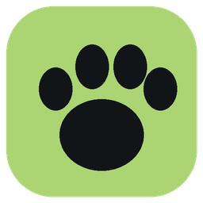
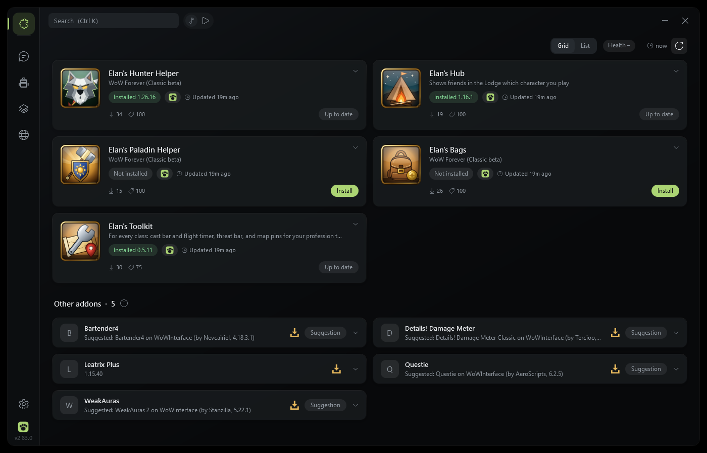
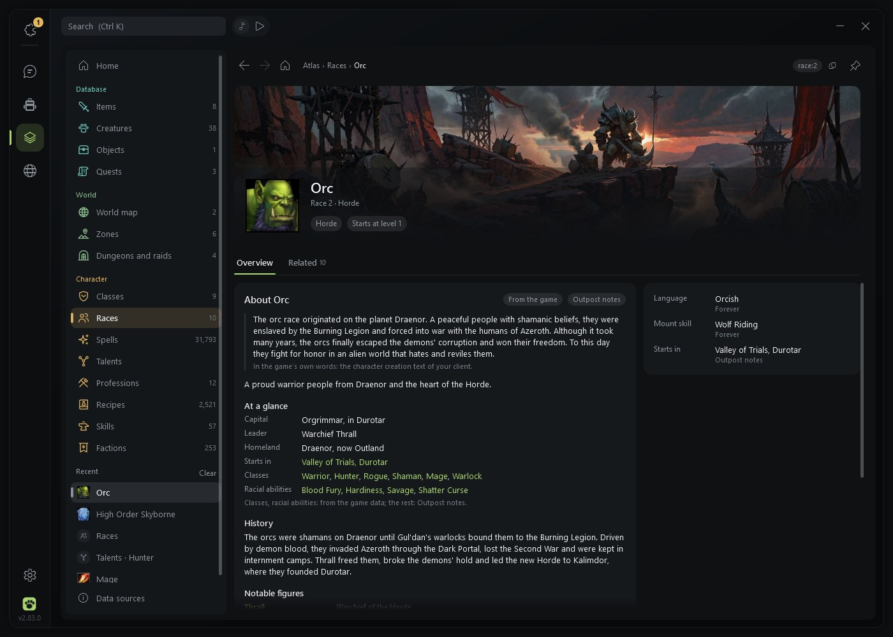
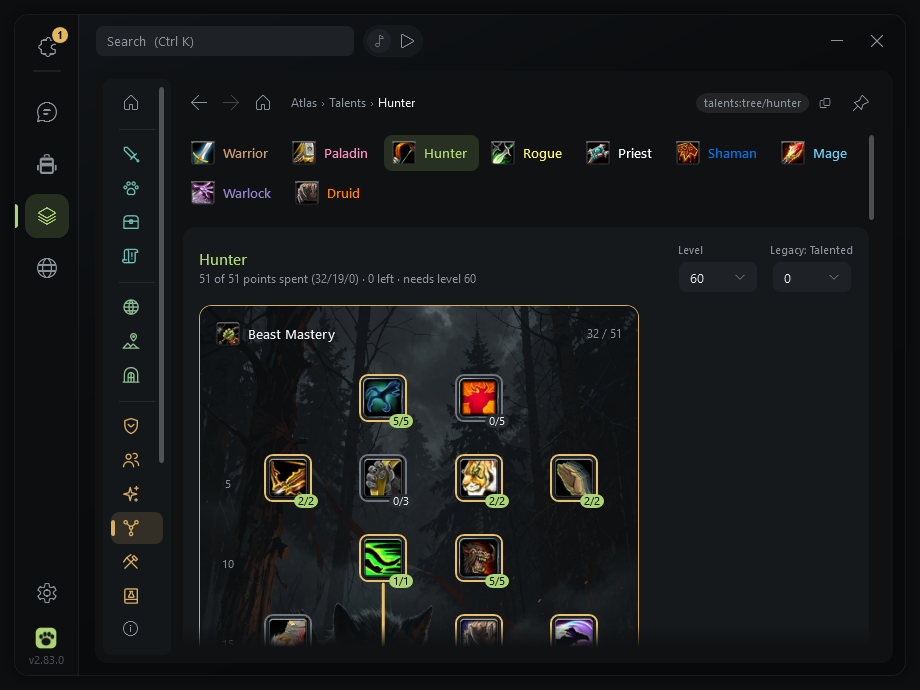
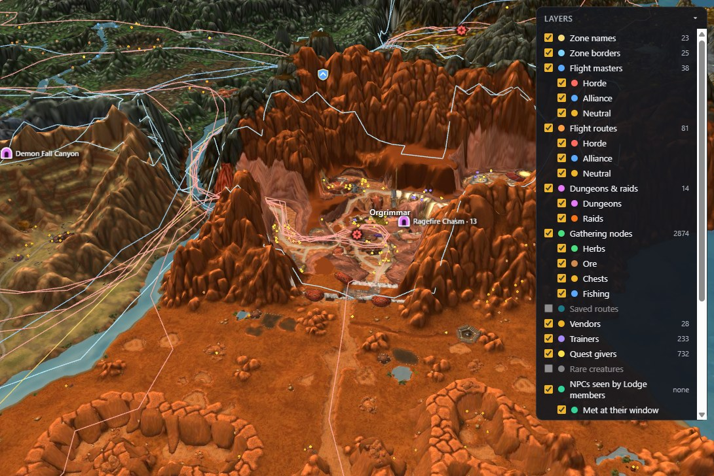
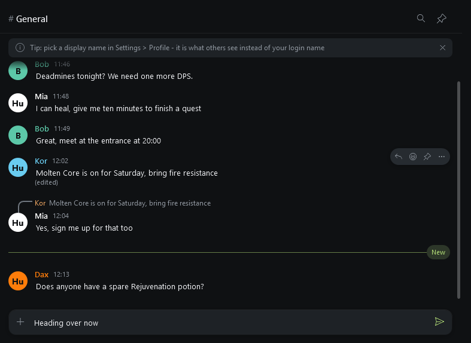
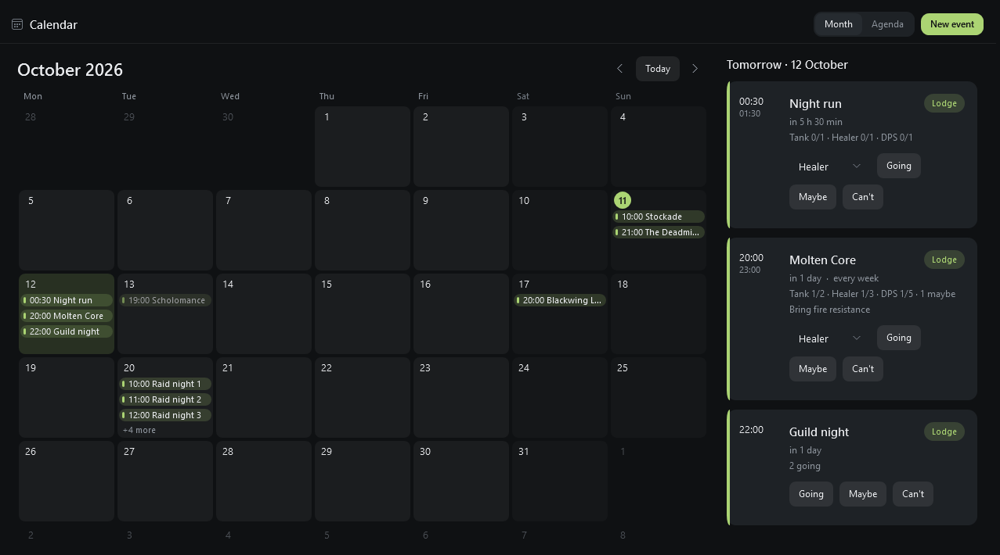
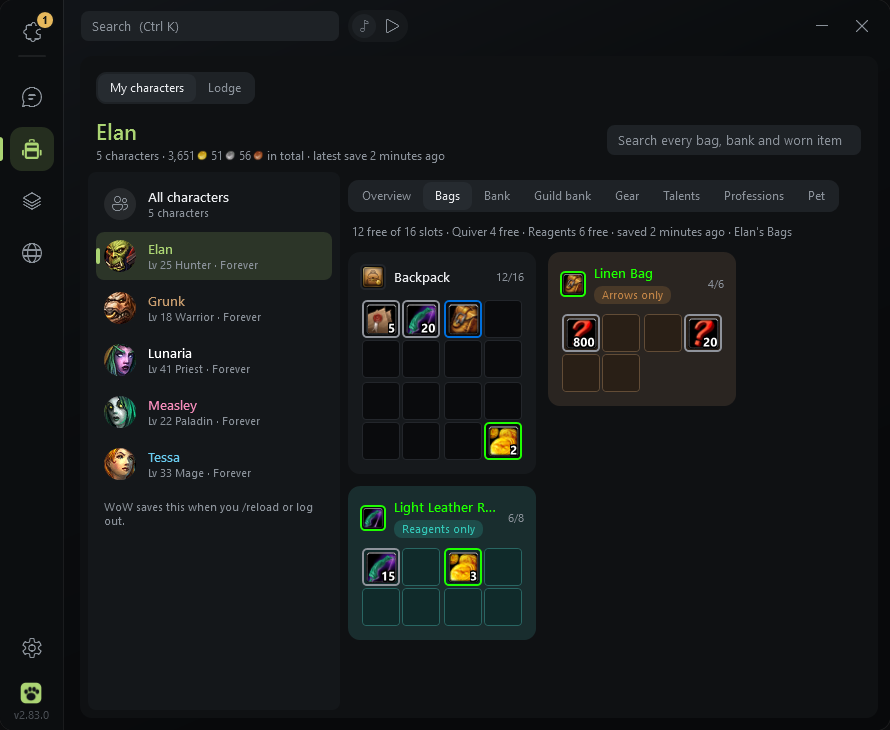
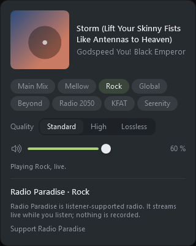

<h1 align="center">Elan's Outpost</h1>

<b>A home base for WoW Forever players and their friends:</b> 
addons kept up to date, a game database built from your own client, a 3D world map, and a private Lodge to chat, talk and plan raids in.

  <a href="https://github.com/Elanoran/ElanAddonHub/releases/latest"><b>⬇ Download the latest version</b></a>
  &nbsp;·&nbsp; Windows 10 / 11 &nbsp;·&nbsp; one exe, no installer

  

---

## What it is

Elan's Outpost is a small Windows app that sits next to World of Warcraft (WoW Forever). It installs and updates
your addons, shows you what your own game files know about items, creatures, quests and the world, and gives you
and your friends a private place to hang out: text chat, voice rooms, a calendar and shared files.

It never touches the game itself: it reads the game's files, and the only things it writes are the addon folders
it installs for you.

## A short tour

### Addons

One click installs or updates Elan's addons, with a short "what's new" first, a checksum check on every download
and a backup to roll back to. Your other addons are listed too: link them to GitHub or WoWInterface and they update
the same way, addons managed by the CurseForge app update from CurseForge's own downloads, and addons without a source get a
suggested match you can accept or ignore.

The addons that come with it:

| Addon | What it does |
|---|---|
| **Elan's Hub** (required) | A tiny companion that tells the Outpost (and your Lodge, if you join one) which character you play, where you are and what you carry. |
| **Elan's Toolkit** | For every class: a movable HUD with cast bar, threat bar and flight timer, trainer pins for your professions, gathering pins and a waypoint arrow. |
| **Elan's Hunter Helper** | Where it all started: pet abilities and where to tame them, Beast Finder, Auto Shot timer, range and dead zone, feeding, stable and more. |
| **Elan's Paladin Helper** | Seal, aura and blessing reminders, a Seal and Judgement bar, party blessing timers. |
| **Elan's Priest Helper** | Heal frames with click-casting, Renew and shield timers, a buff manager, the five-second rule and a healer coach. |
| **Elan's Bags** | One tidy bag window with search, categories and a junk seller. |

### The Atlas

A game database built from **your own game files**, so it matches the version you actually play: items, creatures,
objects, quests (with the whole chain and what comes before and after), zones, dungeons and raids, spells, skills,
factions, every class and race with its own painting and notes, a talent calculator and a professions guide that
plans your way from 1 to 300. Press **Ctrl+K** anywhere to search it.

### The world map

A seamless map of each continent (and islands such as Zephras Isle), drawn from your game files, in 2D or as real
3D terrain with the cities' buildings. Turn on layers for flight paths, dungeon entrances, herbs and ore, vendors,
trainers and quest givers. If you like, your own position shows as a dot with a fading trail of the last ten minutes:
paw prints in your class colour (hoofprints when mounted, ripples when swimming), small marks for what happened along
the way (a kill, notable loot, a herb or ore you gathered, a level-up), and on flights the dot follows the real route
in the air. Flight paths that Forever changed are learned from your own flights.

### The Lodge

A small, private Discord for you and your friends, running on a server one of you hosts. Text channels with
replies, reactions, pictures and item links; voice rooms with push-to-talk and an in-game overlay that shows who is
talking; a raid and event calendar with sign-ups per role; shared files; a ladder with badges; and an armory of the
characters members choose to share. Names show in class colours with level and zone, straight from the game.

**Sharing what you see.** Members who turn it on share what they see in the world with their Lodge: which creatures drop
what, vendors, spawn points, gathering nodes, flight times and learned flight routes. Only ids and counts, never character
names. Everyone's Atlas gets better from it.

**The Cairn.** Lodges can also pool their numbers in the Cairn, a shared commons of many Lodges, so every Lodge's Atlas
learns from the others. It works as give to get: a Lodge only receives the Cairn's numbers while it contributes, and inside
a Lodge only members who share get them. The Cairn only ever sees Lodge totals (no members, no names), publishes an
observation only once enough independent Lodges agree on it, and drops outliers.

**Joining the Cairn.** A Lodge's Guild Master turns it on in the Outpost (Settings > Guild Master > Join the Cairn) - no
keys to pass around, nothing to edit on the server. The Lodge makes its own key pair and keeps the private half to itself,
asks the Cairn to join with its name and public address, and the Cairn calls that address back once to check it really is
that Lodge. During the beta, Lodges join with an invite code from the Cairn's operator; later anyone can ask to join and
is admitted automatically from a waiting list (a few Lodges a day, first come first served). A new Lodge receives the
Cairn's numbers right after its first contribution, but its own numbers only count toward the agreement rule after a week
of contributing.

### Characters

All your characters in one place: bags, bank, guild bank, gear with upgrade suggestions, talents and professions,
saved by Elan's Hub whenever you /reload or log out. Search every bag at once.

### And a few small things

- **Radio.** Radio Paradise in the title bar: eight listener-supported channels, no ads. It only connects when you
  press Play, and the music steps back when people talk in voice.
- **In-game overlay.** The people in your voice room on top of WoW, whoever talks lights up. It is a separate
  window that lets clicks through; nothing is injected into the game.
- **Built-in browser** for Wowhead and the Forever sites, private by default, with an ad and tracker blocker.
- **Realm status** dots in the title bar (when your Lodge supports it).

## Where the data comes from

The Atlas mixes three kinds of data, and every row says which one it is:

- **From your game.** Items, spells, talents, quests, maps, zones, flight paths and the creatures and objects your game
  has met are read from your own game files. They are complete for everything your game contains.
- **Seen on Forever.** Some things only the server knows: what drops where and how often, what vendors sell and for how
  much, where creatures spawn, gathering nodes, flight times and learned flight routes. These are learned as people
  play, from your own game, your Lodge (members who share) and the Cairn. This part is still growing and has gaps: a
  creature nobody has killed yet has no Forever drop data, and the Atlas says so on its page ("Not seen on Forever yet")
  instead of looking complete. Where it does have data, it says what it is based on ("340 looted kills by 3 members
  of your Lodge").
- **Classic baseline.** Optional: the Classic database of the cMaNGOS project (classic-db), downloaded once if you want
  it. These are old Classic numbers, used as a fallback where nobody has seen something on Forever yet, and Forever may
  differ from them. They are always labelled "Classic baseline".

The more people share with their Lodge, the faster the Forever part fills in for everyone. The Atlas's **Data sources**
page shows each source and its state.

## A little history

It started as **Elan's Hunter Helper**, a hunter addon for WoW Forever: which beasts teach which pet abilities,
where to find them, and the small things a hunter keeps an eye on. Installing and updating it by hand got old
quickly, so a one-click installer followed: **Elan's Addon Hub**.

Then friends wanted to talk while playing, and the Hub got the Lodge: chat, voice and file sharing on a small
server of our own. Calendars, profiles, the characters page, the Atlas, the world map and the radio came after,
and the "addon hub" had become a place you hang out in. So it got a new name: **Elan's Outpost**.

Every change since is in the [changelog](src/CHANGELOG.md), also readable inside the app under Settings > About > What's new.

## Install

1. **Download** `ElansAddonHub.exe` from the [latest release](https://github.com/Elanoran/ElanAddonHub/releases/latest)
   and put it wherever you like (for example a folder in your user folder). It is one file of about 24 MB.
2. **Start it.** The app is not code-signed, so Windows SmartScreen may say *"Windows protected your PC"*.
   Click **More info**, then **Run anyway**. You only have to do this once.
3. **First start.** A short guide finds your World of Warcraft folder by itself (or press **Change** and pick any
   `Wow*.exe` in it) and uses the WoW Forever install inside it. Tick the addons you want; Elan's Hub is always included.
4. **In game**, type `/reload` (or restart WoW if it was running when a new addon was installed).
5. **Join a Lodge** (optional): click the invite link a friend sent you. Each link works once and signs in only this PC.

**Requirements:** Windows 10 or 11 (64-bit) and Microsoft's free **.NET Desktop Runtime 10**, installed once per PC. If it is
missing, Windows says so with a download link when the Outpost starts: install it, then start the Outpost again
(or install it beforehand with `winget install Microsoft.DotNet.DesktopRuntime.10`). The browser,
the world map and video previews use Microsoft Edge WebView2, which is part of Windows 11 and of an up-to-date
Windows 10; without it the Atlas falls back to its flat maps.

**Updates.** The Outpost checks for new versions of itself and of your addons every 30 minutes, shows what is new,
and updates itself with one click (every download is checked against its checksum first). You can also let it update
your addons automatically. It can sit in the tray and start with Windows if you want.

**Uninstall.**
1. In Settings > General, turn off **Start with Windows** and **Open elanshub:// links with the Outpost**.
2. Quit the Outpost from its tray icon and delete `ElansAddonHub.exe`.
3. Delete its data folder: `%LOCALAPPDATA%\ElansAddonHub` (settings, caches, the world map pictures and the log).
4. To remove the addons too, delete their folders in your WoW Forever `Interface\AddOns` folder
   (`ElansHub`, `ElansToolkit`, `ElansHunterHelper`, `ElansPaladinHelper`, `ElansPriestHelper`, `ElansBags`).

## Privacy and safety

- **Your game is read-only to the Outpost.** It reads the game's files (items, maps, icons) and the addon data
  Elan's Hub saves. It writes nothing in the WoW folder except the addon folders it installs for you and one
  shared file inside Elan's Hub's folder. Your addon settings (SavedVariables) are never touched.
- **No memory reading, no automation.** Live character info comes from a tiny strip of coloured pixels Elan's Hub
  draws in the corner of the game window, which the Outpost reads on your own PC. Nothing presses keys or plays
  for you. You can turn the strip off.
- **No telemetry, no account.** The Outpost asks GitHub for updates (and WoWInterface for addon matches), the
  sources of addons you linked, Radio Paradise only while you listen, and YouTube for previews of links in chat
  (you can turn that off). The Classic database is only downloaded when you ask for it.
- **The Lodge is opt-in.** Nothing goes to a Lodge unless you join one. Then it gets your messages, your status and
  the character you play and your zone (each can be switched off); your characters' gear and reputations only if you
  switch that on; and, unless you switch it off, your flight times and learned flight routes and what Elan's Toolkit
  noticed in the world (drops, vendors, spawn points), without character names.
- **The Cairn only talks to Lodges.** The Outpost never contacts the Cairn. If your Lodge's Guild Master turns on joining
  the Cairn, the Lodge sends its pooled totals (ids and counts, nothing per member), its name and its public address, and
  gets the Cairn's numbers back, which it hands only to members who share. Every request is signed with the Lodge's own
  key; the data is signed by the Cairn and checked by the Outpost before it is used.
- **Your live position is yours to share.** The map position Elan's Hub draws into its pixel strip (only when you turn
  it on, in the game and in the Outpost) is read by the Outpost on your PC. It goes to your Lodge only if you also turn
  on **Share my map position with the Lodge**, and then only to the members you chose; it is never saved.
- **Your Lodge key** is stored encrypted for your Windows user and only sent in a request header to your own Lodge.
- **Signed updates, unsigned exe.** The exe is not code-signed (that costs money every year). Every release is built
  from this repository and signed with the project's release key: the Outpost checks that signature and the checksum
  of every download before it installs anything, and refuses an update without a valid signature.
- **A Lodge is not trusted blindly.** The Outpost caps what a Lodge may send (message size, depth and counts, download
  size and time), cleans names and text before showing them, warns before you open a file type that can run
  something, plays voice only from members of your room, and never sends a saved sign-in to a different Lodge.

Everything the Outpost may contact, and the switches for it, is listed in Settings > Privacy.

## How we look at it

Elan's Outpost and its addons are made with care, and we try hard to play fair: the addons only use the game's normal addon interface, the Outpost only reads your game files and never touches the game while it runs, and nothing ever plays the game for you. We believe that keeps everything well within the rules - but we can't promise it, because only Blizzard decides what is allowed, and the rules can change.

So please use it at your own risk. It is a free fan project, given as it is, and we can't take responsibility for lost settings, a broken interface, action taken on an account or anything else that happens while you use it. If your addon settings matter to you, keep a copy of your WTF folder now and then - and if something feels wrong, tell us. We'd much rather fix it.

## Hosting a Lodge

A Lodge is one small .NET 10 service on a Linux server (Ubuntu with systemd; the .NET 10 SDK comes from Ubuntu's own
archive), behind a web server you already have (nginx, Caddy, Apache) on HTTPS. One install script sets it up, with
daily backups, a one-command update and a locked-down service; the first start prints a one-time owner link that makes
you the Guild Master. Joining the Cairn is off by default; the Guild Master turns it on in the Outpost (during the beta
with an invite code from the Cairn's operator). A Lodge that was set up with a Cairn key in its settings file
(`LODGE_CAIRN_*`) keeps working and moves to its own key pair by itself. See
[server/deploy/README.md](server/deploy/README.md) to get started, and [server/SECURITY.md](server/SECURITY.md)
and [server/PROTOCOL.md](server/PROTOCOL.md) for the details.

## FAQ

**Is this allowed? Can it get me banned?**
The Outpost never reads game memory, never injects anything into the game and never plays for you; the in-game part
is ordinary addons that use the normal addon interface. We believe that is well within the rules, but only Blizzard
decides - see [How we look at it](#how-we-look-at-it).

**Does it work with other WoW versions?**
It is made for WoW Forever. Other addons still show up on the Addons page, but the Atlas, the map and the addons are
built and tested for Forever.

**What is the Cairn, and do I have to share?**
The Cairn pools the Atlas numbers of many Lodges. Sharing is your choice: the Outpost asks once, in plain words, and
"Not now" is as good an answer as "Share". Without sharing you keep your own game data, your Lodge's own numbers and the
Classic database; the Cairn's numbers come to those who share.

**Do I need a Lodge?**
No. Addons, the Atlas, the world map, the Characters page and the radio all work on their own. The Lodge is for
playing together.

**Why does Windows warn me when I start it?**
Because the exe is not code-signed. Click **More info > Run anyway** once. If you want to be sure, the source is all
here.

**Where are my settings?**
In `%LOCALAPPDATA%\ElansAddonHub`. Your Lodge sign-in in there is encrypted for your Windows user.

**Something is wrong. How do I report it?**
Settings > About > **View log** shows the log with personal details hidden; copy the lines and
[open an issue](https://github.com/Elanoran/ElanAddonHub/issues).

## Credits

The Outpost and its addons stand on the work of others. Thank you!

- **[Petopia Forever](https://www.wow-petopia.com/forever/)**: pet families, abilities and where beasts are found.
- **[Questie / QuestieDB](https://github.com/Questie/Questie)** (GPL-3.0): NPC and item data for vendors and trainers.
- **[WoW Forever Tools](https://wowforevertools.com)**: hunter and paladin trainer spells.
- **[talentsforever.com](https://talentsforever.com)** (CC BY 4.0): talent builds.
- **[cMaNGOS classic-db](https://github.com/cmangos/classic-db)** (GPL-3.0): the optional Classic database (drop rates,
  vendors, spawns, quests), downloaded only on request and always labelled "Classic baseline".
- **[HereBeDragons](https://github.com/Nevcairiel/HereBeDragons)**: the map math for minimap pins.
- **[WoWInterface](https://www.wowinterface.com)**: its public file list feeds the suggested addon matches.
- **[Radio Paradise](https://radioparadise.com)**: the music. It is listener-supported and plays without ads; if you
  enjoy it, please [support them](https://radioparadise.com/donate).
- **[NAudio](https://github.com/naudio/NAudio)** (MIT) and **[Concentus](https://github.com/lostromb/concentus)** (BSD):
  voice chat audio and the Opus codec.
- **[Leaflet](https://leafletjs.com)** 1.9.4 (BSD-2-Clause) and **[three.js](https://threejs.org)** r149 (MIT): the 2D
  and 3D world map engines, built into the app (licence texts in `src/WorldMap/`); the map never loads anything from
  the internet.
- **[Octicons](https://github.com/primer/octicons)** (MIT): the GitHub mark on addon cards.
- **Paintings and splash art**: original, made by the author for this project with ComfyUI.
- Item icons, maps and game data are read at runtime from your own WoW install; none of them are in this repository.
  The screenshots above show them as the app does.

If you are one of these authors and want something credited differently or removed, please
[open an issue](https://github.com/Elanoran/ElanAddonHub/issues).

## License

- **The Outpost, the Lodge server and Elan's Hub** (this repository's code): [MIT](LICENSE).
- **Elan's Hunter Helper, Toolkit, Paladin Helper and Bags**: [GPL-3.0-or-later](https://www.gnu.org/licenses/gpl-3.0.html),
  because some of their data is built from GPL-3.0 sources (QuestieDB); each addon ships its licence in its folder.
- **Artwork** (logos, icons, paintings, banners): © Elanoran, all rights reserved - see [ARTWORK.md](ARTWORK.md).
- Third-party parts keep their own licences (see Credits); World of Warcraft game data, icons and maps belong to Blizzard
  Entertainment and are not in this repository.

---

World of Warcraft is a trademark of Blizzard Entertainment. Elan's Outpost is a fan project and not affiliated with Blizzard.

<b>For developers</b>

Built with WPF on .NET 10 (`net10.0-windows`, 64-bit), as one framework-dependent single-file exe; the .NET 10 SDK is
pinned in `global.json`. How the addons, Elan's Hub, the Outpost and the Lodge fit together is in
[ARCHITECTURE.md](ARCHITECTURE.md); the look and feel rules are in [DESIGN.md](DESIGN.md).

    dotnet publish src/ElansAddonHub.csproj -c Release -o src/bin/publish     -> src/bin/publish/ElansAddonHub.exe

The repository:

| Folder | What is in it |
|---|---|
| `src/` | the Outpost (WPF app) and its changelog |
| `addon/` | Elan's Hub, the companion addon, and its tests |
| `server/` | the Lodge server (`Lodge.Server`), its tests (`Lodge.Tests`, `tests/`), deploy files, [PROTOCOL.md](server/PROTOCOL.md) and [SECURITY.md](server/SECURITY.md) |
| `shared/` | `Elans.Shared`, the code the Outpost, the Lodge server and the Cairn share: signed formats, address rules and the typed Lodge protocol ([shared/README.md](shared/README.md)) |
| `Tools/` | the self-test and update-test wrappers and design helpers |

Tests:

    dotnet test shared/Elans.Shared.Tests      the shared library: signatures, address rules, every Lodge message, the JSON engine, fuzz tests
    cd server && dotnet test Lodge.Tests       the Lodge server
    Tools\selftest.ps1                         the Outpost's built-in self-test (below)
    Tools\updatetest.ps1                       the Outpost updating itself end to end, against a local update server (see its header)

Releases are made from the addon repo with `Tools/release.py`:

    python Tools/release.py            build addon zips + hub exe + manifest.json (nothing uploaded)
    python Tools/release.py --local    manifest with local paths, for testing the hub
    python Tools/release.py --publish  upload as a GitHub release here

The app reads `releases/latest/download/manifest.json`, which lists the newest addon and app versions with download
links, SHA-256 checksums and the changelog.

### Running the self-test

`ElansAddonHub.exe --selftest <dir>` runs the built-in checks and writes `result.txt`. Use the wrapper, not the bare
exe: it publishes Release to `src/bin/publish`, uses a fresh scratch folder under `%TEMP%` (never the real `%LOCALAPPDATA%\ElansAddonHub`),
prints the FAIL lines and the per-section timing, and exits non-zero on new failures:

    Tools\selftest.ps1                          what this branch changed vs origin/main (the default)
    Tools\selftest.ps1 -Changed v2.33.0         ...vs a tag or any ref
    Tools\selftest.ps1 -Only inventory,toasts   just those sections
    Tools\selftest.ps1 -Full                    everything, the real game files included (about 9 min, no pictures)
    Tools\selftest.ps1 -Only worldmapreal      one of the real-game-file sections (see below)
    Tools\selftest.ps1 -NoCache                changed mode, but never skip a real-game-file section
    Tools\selftest.ps1 -WhatIf                  what changed mode would run and why per file, without running it
    Tools\selftest.ps1 -WhatIf -Paths src/Theme/Theme.xaml   ...as if only that file had changed
    Tools\selftest.ps1 -List                    section names

**During development use the default (`--changed`); run `-Full` before every release.** A scoped run is the ~1 s of
setup plus the sections that test the changed files: a decoder or an Atlas page edit is about a minute, a theme token
half a minute, an art picture a few seconds, a Lodge feature file (calendar, badges, invites ...) its own sections; only
the Lodge core (session, models, page) runs every Lodge section (about 2 minutes). Only App, Brand, Util,
SettingsStore, Models (except adding a setting), Json, Net and the fixture still mean "everything". The run ends with
the per-section times, the 12 slowest checks, the failed sections and a one-line summary.

Writing checks: wait for a condition, not a fixed time - `Check("...", await Until(() => cond))` polls (layout brought
up to date) until it holds or 4 s pass; `await Settle()` lets queued dispatcher work run. Keep fixed waits only where a
check proves that something does NOT happen (no request sent, nothing moved). Check behaviour, not incidental pixels or
counts: "all days one height", "a narrower second column", "at least the 96 pictures", not "80 px" or "exactly 96".
A new test file should name its section in its header comment (`// --selftest "atlaspage", ...`): changed mode maps an
unknown file by that.

- **Real-game-file sections** (`mapdatareal worldmapreal instancesreal buildingsreal dungeonmapsreal atlaspagereal`)
  hold the checks that read the installed WoW client (CASC, Map.db2, terrain, buildings); their synthetic twins stay in
  `mapdata worldmap instances buildings dungeonmaps atlaspage`. They run in `-Full`, with `-Only`, and in changed mode
  only when a game-data reader (`Casc`, `Blp`, `Db2/`, `Maps/`, `WorldMap/`, `DungeonMaps/`, the Atlas data layer) or their
  own test file changed; the patterns are `SelfTestCache.Defs`. Changed mode (and `-UseCache`) also skips one that already
  passed with the same game build (`.build.info`) and the same reader and test files. The pass is stored in
  `%LOCALAPPDATA%\ElansAddonHub-selftest-cache` (never the app's data folder); a FAIL is never stored, a new game patch
  or an edit of a reader re-runs them, `-NoCache` forces.
- `idlecpu` is the idle-CPU measurement (20 s when the first pair is clear, up to a minute); it runs when something
  that ticks changes (`WowWatch`, the pixel strip, presence, `LodgeSession.cs` / `.History.cs`) or for a shared file.
- Pictures (`1-before.png` ... and the world map / buildings WebView captures) are not assertions: they are only taken
  with `ELANSHUB_SHOTS=1` (not in `-Full`), together with the waits that only serve them. Design pictures go to
  `docs/design/`, which is git-ignored; the README's pictures in `docs/readme/` are the only ones committed.
- The exe takes `--only a,b`, `--changed <base> [--repo <dir>]` and `--list`; no flag runs everything. Unselected
  sections are logged as `skipped <name>` in `result.txt`, each run section as `section <name>: 12.3 s`, plus `total:`.
  `scope.txt` says why each file chose its sections.
- The path -> section table, the section dependencies and their unit checks are in `src/Services/TestScope.cs`.
  Shared files (App, Brand, Util, SettingsStore, Models, Json, Net, SelfTestFixture) and unknown files without a
  section in their header select ALL: add a new test block to `TestScope.All`/`Info` and the table when you add one.
- The wrapper runs on a hidden Windows desktop (`Tools\HiddenRun.cs`), so no window, toast or dialog appears
  on screen or takes focus; `-Visible` shows it. Checks that need the real desktop (the live pixel-strip screen
  capture) report `skipped (hidden desktop)` there (`ELANSHUB_HIDDEN_DESKTOP=1`). Do not run two visible
  self-tests at once: they steal each other's focus and the unread-marker checks fail.
- A clean run has ZERO FAIL lines, so any FAIL is real. The update check talks to a local fake server
  (`Services/FakeUpdateServer.cs`, never GitHub; `ELANSHUB_FAKE_UPDATE=0` turns it off), and WoW running on the PC is
  ignored (`ELANSHUB_FAKE_WOW=0` is set for the self-test).
- `ELANSHUB_TEST_LODGE=url|code|name` still enables the live Lodge session (`lodge` section).

